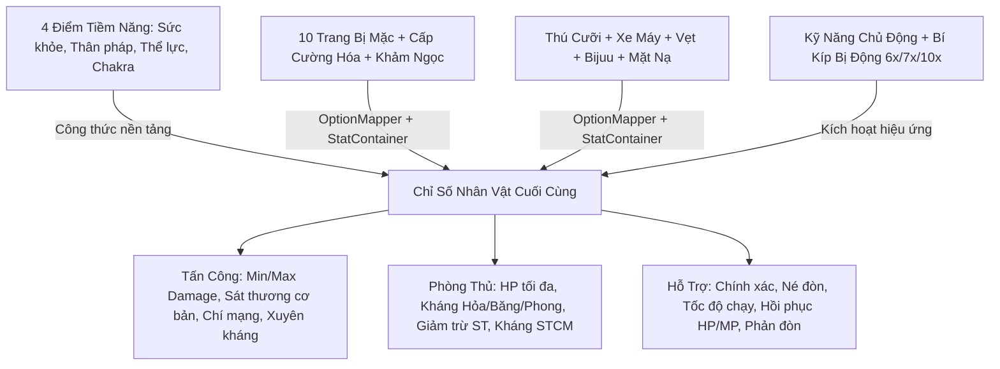

# TÀI LIỆU TOÀN DIỆN VỀ CHỈ SỐ NHÂN VẬT & THUỘC TÍNH TRANG BỊ NSO

> **Phiên bản máy chủ**: NSO Ninja School Private 2026  
> **Áp dụng cho**: Hệ thống 6 Môn Phái (Kiếm, Tiêu, Kunai, Cung, Đao, Quạt) & Toàn bộ Trang Bị, Thú Cưỡi, Khảm Ngọc  
> **Cơ sở dữ liệu**: MariaDB / MySQL (`nso_test`)  
> **Mã nguồn tính toán**: `com.nsoz.ability.AbilityFromEquip.java`, `com.nsoz.model.stat.OptionMapper.java`, `com.nsoz.combat.CombatService.java` & `com.nsoz.model.Char.java`

---

## MỤC LỤC
1. [Sơ Đồ & Cơ Chế Tính Toán Chỉ Số](#1-sơ-đồ--cơ-chế-tính-toán-chỉ-số)
2. [Chi Tiết 4 Điểm Tiềm Năng Gốc](#2-chi-tiết-4-điểm-tiềm-năng-gốc)
3. [Chi Tiết Các Chỉ Số Chiến Đấu Của Nhân Vật](#3-chi-tiết-các-chỉ-số-chiến-đấu-của-nhân-vật)
   - [3.1. Nhóm Tấn Công & Sát Thương](#31-nhóm-tấn-công--sát-thương)
   - [3.2. Nhóm Sinh Lực & Phòng Ngự](#32-nhóm-sinh-lực--phòng-ngự)
   - [3.3. Nhóm Cơ Động, Khống Chế & Phản Đòn](#33-nhóm-cơ-động-khống-chế--phản-đòn)
4. [Bảng Tra Cứu Chi Tiết Toàn Bộ Thuộc Tính Trang Bị (ItemOption ID 0 - 161)](#4-bảng-tra-cứu-chi-tiết-toàn-bộ-thuộc-tính-trang-bị-itemoption-id-0---161)
5. [Hướng Dẫn Chỉnh Sửa & Câu Lệnh SQL Mẫu](#5-hướng-dẫn-chỉnh-sửa--câu-lệnh-sql-mẫu)

---

## 1. SƠ ĐỒ & CƠ CHẾ TÍNH TOÁN CHỈ SỐ

Mọi thuộc tính chiến đấu của nhân vật được Server tổng hợp theo thời gian thực từ 4 nguồn chính thông qua `StatContainer` & `OptionMapper`:



---

## 2. CHI TIẾT 4 ĐIỂM TIỀM NĂNG GỐC

Mỗi khi lên cấp hoặc dùng sách tiềm năng, nhân vật nhận được điểm tiềm năng tự do để phân phối vào 4 nhánh:

| Chỉ Số Tiềm Năng | Tên Gọi | Tác Dụng Cốt Lõi | Môn Phái Ưu Tiên |
| :--- | :--- | :--- | :--- |
| **Sức Khỏe** (`potential[0]`) | Ngoại công / Sức mạnh | Tăng **Tấn công Ngoại công** (Sát thương vật lý cận chiến/viễn chiến). | Kiếm, Kunai, Đao |
| **Thân Pháp** (`potential[1]`) | Nhanh nhẹn / Độ khéo | Tăng mạnh **Né đòn (`miss = Thân pháp * 1.5`)** và **Chính xác (`exactly = Thân pháp`)**. | Cả 6 phái (rất quan trọng trong PvP) |
| **Thể Lực** (`potential[2]`) | Thể chất / Sinh mệnh | Tăng **Máu tối đa (`maxHP`)**. Mỗi 1 điểm Thể lực = **+10 HP cơ bản**. | Mọi phái (tăng độ chống chịu) |
| **Chakra** (`potential[3]`) | Nội công / Trí lực | Tăng **Tấn công Nội công** và **MP tối đa (`maxMP`)**. Quy đổi: **+5 MP/điểm** (phái Nội công), **+8 MP/điểm** (phái Ngoại công). | Tiêu, Cung, Quạt (Nội công) |

---

## 3. CHI TIẾT CÁC CHỈ SỐ CHIẾN ĐẤU CỦA NHÂN VẬT

Dưới đây là các công thức giải mã trực tiếp từ mã nguồn [`AbilityFromEquip.java`](file:///e:/TT/SETUP_LOCAL/SRC_GAME/src/main/java/com/nsoz/ability/AbilityFromEquip.java) và [`CombatService.java`](file:///e:/TT/SETUP_LOCAL/SRC_GAME/src/main/java/com/nsoz/combat/CombatService.java) của Server:

### 3.1. Nhóm Tấn Công & Sát Thương

* **`basicAttack` (Tấn công cơ bản)**: Lực đánh từ điểm tiềm năng kết hợp với chỉ số sát thương thuần của vũ khí và kỹ năng.
* **`damage` (Tấn công tối đa)** & **`damage2` (Tấn công tối thiểu)**:
  * Là khoảng sát thương đầu ra thực tế khi nhân vật tung đòn đánh.
  * **Công thức**:
    $$\text{damage} = \text{basicAttack} + \text{Công flat trang bị} + \left(\text{potentialDame} \times \frac{\% \text{Vận công} + \text{Skill bị động}}{100}\right) + \text{potentialDame} + \dots$$
    $$\text{damage2} = \text{damage} - \frac{\text{damage}}{10} \quad (\text{Min Dame cố định } 90\% \times \text{Max Dame})$$
* **`fatal` (Tỉ lệ chí mạng)**: Điểm xác suất nổ đòn đánh chí mạng (gom Option 14, 37, 69, 92, 114 + kỹ năng bị động).
* **`percentFatalDame` (Sát thương chí mạng %)**: Tăng uy lực phần trăm khi nổ chí mạng (Option ID 39, 67).
* **`fatalDame` (Sát thương chí mạng cố định)**: Điểm cộng thẳng trực tiếp vào sát thương chí mạng (Option ID 105).
* **`Hỏa công / Băng sát / Phong lôi` (Option 88, 89, 90)**: Sát thương nguyên tố cộng thẳng vào đòn đánh theo hệ của nhân vật.
* **`Bỏ qua kháng đối phương (%)` (Option ID 101)**: Kết hợp với Hạ khắc kỹ năng (`sysDown`), giảm trừ trực tiếp % lượng kháng nguyên tố của mục tiêu trong `CombatService`.
* **`Sát thương chuẩn` (Option ID 113)**: Sát thương thuần (True Damage) cộng sau cùng, đánh xuyên qua mọi loại giáp, kháng và `dameDown`, không bị ảnh hưởng bởi suy yếu (80%) hay đóng băng (50%).

---

### 3.2. Nhóm Sinh Lực & Phòng Ngự

* **`maxHP` (Lượng máu tối đa)**:
  $$\text{maxHP} = \left[(\text{Thể lực} \times 10) \times (1 + \sum \% \text{HP trang bị}) + \sum \text{HP cộng thẳng}\right] \times (1 + \% \text{HP sau mặc đồ Opt 128})$$
* **`maxMP` (Lượng Chakra tối đa)**:
  $$\text{maxMP} = (\text{Chakra} \times \text{Hệ số MP}) \times (1 + \sum \% \text{MP trang bị}) + \sum \text{MP cộng thẳng}$$
  *(Trong đó: Phái Nội công nhân hệ số **5**, Phái Ngoại công nhân hệ số **8**)*.
* **`resFire` (Kháng Hỏa), `resIce` (Kháng Băng), `resWind` (Kháng Phong)**: Giảm sát thương nhận vào qua công thức kháng $y = \frac{77 \cdot x}{x + 231} (\%)$ trong `CombatService`.
* **`Kháng tất cả` (Option ID 20, 36, 81, 98, 118)**: Tăng đồng thời cả 3 chỉ số Kháng Hỏa, Kháng Băng và Kháng Phong (gom vào `StatType.RES_ALL`).
* **`dameDown` (Giảm trừ sát thương - Option ID 47, 74, 80, 124)**: Trừ thẳng một lượng sát thương cố định nhận vào từ mỗi đòn đánh của địch trước khi cộng Sát thương chuẩn.
* **`Kháng ST Chí mạng (%)` (Option ID 63, 79, 121)**: Triệt tiêu lượng sát thương bạo kích nổ thêm khi bị đối phương đánh chí mạng (áp trần tối đa 100%). Option 63 đã được quy chuẩn về nhóm này thay vì trừ % thô để chống bất tử.
* **`Bùa hộ thể` (Option ID 136)**: Kích hoạt tăng trực tiếp điểm kháng tất cả của nhân vật trong 5 giây.

---

### 3.3. Nhóm Cơ Động, Khống Chế & Phản Đòn

* **`miss` (Né đòn)**: Khả năng né tránh hoàn toàn đòn tấn công của đối thủ (hiển thị chữ *Hụt*). Tính từ $\text{Thân pháp} \times 1.5$ cộng dồn toàn bộ Option né đòn (5, 17, 62, 68, 78, 84, 115).
* **`exactly` (Chính xác)**: Tăng khả năng đánh trúng mục tiêu có chỉ số Né đòn cao. Tính từ $\text{Thân pháp}$ cộng dồn toàn bộ Option chính xác (10, 18, 75, 86, 116) — *đã tách triệt để Option 12 Kháng Băng khỏi Chính xác*.
* **`reactDame` (Phản đòn cận chiến)**: Phản lại sát thương cho kẻ tấn công khi ở cự ly gần ($\le 60$), sát thương phản đòn đi qua kháng nguyên tố và `dameDown`.
* **`Phản đòn băng giá 20% HP` (Option ID 135)**: Tỷ lệ phản lại ngay 20% lượng máu hiện tại của người ra đòn ở cự ly gần.
* **`speed` (Tốc độ di chuyển)**: Mặc định là `5`. Khi cưỡi thú được cộng thêm `+2`, cộng thêm từ giày/thú cưỡi và mỗi 10 điểm Option 16 kỹ năng bị động được `+1` tốc chạy.
* **`Giảm trừ thời gian Bỏng / Đóng băng / Choáng`**: Giảm thời gian nhân vật bị dính các hiệu ứng khống chế bất lợi.

---

## 4. BẢNG TRA CỨU CHI TIẾT TOÀN BỘ THUỘC TÍNH TRANG BỊ (ItemOption ID 0 - 161)

> **Quy ước Client Type**: `0`: Cơ bản/Trắng | `1`: Xanh dương | `2`: Thuộc tính môn phái | `3..7`: Dòng kích hoạt cường hóa (+4, +8, +12, +14, +16) | `8`: Thú cưỡi/Ngọc | `9`: Đặc biệt  
> **Mã Chuẩn (Canonical)**: Mã đại diện duy nhất sau chuẩn hóa Runtime Big Update (`OptionStandardizer`). Dấu `—` nghĩa là giữ nguyên mã độc lập.

| ID | Tên Chuỗi Client (Template) | Type | Mã Chuẩn | Chi Tiết Kỹ Thuật (Details) |
| :---: | :--- | :---: | :---: | :--- |
| **0** | `Tấn công: +#` | `0` | — | Tấn công cố định duy nhất (Flat Attack cho mọi phái) |
| **1** | `[ĐÃ GỘP] Tấn công nội: +#` | `0` | **Opt 0** | Đã khai tử & di trú sang Opt 0 (Tấn công duy nhất) |
| **2** | `Kháng hỏa:  +#` | `0` | — | Điểm kháng hệ Hỏa cố định |
| **3** | `Kháng băng: +#` | `0` | — | Điểm kháng hệ Băng cố định |
| **4** | `Kháng phong:  +#` | `0` | — | Điểm kháng hệ Phong cố định |
| **5** | `Né đòn: +#` | `0` | — | Điểm né đòn cố định (Evasion) |
| **6** | `HP tối đa: +#` | `1` | — | Điểm máu tối đa cố định (Flat HP) |
| **7** | `MP tối đa: +#` | `1` | — | Điểm mana tối đa cố định (Flat MP) |
| **8** | `Vật công: +#%` | `1` | — | Tăng % Vật công duy nhất (Hệ số VC cho mọi phái) |
| **9** | `[ĐÃ GỘP] Vật công nội: +#%` | `1` | **Opt 8** | Đã khai tử & di trú sang Opt 8 (Vật công duy nhất %) |
| **10** | `Chính xác: +#` | `1` | — | Điểm chính xác cố định (Accuracy) |
| **11** | `[ĐÃ GỘP] Kháng hỏa: +#` | `2` | **Opt 2** | Đã khai tử & di trú sang Opt 2 (Kháng hỏa cố định) |
| **12** | `[ĐÃ GỘP] Kháng băng: +#` | `2` | **Opt 3** | Đã khai tử & di trú sang Opt 3 (Kháng băng cố định) |
| **13** | `[ĐÃ GỘP] Kháng phong: +#` | `2` | **Opt 4** | Đã khai tử & di trú sang Opt 4 (Kháng phong cố định) |
| **14** | `Chí mạng: #` | `2` | — | Điểm tỉ lệ chí mạng cố định (Fatal/Crit Rate) |
| **15** | `Phản đòn cận chiến: +#` | `2` | — | Phản đòn sát thương khi đối thủ đánh cận chiến (cự ly <= 60) |
| **16** | `Tốc độ di chuyển: +#%` | `2` | — | Tốc độ di chuyển nhân vật (+1 speed mỗi 10 điểm) |
| **17** | `[ĐÃ GỘP] Né đòn: #` | `2` | **Opt 5** | Đã khai tử & di trú sang Opt 5 (Né đòn cố định) |
| **18** | `[ĐÃ GỘP] Chính xác: #` | `2` | **Opt 10** | Đã khai tử & di trú sang Opt 10 (Chính xác cố định) |
| **19** | `[ĐÃ GỘP] MP tối đa: #` | `2` | **Opt 7** | Đã khai tử & di trú sang Opt 7 (MP tối đa cố định) |
| **20** | `Kháng tất cả: #` | `2` | — | Kháng tất cả (Tăng đồng thời Kháng Hỏa, Băng, Phong) |
| **21** | `[ĐÃ GỘP] Hỏa công ngoại: +#` | `2` | **Opt 0** | Đã khai tử & di trú sang Opt 0 (Ngoại công cố định) |
| **22** | `[ĐÃ GỘP] Hỏa công nội: +#` | `2` | **Opt 0** | Đã khai tử & di trú sang Opt 0 (Tấn công cố định) |
| **23** | `[ĐÃ GỘP] Băng sát ngoại: +#` | `2` | **Opt 0** | Đã khai tử & di trú sang Opt 0 (Ngoại công cố định) |
| **24** | `[ĐÃ GỘP] Băng sát nội: +#` | `2` | **Opt 0** | Đã khai tử & di trú sang Opt 0 (Tấn công cố định) |
| **25** | `[ĐÃ GỘP] Phong lôi ngoại: +#` | `2` | **Opt 0** | Đã khai tử & di trú sang Opt 0 (Ngoại công cố định) |
| **26** | `[ĐÃ GỘP] Phong lôi nội: +#` | `2` | **Opt 0** | Đã khai tử & di trú sang Opt 0 (Tấn công cố định) |
| **27** | `(+4) Mỗi 5 giây phục hồi MP: #` | `3` | — | Kích hoạt +4: Tự động hồi MP mỗi 5 giây |
| **28** | `(+8) Tỉ lệ MP tối đa: +#%` | `4` | — | Kích hoạt +8: Tăng % tỉ lệ MP tối đa |
| **29** | `(+12) MP tối đa: +#` | `5` | **Opt 7** | Kích hoạt +12: MP tối đa cố định (Gộp Opt 7) |
| **30** | `(+4) Mỗi 5 giây phục hồi HP: #` | `3` | — | Kích hoạt +4: Tự động hồi HP mỗi 5 giây |
| **31** | `(+8) Tỉ lệ HP tối đa: +#%` | `4` | — | Kích hoạt +8: Tăng % tỉ lệ HP tối đa |
| **32** | `(+12) HP tối đa: +#` | `5` | **Opt 6** | Kích hoạt +12: HP tối đa cố định (Gộp Opt 6) |
| **33** | `(+14) Kháng hỏa: +#` | `6` | **Opt 2** | Kích hoạt +14: Kháng hỏa cố định (Gộp Opt 2) |
| **34** | `(+14) Kháng băng: +#` | `6` | **Opt 3** | Kích hoạt +14: Kháng băng cố định (Gộp Opt 3) |
| **35** | `(+14) Kháng phong: +#` | `6` | **Opt 4** | Kích hoạt +14: Kháng phong cố định (Gộp Opt 4) |
| **36** | `(+14) Kháng tất cả: +#` | `6` | **Opt 20** | Kích hoạt +14: Kháng tất cả các hệ (Gộp Opt 20) |
| **37** | `(+8) Chí mạng: +#` | `4` | **Opt 14** | Kích hoạt +8: Điểm chí mạng (Gộp Opt 14) |
| **38** | `(+12) Tấn công cơ bản của vũ khí: +#` | `5` | — | Kích hoạt +12: Tấn công cơ bản vũ khí (Thích ứng Flat theo phái) |
| **39** | `(+14) Tấn công khi đánh chí mạng: +#%` | `6` | — | Kích hoạt +14: Tăng % sát thương khi nổ chí mạng (% Crit Damage) |
| **40** | `(+16) Giảm trừ thời gian bị bỏng: -#` | `7` | — | Kích hoạt +16: Giảm thời gian dính hiệu ứng Bỏng (ms) |
| **41** | `(+16) Giảm trừ thời gian bị đóng băng: -#` | `7` | — | Kích hoạt +16: Giảm thời gian dính hiệu ứng Đóng Băng (ms) |
| **42** | `(+16) Giảm trừ thời gian bị choáng: -#` | `7` | — | Kích hoạt +16: Giảm thời gian dính hiệu ứng Choáng (ms) |
| **43** | `(+16) Thời gian bị bỏng: +#` | `7` | — | Kích hoạt +16: Tăng thời gian gây Bỏng lên đối thủ (ms) |
| **44** | `(+16) Thời gian bị đóng băng: +#` | `7` | — | Kích hoạt +16: Tăng thời gian gây Đóng Băng lên đối thủ (ms) |
| **45** | `(+16) Thời gian bị choáng: +#` | `7` | — | Kích hoạt +16: Tăng thời gian gây Choáng lên đối thủ (ms) |
| **46** | `[ĐÃ GỘP] (+16) Chịu sát thương khi bị chí mạng: -#%` | `7` | **Opt 121** | Đã khai tử & di trú sang Opt 121 (Kháng STCM %) |
| **47** | `Giảm trừ sát thương: +#` | `0` | — | Giảm trừ sát thương cố định (dameDown chuẩn trừ trước STC) |
| **48** | `(+16) Giảm trừ sát thương bởi hỏa hệ: +#` | `7` | — | Kích hoạt +16: Giảm trừ sát thương nhận vào từ hệ Hỏa |
| **49** | `(+16) Giảm trừ sát thương bởi băng hệ: +#` | `7` | — | Kích hoạt +16: Giảm trừ sát thương nhận vào từ hệ Băng |
| **50** | `(+16) Giảm trừ sát thương bởi phong hệ: +#` | `7` | — | Kích hoạt +16: Giảm trừ sát thương nhận vào từ hệ Phong |
| **51** | `(+16) Tăng sát thương bởi hỏa hệ: +#` | `7` | — | Kích hoạt +16: Tăng sát thương cố định khi đánh mục tiêu hệ Hỏa |
| **52** | `(+16) Tăng sát thương bởi băng hệ: +#` | `7` | — | Kích hoạt +16: Tăng sát thương cố định khi đánh mục tiêu hệ Băng |
| **53** | `(+16) Tăng sát thương bởi phong hệ: +#` | `7` | — | Kích hoạt +16: Tăng sát thương cố định khi đánh mục tiêu hệ Phong |
| **54** | `(+16) Sát thương đánh hệ hỏa: +#%` | `7` | — | Kích hoạt +16: Tăng % sát thương khi đánh quái/mục tiêu hệ Hỏa |
| **55** | `(+16) Sát thương đánh hệ băng: +#%` | `7` | — | Kích hoạt +16: Tăng % sát thương khi đánh quái/mục tiêu hệ Băng |
| **56** | `(+16) Sát thương đánh hệ phong: +#%` | `7` | — | Kích hoạt +16: Tăng % sát thương khi đánh quái/mục tiêu hệ Phong |
| **57** | `+# điểm tiềm năng cho tất cả` | `1` | — | Cộng thẳng điểm tiềm năng cho cả 4 nhánh (Sức khỏe, Thân pháp, Thể lực, Chakra) |
| **58** | `Cộng thêm tiềm năng: +#%` | `0` | — | Cộng thêm % trên tổng điểm tiềm năng nhân vật |
| **59** | `Cho phép tăng thêm điểm kỹ năng 6x: +# điểm` | `0` | — | Mở rộng cấp tối đa kỹ năng 6x |
| **60** | `(+4) Tỉ lệ MP tối đa: +#%` | `3` | **Opt 28** | Kích hoạt +4: Tỉ lệ MP tối đa % (Gộp Opt 28) |
| **61** | `(+8) Tỉ lệ HP tối đa: +#%` | `4` | **Opt 31** | Kích hoạt +8: Tỉ lệ HP tối đa % (Gộp Opt 31) |
| **62** | `(+12) Né đòn: +#` | `5` | **Opt 5** | Kích hoạt +12: Né đòn cố định (Gộp Opt 5) |
| **63** | `[ĐÃ GỘP] Giảm sát thương bởi người chơi khác: +#%` | `1` | **Opt 121** | Đã khai tử & di trú sang Opt 121 (Kháng STCM %) |
| **64** | `Chưa xác định` | `0` | — | Dòng dự trữ hệ thống (Chưa gán thuộc tính) |
| **65** | `Kinh nghiệm: #/1000` | `0` | — | Điểm kinh nghiệm thú cưỡi (#/1000) |
| **66** | `Sinh lực: #/1000` | `0` | — | Thể lực / Sinh lực thú cưỡi (#/1000) |
| **67** | `Tấn công khi đánh chí mạng: #%` | `1` | **Opt 39** | Tăng % sát thương khi nổ chí mạng (Gộp Opt 39) |
| **68** | `[ĐÃ GỘP] Né đòn: +#` | `1` | **Opt 5** | Đã khai tử & di trú sang Opt 5 (Né đòn cố định) |
| **69** | `[ĐÃ GỘP] Chí mạng: +#` | `1` | **Opt 14** | Đã khai tử & di trú sang Opt 14 (Chí mạng cố định) |
| **70** | `[ĐÃ GỘP] Kháng hỏa:  +#` | `1` | **Opt 2** | Đã khai tử & di trú sang Opt 2 (Kháng hỏa cố định) |
| **71** | `[ĐÃ GỘP] Kháng băng:  +#` | `1` | **Opt 3** | Đã khai tử & di trú sang Opt 3 (Kháng băng cố định) |
| **72** | `[ĐÃ GỘP] Kháng phong:  +#` | `1` | **Opt 4** | Đã khai tử & di trú sang Opt 4 (Kháng phong cố định) |
| **73** | `[ĐÃ GỘP] Tấn công: #` | `1` | **Opt 0** | Đã khai tử & di trú sang Opt 0/1 (Tấn công cố định theo phái) |
| **74** | `[ĐÃ GỘP] Chịu sát thương cho chủ: +#` | `1` | **Opt 47** | Đã khai tử & di trú sang Opt 47 (Giảm trừ ST) |
| **75** | `[ĐÃ GỘP] Tăng chính xác cho chủ: +#` | `8` | **Opt 10** | Đã khai tử & di trú sang Opt 10 (Chính xác cố định) |
| **76** | `[ĐÃ GỘP] Tăng tấn công cho chủ: +#` | `8` | **Opt 0** | Đã khai tử & di trú sang Opt 0/1 (Tấn công cố định theo phái) |
| **77** | `[ĐÃ GỘP] Tăng max HP cho chủ: +#` | `8` | **Opt 6** | Đã khai tử & di trú sang Opt 6 (HP tối đa cố định) |
| **78** | `[ĐÃ GỘP] Tăng né tránh cho chủ: +#` | `8` | **Opt 5** | Đã khai tử & di trú sang Opt 5 (Né đòn cố định) |
| **79** | `[ĐÃ GỘP] Kháng sát thương chí mạng: #%` | `8` | **Opt 121** | Đã khai tử & di trú sang Opt 121 (Kháng STCM %) |
| **80** | `[ĐÃ GỘP] Giảm trừ sát thương: #` | `8` | **Opt 47** | Đã khai tử & di trú sang Opt 47 (Giảm trừ ST) |
| **81** | `[ĐÃ GỘP] Kháng tất cả: +#` | `8` | **Opt 20** | Đã khai tử & di trú sang Opt 20 (Kháng tất cả) |
| **82** | `[ĐÃ GỘP] HP tối đa: #` | `8` | **Opt 6** | Đã khai tử & di trú sang Opt 6 (HP tối đa cố định) |
| **83** | `[ĐÃ GỘP] MP tối đa: +#` | `8` | **Opt 7** | Đã khai tử & di trú sang Opt 7 (MP tối đa cố định) |
| **84** | `[ĐÃ GỘP] Né đòn: +#` | `8` | **Opt 5** | Đã khai tử & di trú sang Opt 5 (Né đòn cố định) |
| **85** | `Độ tinh luyện: #` | `8` | — | Cấp độ tinh luyện trang bị thú cưỡi |
| **86** | `[ĐÃ GỘP] Chính xác: +#` | `8` | **Opt 10** | Đã khai tử & di trú sang Opt 10 (Chính xác cố định) |
| **87** | `[ĐÃ GỘP] Tấn công: +#` | `8` | **Opt 0** | Đã khai tử & di trú sang Opt 0/1 (Tấn công cố định theo phái) |
| **88** | `Hỏa công: +#` | `8` | — | Sát thương nguyên tố hệ Hỏa cộng thêm (Hỏa công) |
| **89** | `Băng công: +#` | `8` | — | Sát thương nguyên tố hệ Băng cộng thêm (Băng công) |
| **90** | `Phong lôi: +#` | `8` | — | Sát thương nguyên tố hệ Phong cộng thêm (Phong lôi) |
| **91** | `[ĐÃ GỘP] Phản đòn: #` | `8` | **Opt 15** | Đã khai tử & di trú sang Opt 15 (Phản đòn cận chiến) |
| **92** | `[ĐÃ GỘP] Chí mạng: +#` | `8` | **Opt 14** | Đã khai tử & di trú sang Opt 14 (Chí mạng cố định) |
| **93** | `[ĐÃ GỘP] Tốc độ di chuyển: +#` | `8` | **Opt 16** | Đã khai tử & di trú sang Opt 16 (Tốc độ di chuyển) |
| **94** | `[ĐÃ GỘP] Tấn công: +#%` | `8` | **Opt 8** | Đã khai tử & di trú sang Opt 8 (Vật công duy nhất %) |
| **95** | `[ĐÃ GỘP] Kháng băng:  +#` | `8` | **Opt 3** | Đã khai tử & di trú sang Opt 3 (Kháng băng cố định) |
| **96** | `[ĐÃ GỘP] Kháng hỏa:  +#` | `8` | **Opt 2** | Đã khai tử & di trú sang Opt 2 (Kháng hỏa cố định) |
| **97** | `[ĐÃ GỘP] Kháng phong:  +#` | `8` | **Opt 4** | Đã khai tử & di trú sang Opt 4 (Kháng phong cố định) |
| **98** | `[ĐÃ GỘP] Miễn giảm sát thương: #%` | `8` | — | Đã khai tử & di trú sang Opt 20 (Kháng tất cả) |
| **99** | `Mỗi nửa giây hồi phục # Hp và Mp` | `8` | — | Tự động hồi phục đồng thời cả HP và MP mỗi 0.5 giây trong chiến đấu |
| **100** | `Tăng #% kinh nghiệm khi đánh quái` | `8` | — | Tăng % kinh nghiệm nhận được khi tiêu diệt quái vật (x EXP) |
| **101** | `#% Bỏ qua kháng đối phương` | `8` | — | Hạ khắc (% Bỏ qua kháng): Trừ trực tiếp % kháng nguyên tố đối phương |
| **102** | `St lên quái: #` | `1` | — | Cộng sát thương thuần khi đánh quái vật / Boss (PvE Flat Damage) |
| **103** | `St lên người: #` | `1` | — | Cộng sát thương thuần khi PK người chơi (PvP Flat Damage) |
| **104** | `Exp: #` | `0` | — | Điểm kinh nghiệm nhận thêm cố định |
| **105** | `Sát thương chí mạng: #` | `1` | — | Điểm sát thương cộng thẳng khi nổ chí mạng (Flat Crit Damage) |
| **106** | `Vũ khí` | `0` | — | Nhãn phân loại: Vũ khí (Item category header) |
| **107** | `Trang bị` | `0` | — | Nhãn phân loại: Trang bị phòng cụ (Item category header) |
| **108** | `Trang sức` | `0` | — | Nhãn phân loại: Trang sức (Item category header) |
| **109** | `Huyền Tinh Ngọc` | `0` | — | Loại ngọc khảm: Huyền Tinh Ngọc (Tăng công / sát thương) |
| **110** | `Huyết Ngọc` | `0` | — | Loại ngọc khảm: Huyết Ngọc (Tăng HP / hồi phục máu) |
| **111** | `Lam Tinh Ngọc` | `0` | — | Loại ngọc khảm: Lam Tinh Ngọc (Tăng MP / kháng nguyên tố) |
| **112** | `Lục Ngọc` | `0` | — | Loại ngọc khảm: Lục Ngọc (Tăng Chí mạng / Né đòn / Chính xác) |
| **113** | `Sát thương chuẩn: +#` | `0` | — | Sát thương chuẩn (True Damage): Cộng sau cùng, bỏ qua giáp, kháng và dameDown |
| **114** | `[ĐÃ GỘP] Chí mạng: #` | `1` | **Opt 14** | Đã khai tử & di trú sang Opt 14 (Chí mạng cố định) |
| **115** | `[ĐÃ GỘP] Né đòn: #` | `1` | **Opt 5** | Đã khai tử & di trú sang Opt 5 (Né đòn cố định) |
| **116** | `[ĐÃ GỘP] Chính xác: #` | `1` | **Opt 10** | Đã khai tử & di trú sang Opt 10 (Chính xác cố định) |
| **117** | `[ĐÃ GỘP] MP tối đa: #` | `1` | **Opt 7** | Đã khai tử & di trú sang Opt 7 (MP tối đa cố định) |
| **118** | `[ĐÃ GỘP] Kháng tất cả: #` | `1` | **Opt 20** | Đã khai tử & di trú sang Opt 20 (Kháng tất cả) |
| **119** | `Mỗi 5 giây phục hồi MP: #` | `1` | — | Kích hoạt ngọc: Tự động hồi phục MP mỗi 5 giây |
| **120** | `Mỗi 5 giây phục hồi HP: #` | `1` | — | Kích hoạt ngọc: Tự động hồi phục HP mỗi 5 giây |
| **121** | `Kháng sát thương chí mạng: #%` | `1` | — | Kháng sát thương chí mạng % chuẩn (Áp trần tối đa 100%) |
| **122** | `Yên tháo ngọc: #` | `8` | — | Lượng yên yêu cầu để tháo ngọc ra khỏi trang bị |
| **123** | `Giá khảm: #` | `8` | — | Lượng xu yêu cầu để khảm ngọc vào trang bị |
| **124** | `[ĐÃ GỘP] Giảm trừ sát thương: #` | `1` | **Opt 47** | Đã khai tử & di trú sang Opt 47 (Giảm trừ ST) |
| **125** | `[ĐÃ GỘP] HP tối đa: #` | `1` | **Opt 6** | Đã khai tử & di trú sang Opt 6 (HP tối đa cố định) |
| **126** | `[ĐÃ GỘP] Phản đòn: #` | `1` | **Opt 15** | Đã khai tử & di trú sang Opt 15 (Phản đòn cận chiến) |
| **127** | `Kháng st hệ hoả: #%` | `1` | — | Giảm % sát thương nhận vào từ chiêu thức hệ Hỏa (% Kháng Hỏa) |
| **128** | `HP tối đa: #%` | `0` | — | Dòng VIP: Nhân thêm % trên tổng HP sau khi đã trang bị đầy đủ đồ |
| **129** | `Có thể giao dịch` | `0` | — | Cờ thuộc tính: Vật phẩm có thể giao dịch tự do qua trade / gian hàng |
| **130** | `Kháng st hệ băng: #%` | `1` | — | Giảm % sát thương nhận vào từ chiêu thức hệ Băng (% Kháng Băng) |
| **131** | `Kháng st hệ phong: #%` | `1` | — | Giảm % sát thương nhận vào từ chiêu thức hệ Phong (% Kháng Phong) |
| **132** | `Số lượng: #` | `0` | — | Thuộc tính số lượng vật phẩm xếp chồng (Stack Count) |
| **133** | `Giá mua lại: # xu` | `8` | — | Giá xu NPC thu mua lại vật phẩm |
| **134** | `Kỹ năng Mưa Băng:- Gây sát thương 30%hp của mục tiêu- Phạm vi sát thương 2m-Tỷ lệ xh: #%` | `0` | — | Kỹ năng Mưa Băng: Gây sát thương 30% HP mục tiêu diện rộng 2m (Tỉ lệ #%) |
| **135** | `Kỹ năng Vụ Nổ Băng Giá:- Phản sát thương 20%hp mục tiêu đánh vào-Tỷ lệ xh: #%` | `0` | — | Kỹ năng Vụ Nổ Băng Giá: Phản 20% HP mục tiêu khi bị đánh gần (Tỉ lệ #%) |
| **136** | `Miễn giảm sát thương: #%- Tỷ lệ xuất hiện: 10%- Tồn tại: 5s- Thời gian chờ: 40s` | `0` | — | Bùa Hộ Thể: Tỉ lệ 10% kích hoạt tăng điểm kháng tất cả trong 5s (CD: 40s) |
| **137** | `Không nhận exp` | `0` | — | Thuộc tính hãm cấp: Nhân vật mang đồ không nhận thêm EXP |
| **138** | `Gia hạn thêm: # phút` | `0` | — | Gia hạn thời hạn sử dụng vật phẩm theo số phút |
| **139** | `Gian hạn: # lần` | `0` | — | Số lần cho phép gia hạn vật phẩm có thời hạn |
| **140** | `Sơ cấp` | `2` | — | Cấp độ bí kíp / kỹ năng: Sơ cấp |
| **141** | `Trung cấp` | `2` | — | Cấp độ bí kíp / kỹ năng: Trung cấp |
| **142** | `Cao cấp` | `2` | — | Cấp độ bí kíp / kỹ năng: Cao cấp |
| **143** | `Siêu cấp` | `2` | — | Cấp độ bí kíp / kỹ năng: Siêu cấp |
| **144** | `Sức mạnh: #` | `5` | — | Điểm tiềm năng Sức Mạnh bổ trợ |
| **145** | `Nhanh nhẹn: #` | `5` | — | Điểm tiềm năng Nhanh Nhẹn bổ trợ |
| **146** | `Sức khoẻ: #` | `5` | — | Điểm tiềm năng Sức Khỏe bổ trợ |
| **147** | `Sinh Lực: #` | `5` | — | Điểm tiềm năng Sinh Lực bổ trợ |
| **148** | `Hấp thụ sát thương: #` | `5` | — | Điểm hấp thụ sát thương cố định (Khiên giáp ảo) |
| **149** | `Tỷ lệ xh hấp thu: #%` | `9` | — | Tỉ lệ % xuất hiện hiệu ứng khiên hấp thụ sát thương |
| **150** | `Sinh lực: #` | `0` | — | Sinh lực bổ sung cố định |
| **151** | `Kinh nghiệm: #%` | `9` | — | Tăng % điểm kinh nghiệm nâng cấp |
| **152** | `Có thể nâng cấp` | `0` | — | Cờ thuộc tính: Trang bị có thể đem đi nâng cấp / tiến hóa |
| **153** | `Chống đồ sát` | `0` | — | Cờ thuộc tính đặc biệt: Miễn nhiễm trạng thái PK đồ sát |
| **154** | `Mỗi 10 giây phục hồi HP: #` | `1` | — | Tự động hồi phục HP mỗi 10 giây |
| **155** | `Kỹ năng Mưa Băng:- Gây sát thương 30%hp của mục tiêu- Phạm vi sát thương 2m-Tỷ lệ xh: #%-Tác dụng lên người và quái` | `0` | — | Kỹ năng Mưa Băng (Bản mở rộng): Gây 30% HP lên cả Người chơi và Quái vật |
| **156** | `Ngưỡng khai hóa: #` | `0` | — | Ngưỡng điểm yêu cầu để khai hóa trang bị |
| **157** | `Cấp khai hóa: #` | `0` | — | Cấp độ khai hóa hiện tại của trang bị |
| **158** | `Kỹ năng Hỏa Kích:  - Gây sát thương 50% HP của mục tiêu - Thiêu đốt mục tiêu trong 3 giây, trừ 10% HP mỗi giây  - Phạm vi sát thương 2m - Tỉ lệ xuất hiện #%` | `0` | — | Kỹ năng Hỏa Kích: Đòn đánh gây 50% HP mục tiêu, thiêu đốt 3s (mỗi s -10% HP) |
| **159** | `Kỹ năng Cường Thân:  - Giảm 95% sát thương nhận vào. - Xuất hiện khi hp dưới 30%. - Tồn tại trong 3 giây. - Thời gian chờ 30 giây. - Tỉ lệ xuất hiện #%.` | `0` | — | Kỹ năng Cường Thân: Khi HP < 30%, kích hoạt giảm 95% sát thương nhận vào trong 3s (CD: 30s) |
| **160** | `Kỹ năng Hộ Thể:  - Chuyển hoá 30% sát thương nhận vào thành HP. - Xuất hiện khi HP dưới 50%. - Tồn tại trong 3 giây. - Thời gian chờ 30 giây. - Tỉ lệ xuất hiện #%.` | `0` | — | Kỹ năng Hộ Thể: Khi HP < 50%, kích hoạt chuyển 30% sát thương nhận vào thành hồi HP trong 3s (CD: 30s) |
| **161** | `Ảo hoá: #%` | `0` | — | Tỉ lệ % ảo hóa trang bị / thời trang danh hiệu |

---

## 5. HƯỚNG DẪN CHỈNH SỬA & CÂU LỆNH SQL MẪU

Tất cả các dòng thuộc tính trên đều được lưu trữ dưới định dạng JSON trong Database:
$$\text{JSON Format: } \left[\left\{\text{"id"}: \text{Option\_ID}, \text{"param"}: \text{Giá\_Trị}\right\}\right]$$

### 5.1. Ví Dụ: Tạo Vũ Khí VIP Bán Trong Shop NPC
Mở bảng `store_data` hoặc `weapon_store`, sửa cột `options`:
```json
[
  {"id": 0, "param": 1500},
  {"id": 6, "param": 5000},
  {"id": 8, "param": 30},
  {"id": 14, "param": 80},
  {"id": 39, "param": 50},
  {"id": 101, "param": 20},
  {"id": 158, "param": 15}
]
```
> **Giải nghĩa**: Vũ khí có: +1500 Công ngoại, +5000 HP, +30% Vật công, +80 Chí mạng, +50% Sát thương chí mạng, 20% Xuyên kháng và 15% Tỷ lệ kích hoạt Kỹ năng Hỏa Kích.

### 5.2. Câu Lệnh SQL Chỉnh Sửa Hàng Loạt
```sql
-- 1. Giảm thời gian hồi chiêu của Skill ID 45 xuống 1.5 giây
UPDATE skill SET cooldown = 1500 WHERE template_id = 45;

-- 2. Tăng số mục tiêu đánh lan của Skill ID 58 lên 7 mục tiêu
UPDATE skill SET max_fight = 7 WHERE template_id = 58;

-- 3. Cập nhật options cho vật phẩm ID 100 trong NPC Shop (store = 1)
UPDATE store_data 
SET options = '[{"id":0,"param":800},{"id":6,"param":3000},{"id":8,"param":20},{"id":14,"param":50}]'
WHERE item_id = 100;
```

> ⚠️ **LƯU Ý QUAN TRỌNG**: Sau khi chỉnh sửa cơ sở dữ liệu, bạn cần khởi động lại server để nạp dữ liệu mới vào RAM:
> ```bash
> sudo systemctl restart nso-server.service
> ```
