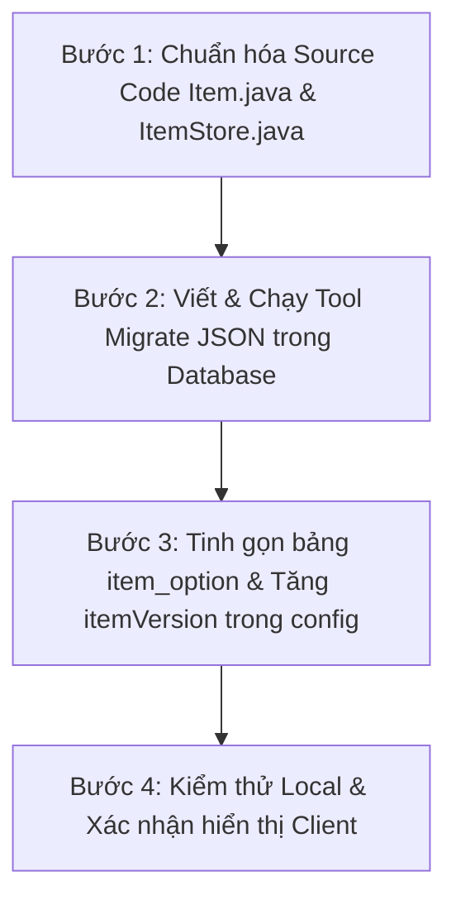

# TÀI LIỆU ĐẶC TẢ KỸ THUẬT (TECHNICAL SPECIFICATION)
## CHUẨN HÓA BẢNG MÃ OPTION & ĐỒNG BỘ DỮ LIỆU TRANG BỊ NSO
**Dự án:** NSO Ninja School Online Server (Java / MariaDB)  
**Trạng thái tài liệu:** 
- **Giai đoạn 1 (Runtime Adapter):** **ĐÃ TRIỂN KHAI HOÀN TẤT** trong Codebase ([OptionMapper.java](file:///e:/TT/SETUP_LOCAL/SRC_GAME/src/main/java/com/nsoz/model/stat/OptionMapper.java), [StatContainer.java](file:///e:/TT/SETUP_LOCAL/SRC_GAME/src/main/java/com/nsoz/model/stat/StatContainer.java), [Item.java](file:///e:/TT/SETUP_LOCAL/SRC_GAME/src/main/java/com/nsoz/item/Item.java) cho một số item sinh mới).
- **Giai đoạn 2 (Database Migration & Purge mã cũ):** **BẢN THẢO THIẾT KẾ (DRAFT / FUTURE SPEC)** – Giữ nguyên mã cũ trong Database và [ItemStore.java](file:///e:/TT/SETUP_LOCAL/SRC_GAME/src/main/java/com/nsoz/store/ItemStore.java) để tương thích ngược 100%, chưa purge dữ liệu.  
**Tác giả:** Antigravity Engineering Team  
**Kế thừa từ:** [STAT_COMBAT_REFACTOR_SPEC.md](file:///e:/TT/SETUP_LOCAL/SRC_GAME/STAT_COMBAT_REFACTOR_SPEC.md)

---

## 1. MỤC TIÊU & NGUYÊN TẮC THIẾT KẾ (OBJECTIVES & CONSTRAINTS)

### 1.1. Mục tiêu
1. **Triệt tiêu phân mảnh dữ liệu:** Loại bỏ hoàn toàn tình trạng một thuộc tính (như Né đòn, HP, Kháng hệ...) bị phân tán thành 5 - 8 mã Option ID khác nhau giữa đồ thường, trang sức, thú cưỡi, pet và vĩ thú.
2. **Kế thừa và chuẩn hóa `type` có sẵn:** 
   - Quy tụ mọi dòng chỉ số thường luôn có hiệu lực về **1 mã Option ID chuẩn duy nhất (Canonical ID)**.
   - Giữ nguyên vẹn cơ chế kích hoạt cường hóa (+4, +8, +12, +14, +16) thông qua các Option mang `type 3..7` để đảm bảo Client tô màu xanh lá chuẩn xác.
3. **Đồng bộ hóa 3 tầng:** Đồng bộ toàn diện giữa **Database** (`item_option`, `stores`, `players`), **Source Code** (`Item.java`, `ItemStore.java`, `OptionMapper.java`) và **Game Client** (thông qua cơ chế cập nhật `itemVersion`).

### 1.2. Nguyên tắc "Bất biến" (Safety Constraints)
* **Zero Client Crash:** Không thay đổi thứ tự hay kiểu dữ liệu của các gói tin socket (`dos.writeByte`, `dos.writeUTF`).
* **Bảo toàn hiển thị dòng ẩn:** Giữ nguyên các mã Option thuộc Type 3..7 để Client hiển thị đúng tiền tố `(+4)`, `(+8)`, `(+12)`, `(+14)`, `(+16)`.
* **Zero Data Loss:** Toàn bộ trang bị của người chơi hiện có trong DB (túi đồ, rương, thú cưỡi) sau khi migrate phải giữ nguyên giá trị chỉ số (`param`), chỉ đổi mã `option_id` cũ sang mã chuẩn tương ứng.

---

## 2. MA TRẬN CHUẨN HÓA MÃ OPTION (CANONICAL OPTION MAPPING MATRIX)

> ⚠️ **NGUYÊN TẮC BẤT DI BẤT DỊCH VỀ DÒNG TẤN CÔNG:**
> Server tuyệt đối phân tách độc lập 4 nhóm sát thương, **KHÔNG BAO GIỜ ĐƯỢC GỘP LẪN**:
> 1. **Tấn công Ngoại công CỐ ĐỊNH (Flat Atk)**: Mã chuẩn **`Option 0`** (`Tấn công ngoại: +#`).
> 2. **Tấn công Nội công CỐ ĐỊNH (Flat Atk)**: Mã chuẩn **`Option 1`** (`Tấn công nội: +#`).
> 3. **% Vật công Ngoại (Percent Atk)**: Mã chuẩn **`Option 8`** (`Vật công ngoại: +#%`) – Nhân theo điểm **Sức Khỏe**. **ĐỘC LẬP, KHÔNG GỘP VÀO 0**.
> 4. **% Vật công Nội (Percent Atk)**: Mã chuẩn **`Option 9`** (`Vật công nội: +#%`) – Nhân theo điểm **Chakra**. **ĐỘC LẬP, KHÔNG GỘP VÀO 1**.
> 5. **% Tấn công tiềm năng**: Mã chuẩn **`Option 94`** (`Tấn công: +#%`) – Nhân 4 lần tiềm năng. **ĐỘC LẬP TUYỆT ĐỐI**.

Bảng quy chuẩn chuyển đổi toàn bộ mã phân mảnh cũ sang mã Canonical ID duy nhất:

| Bản Chất Thuộc Tính | Các Mã Cũ Bị Phân Mảnh (Gồm cả Type 3..7) | Mã Chuẩn Sau Gộp | Type Chuẩn | Quy Tắc Cộng Dồn & Ghi Chú |
| :--- | :--- | :---: | :---: | :--- |
| **Ngoại công cố định (Flat)**| `0, 21, 23, 25, 73, 76, 87` | **`0`** | `0` | Cộng dồn `param` vào dòng Tấn công ngoại |
| **Nội công cố định (Flat)** | `1, 22, 24, 26` | **`1`** | `0` | Cộng dồn `param` vào dòng Tấn công nội |
| **% Vật công Ngoại** | `8` | **`8`** | `1` | **GIỮ RIÊNG 100% - KHÔNG GỘP VÀO 0** |
| **% Vật công Nội** | `9` | **`9`** | `1` | **GIỮ RIÊNG 100% - KHÔNG GỘP VÀO 1** |
| **% Tấn công tiềm năng** | `94` | **`94`** | `8` | **GIỮ RIÊNG 100%** |
| **Tấn công cơ bản vũ khí (+12)**| `38` | **`38`** *(hoặc 0/1 theo phái)* | `5` | Tăng công cơ bản của vũ khí (Flat) |
| **HP tối đa cố định** | `6, 32` *(+12)*, `77, 82, 125` | **`6`** | `1` | Cộng dồn vào dòng `HP tối đa: +#` |
| **MP tối đa cố định** | `7, 19, 29` *(+12)*, `83, 117` | **`7`** | `1` | Cộng dồn vào dòng `MP tối đa: +#` |
| **% Tỉ lệ HP tối đa** | `31, 61` *(dòng ẩn +8)* | **`31`** | `4` | Cộng dồn vào dòng `% Tỉ lệ HP` |
| **% Tỉ lệ MP tối đa** | `28, 60` *(dòng ẩn +4)* | **`28`** | `4` | Cộng dồn vào dòng `% Tỉ lệ MP` |
| **Né đòn cố định** | `5, 17, 62` *(+12)*, `68, 78, 84, 115` | **`5`** | `0` | Cộng dồn toàn bộ vào dòng `Né đòn: +#` |
| **Chính xác cố định** | `10, 18, 75, 86, 116` | **`10`** | `1` | Cộng dồn toàn bộ vào dòng `Chính xác: +#` |
| **Chí mạng cố định** | `14, 37` *(+8)*, `69, 92, 114` | **`14`** | `2` | Cộng dồn toàn bộ vào dòng `Chí mạng: #` |
| **% Tăng ST Chí Mạng**| `39` *(+14)*, `67` | **`39`** | `6` | Cộng dồn vào dòng `% ST Chí Mạng` |
| **% Kháng ST Chí Mạng**| `46` *(+16)*, `63, 79, 121` | **`121`** | `1` | Cộng dồn vào Kháng STCM (cap 100%) |
| **Kháng Hỏa cố định** | `2, 11, 33` *(+14)*, `70, 96` | **`2`** | `0` | Cộng dồn toàn bộ vào dòng Kháng Hỏa |
| **Kháng Băng cố định** | `3, 12` *(fix lỗi)*, `34` *(+14)*, `71, 95`| **`3`** | `0` | Cộng dồn toàn bộ vào dòng Kháng Băng |
| **Kháng Phong cố định**| `4, 13, 35` *(+14)*, `72, 97` | **`4`** | `0` | Cộng dồn toàn bộ vào dòng Kháng Phong |
| **Kháng tất cả các hệ** | `20, 36` *(+14)*, `81, 118` | **`20`** | `2` | Cộng dồn toàn bộ vào dòng Kháng tất cả |
| **Giảm trừ ST (`dameDown`)**| `47, 74, 80, 124` | **`47`** | `0` | Cộng dồn vào dòng Giảm trừ ST |
| **Phản đòn cận chiến** | `15, 91, 126` | **`15`** | `2` | Cộng dồn vào dòng Phản đòn |
| **Điểm tiềm năng (tất cả)**| `57` | **`57`** | `1` | Giữ nguyên |
| **% Điểm tiềm năng** | `58` | **`58`** | `0` | Giữ nguyên |
| **% Miễn giảm sát thương** | `98` | **`98`** | `8` | Quy chuẩn về `StatType.RES_ALL` |
| **Sát thương lên người** | `103` | **`103`** | `1` | PvP Flat Damage |
| **Sát thương chuẩn** | `113` | **`113`** | `0` | True Damage (cộng sau cùng) |
| **Hạ khắc (% Xuyên kháng)** | `101` | **`101`** | `8` | Xuyên kháng % đối thủ |
| **% Kháng Hỏa/Băng/Phong**| `127, 130, 131` | **`127, 130, 131`**| `1` | Giữ nguyên theo 3 hệ nguyên tố |
| **% HP sau khi mặc đồ** | `128` | **`128`** | `0` | Dòng VIP nhân trên tổng HP |
| **% Phản đòn băng giá 20%**| `135` | **`135`** | `0` | Giữ nguyên |

---

### 2.1. Cơ Chế Thuật Toán Gộp & Cộng Dồn (`Merge & Sum Aggregator`)
Thuật toán duyệt qua từng option của trang bị:
1. Xác định mã Canonical ID tương ứng theo ma trận.
2. Nếu mã Canonical ID **đã tồn tại** trên trang bị $\rightarrow$ **Cộng dồn chỉ số**: `existingOption.param += currentOption.param`.
3. Nếu mã Canonical ID **chưa tồn tại** $\rightarrow$ Thêm mới với mã Canonical ID và giá trị `param` hiện tại.
4. Loại bỏ hoàn toàn các mã phân mảnh và mã dòng ẩn đã gộp.

```java
// Ví dụ xử lý:
// Đồ có [Opt 6: 1000] (HP gốc) và [Opt 32: 500] ((+12) HP)
// Sau khi chạy thuật toán -> Chỉ còn 1 dòng duy nhất: [Opt 6: 1500]
```

---

## 3. CÁC ĐỊA ĐIỂM CẦN CẢI BIẾN TRONG SOURCE CODE

```
[ SOURCE CODE THAY ĐỔI ]
       │
       ├─► 1. Item.java: Phương thức initOption()
       │      (Thay thế toàn bộ Option ID cũ 82, 83, 84, 81, 69, 73... sang mã Canonical 6, 7, 5, 20, 14, 0...)
       │
       ├─► 2. ItemStore.java: Phương thức setMinOptions()
       │      (Hiện tại vẫn giữ lại mã cũ để tương thích ngược dữ liệu Store từ Database, sẽ tinh gọn sau khi di trú DB)
       │
       └─► 3. OptionMapper.java
              (Hiện tại hoạt động như một Adapter Layer giữ đầy đủ các case cũ 0..150 để không làm vỡ đồ người chơi trong DB)
```

> **Lưu ý quan trọng về hiện trạng Codebase:**
> Codebase hiện tại đã áp dụng **Adapter Pattern (Tầng Runtime)** thông qua `OptionMapper.java` và `StatContainer.java`. Nhờ đó, máy chủ đã tính toán hoàn toàn chuẩn xác theo các mã chuẩn mà **KHÔNG CẦN sửa dữ liệu gốc trong Database**. Việc tinh gọn triệt để `ItemStore.java` và xóa bỏ case cũ trong `OptionMapper.java` sẽ được thực hiện khi chạy công cụ Di trú Database (Giai đoạn 2).

### 3.1. Chi tiết chỉnh sửa trong `Item.java`
Thay thế các đoạn hardcode khởi tạo option:
```java
// TRƯỚC KHI CHUẨN HÓA (Item.java L257-260):
this.options.add(new ItemOption(82, 1000)); // HP thú
this.options.add(new ItemOption(83, 350));  // MP thú
this.options.add(new ItemOption(84, 100));  // Né thú
this.options.add(new ItemOption(81, 10));   // Kháng tất cả thú

// SAU KHI CHUẨN HÓA (Dùng Canonical ID có sẵn):
this.options.add(new ItemOption(6, 1000));  // Chuẩn hóa về HP tối đa
this.options.add(new ItemOption(7, 350));   // Chuẩn hóa về MP tối đa
this.options.add(new ItemOption(5, 100));   // Chuẩn hóa về Né đòn
this.options.add(new ItemOption(20, 10));   // Chuẩn hóa về Kháng tất cả
```

---

## 4. CHIẾN LƯỢC DI TRÚ DATABASE (DATABASE MIGRATION STRATEGY)

Do dữ liệu trang bị người chơi được lưu dưới dạng chuỗi JSON lồng nhau trong MariaDB:
`"options": [[id, param], [id, param], ...]`

### 4.1. Bản đồ thay thế JSON (Replacement Map):
```json
{
  "17": 5, "68": 5, "78": 5, "84": 5, "115": 5,   // Né đòn -> 5
  "77": 6, "82": 6, "125": 6,                     // HP -> 6
  "19": 7, "83": 7, "117": 7,                     // MP -> 7
  "18": 10, "75": 10, "86": 10, "116": 10,        // Chính xác -> 10
  "69": 14, "92": 14, "114": 14,                  // Chí mạng -> 14
  "91": 15, "126": 15,                            // Phản đòn -> 15
  "81": 20, "118": 20,                            // Kháng tất cả -> 20
  "11": 2, "70": 2, "96": 2,                      // Kháng hỏa -> 2
  "12": 3, "71": 3, "95": 3,                      // Kháng băng -> 3
  "13": 4, "72": 4, "97": 4,                      // Kháng phong -> 4
  "74": 47, "80": 47, "124": 47,                  // Giảm trừ ST -> 47
  "79": 121                                       // Kháng STCM -> 121
}
```

### 4.2. Công cụ di trú: Java Migration Tool (An toàn tuyệt đối)
Thay vì dùng Regex SQL dễ làm vỡ JSON của MariaDB, sử dụng một Java Migration Script độc lập:
1. Kết nối DB qua HikariCP.
2. Đọc từng bản ghi trong `stores.data`, `players.equiped`, `players.bag`, `players.box`, `players.mount`, `players.bijuu`.
3. Parse sang `JSONArray`, thay thế `optionId` theo Bản đồ thay thế trên.
4. Ghi ngược lại Database trong cùng 1 Transaction (có Rollback tự động nếu gặp lỗi).

---

## 5. CƠ CHẾ ĐỒNG BỘ CLIENT (ZERO-CLIENT-PATCH)

Sau khi dọn dẹp các mã trùng lặp trong bảng `item_option`:
1. Server mở file `config.properties`, tăng giá trị `itemVersion`:
   ```properties
   itemVersion=2  # (Tăng từ 1 lên 2)
   ```
2. Khi Client kết nối vào server, Client gửi gói tin kiểm tra phiên bản dữ liệu.
3. Khi nhận thấy `itemVersion` mới, Client tự động yêu cầu tải lại toàn bộ danh mục `item_option` từ Server qua phương thức [ItemManager.setData()](file:///e:/TT/SETUP_LOCAL/SRC_GAME/src/main/java/com/nsoz/item/ItemManager.java#L65).
4. **Kết quả:** Client tự động cập nhật tên dòng hiển thị, không cần biên dịch lại file APK hay JAR client.

---

## 6. KẾ HOẠCH TRIỂN KHAI 4 BƯỚC (ROADMAP)



* **Bước 1: Chuẩn hóa Source Code (30 phút)**
  - Cập nhật các hàm tạo option trong [Item.java](file:///e:/TT/SETUP_LOCAL/SRC_GAME/src/main/java/com/nsoz/item/Item.java).
  - Tinh giản các case trong [OptionMapper.java](file:///e:/TT/SETUP_LOCAL/SRC_GAME/src/main/java/com/nsoz/model/stat/OptionMapper.java).
  - Biên dịch kiểm thử bằng Maven Portable.
* **Bước 2: Di trú Database (30 phút)**
  - Tự động Backup database `nso_test` thành file `.sql` dự phòng.
  - Chạy migration script chuẩn hóa JSON trong các bảng `stores`, `players`, `clone_char`.
* **Bước 3: Tinh gọn Bảng mã & Tăng Version (15 phút)**
  - Cập nhật bảng `item_option`.
  - Tăng `itemVersion` trong `config.properties`.
* **Bước 4: Kiểm thử hiển thị & Giao tranh (30 phút)**
  - Chạy Server Local.
  - Đăng nhập kiểm tra tooltip trang bị túi đồ, rương, thú cưỡi.
  - Kiểm tra giao tranh PvE và PvP.

---

## 7. KỊCH BẢN PHÒNG NGỪA RỦI RO & ROLLBACK (DISASTER RECOVERY)

1. **Sao lưu trước khi chạy (Mandatory Backup):**
   - Trước khi thực hiện Bước 2, tự động xuất bản snapshot `backups/pre_option_standardization_backup.sql`.
2. **Kịch bản Rollback:**
   - Nếu xuất hiện bất kỳ món đồ nào bị lỗi hiển thị hoặc mất chỉ số:
     - Khôi phục database từ file backup bằng 1 lệnh duy nhất.
     - Đặt lại `itemVersion=1`.
     - Khởi động lại server về trạng thái cũ trong dưới 1 phút.
