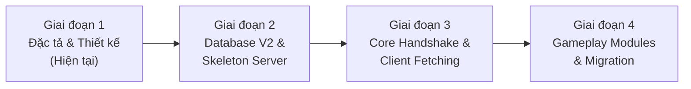

# KẾ HOẠCH TÁI CẤU TRÚC TOÀN DIỆN (MASTER PLAN REWORK & MODERNIZATION)
## DỰ ÁN: NSO GAME SERVER (BACKEND TO DATABASE)

---

## 1. TỔNG QUAN & TẦM NHÌN DỰ ÁN

### 1.1. Bối cảnh
Dự án kế thừa mã nguồn máy chủ cộng đồng Ninja School Online (NSO). Mặc dù hệ thống đã vận hành được, nhưng codebase hiện tại đang đối mặt với những vấn đề nghiêm trọng về nợ kỹ thuật (Technical Debt):
- **God Class siêu khổng lồ:** `Char.java` chiếm tới ~25.000 dòng code (~34% toàn bộ mã nguồn Java), ôm đồm từ mạng, cơ sở dữ liệu, túi đồ, nhiệm vụ đến luồng xử lý.
- **Tầng mạng gắn chặt vào nghiệp vụ (Inverted Layering):** Đối tượng socket nhị phân (`Message mss`) bị truyền sâu vào từng hàm của nhân vật, không có ranh giới phân tách.
- **Cơ sở dữ liệu phình to và chứa rác:** Hơn 70 bảng cơ sở dữ liệu, trong đó hơn 50% là tàn dư từ các hệ thống web nạp thẻ/CMS cũ (`charging_*`, `comments`, `napatm`, `momo_accounts`...), dữ liệu nhân vật bị nhồi nhét vào các chuỗi JSON tự do không có schema kiểm soát.
- **Rủi ro cạn kiệt luồng (Thread Starvation):** Tồn tại các đoạn mã `threadPool.submit(new Thread(... Thread.sleep ...))` gây tắc nghẽn luồng xử lý khi lượng người chơi tăng.

### 1.2. Mục tiêu Tái cấu trúc
1. **Dọn rác triệt để từ Backend đến Database:** Tinh giản cấu trúc, loại bỏ toàn bộ code chết và bảng rác.
2. **Bảo toàn 100% Giao thức Client (Zero Client Impact):** Giữ nguyên vẹn định dạng gói tin byte stream với game client JAR/APK hiện có. Client không cần biết backend bên dưới được viết lại.
3. **Mô hình hóa theo Clean Architecture & Domain-Driven Design (DDD):** Phân chia rõ ràng thành 4 tầng (Protocol Adapter -> Domain Logic -> Data Access -> Database Schema).
4. **Dựng song song (Dual-Stack Sandbox):** Vừa phát triển server mới trên port riêng (`14445`) và database mới (`nso_v2`), vừa kiểm thử liên tục với client thật bằng công cụ patch IP có sẵn trong `manage.bat`.

### 1.3. Định vị Portfolio & Tiêu chuẩn Thiết kế của Tác giả (Author's Core Guidelines)
Dự án được định hướng như một **Showpiece Portfolio** chứng minh năng lực kỹ thuật thực chiến ở cấp độ Senior Backend / System Architect:
1. **Tiêu chuẩn "Dùng gì gọi nấy — Hỏi gì trả đúng cái nấy":**
   * Triệt tiêu tác dụng phụ ngầm (No Hidden Side-Effects): Hàm tính toán không tự tiện sửa DB, không tự ý bắn socket broadcast.
   * Dữ liệu tường minh: Cần trường nào lấy đúng trường đó (No Over-fetching), không load cả cụm JSON to đùng lên RAM chỉ để đọc một con số.
   * Dùng Java 17 `record` làm DTO rõ ràng giữa các tầng.
2. **Nguyên tắc "Gom nhóm theo vai trò — Chống phân mảnh cực đoan":**
   * **Không sa vào cái bẫy Over-engineering:** Không chia vụn vặt mỗi hành động một class, không tạo ra hàng trăm file li ti gây áp lực dọn rác (GC Pressure) và khó trace code.
   * **Tập hợp phần tử tương đồng (High Cohesion):** Gom các tính năng có chung ngữ cảnh và thao tác trên cùng một tập dữ liệu thành **5 Tập Hợp Vai Trò (5 Cohesive Sets)**.
3. **Bảo tồn "Di sản" (Game DNA) của Ninja School Online:**
   * Không khắt khe ở các ID nhỏ lẻ hay công thức toán học vi mô (tác giả tự do refactor/cân bằng).
   * Phải giữ trọn vẹn 5 Cột trụ Bản sắc (Tam trường lục phái, Hào quang Kenshiko +16, Avatar Part, Phân thân & Vĩ thú, Map tuổi thơ) để người chơi/người xem demo nhận ra ngay đây là Ninja School.
4. **Kế thừa Thực dụng (Pragmatic Inheritance):**
   * Kế thừa 100% Quái vật (bảng `monster`, tọa độ spawn) kết hợp kỹ thuật **Zone Hibernation** (ngủ đông zone trống, tiết kiệm 90% CPU).
   * Kế thừa 100% Nhiệm vụ 50 cấp cốt truyện kết hợp **Event-Driven Observer Pattern** nhẹ nhàng.

---

## 2. NGUYÊN TẮC CỐT LÕI: CHIẾN LƯỢC 80/20 (PARETO)

Để công cuộc rework không biến thành gánh nặng vô tận, dự án áp dụng nguyên lý: **Kế thừa 20% cốt lõi giải quyết 80% độ phức tạp, và vứt bỏ 80% vỏ bọc spaghetti**.

```mermaid
graph TD
    subgraph KẾ THỪA 100% (KHÔNG TỐN CÔNG VIẾT LẠI)
        A1[Bộ máy Combat & Stat mới: NewDamageEngine, StatContainer]
        A2[Dữ liệu Game tĩnh: item_template, skill_template, map]
        A3[Quái vật & Tọa độ Spawn: monster table + Kỹ thuật Zone Hibernation]
        A4[Nhiệm vụ 50 cấp cốt truyện: task_template + Observer Pattern]
        A5[File nhị phân: Data/Map, Data/Img, Data/Lang]
        A6[Thuật toán TileMap: Va chạm địa hình pixel]
        A7[Bảng hằng số Opcode CMD.java & Crypto Handshake -27]
        A8[Bảng cấp độ Level & Mốc kinh nghiệm EXPS]
    end

    subgraph CHỈ LẤY CÔNG THỨC TOÁN - VIẾT LẠI VỎ
        B1[Công thức Cường hóa đập đồ: Đá +1 đến +16, tỷ lệ %]
        B2[Quy tắc Trang bị: Điều kiện mặc class/level/nam/nữ]
        B3[Công thức chia EXP Tổ đội & Điều kiện Gia tộc]
    end

    subgraph VỨT BỎ HOÀN TOÀN - DỌN RÁC
        C1[Hơn 40 bảng DB rác: charging, momo, ctv_money, comments]
        C2[File Char.java 25.000 dòng]
        C3[Toàn bộ Thread.sleep trong Worker Thread Pool]
        C4[Switch-case 135 nhánh trong Controller.java]
        C5[Các file Event copy-paste: Noel, LunarNewYear, He...]
        C6[Thư viện rác: log4j 1.x, poi Excel, json-simple]
    end
```

---

## 3. MÔ HÌNH KIẾN TRÚC MỤC TIÊU (4 TẦNG PHÂN LẬP)

```
┌────────────────────────────────────────────────────────┐
│               GAME CLIENT (JAR / APK)                  │
│       (Hộp đen giao tiếp qua TCP Socket Byte)          │
└───────────────────────────▲────────────────────────────┘
                            │ (Raw Byte Stream)
┌───────────────────────────▼────────────────────────────┐
│ 1. PROTOCOL ADAPTER LAYER                              │
│    - Packet Codec (Inbound Reader & Outbound Writer)   │
│    - 5 Controller Routers theo nhóm vai trò:           │
│      + AuthPacketHandler      + MovementPacketHandler  │
│      + InventoryPacketHandler + CombatPacketHandler    │
│      + SocialPacketHandler                             │
│    - Chuyển đổi Byte <---> DTO / Command sạch          │
└───────────────────────────▲────────────────────────────┘
                            │ (Clean Request/Response DTOs)
┌───────────────────────────▼────────────────────────────┐
│ 2. PURE DOMAIN LAYER (5 TẬP HỢP VAI TRÒ CỐT LÕI)       │
│    - PlayerCharacter (Context / Facade tinh gọn)       │
│    - 1. SpatialComponent       (Map, Zone, Tọa độ X/Y) │
│    - 2. CharacterStateComponent (Level, EXP, HP, MP)   │
│    - 3. InventoryComponent    (Bag, Box, Equip, Mount) │
│    - 4. CombatComponent       (Skills, DamageEngine)   │
│    - 5. SocialComponent       (Party, Clan, Friends)   │
│    * Hoàn toàn không phụ thuộc vào Netty hay SQL       │
└───────────────────────────▲────────────────────────────┘
                            │ (Domain Entities)
┌───────────────────────────▼────────────────────────────┐
│ 3. DATA ACCESS LAYER (REPOSITORY PATTERN)              │
│    - PlayerRepository, UserRepository, ClanRepository  │
│    - Entity Mappers (Chuyển Domain <---> DB Entity)    │
│    - Dirty-checking & Batch Flushing (Hạn chế ghi DB)  │
└───────────────────────────▲────────────────────────────┘
                            │ (Clean SQL / HikariCP Pool)
┌───────────────────────────▼────────────────────────────┐
│ 4. DATABASE V2 SCHEMA (TINH GỌN ~18 BẢNG)              │
│    - Chuẩn hóa UTF8MB4 toàn diện, Foreign Key rõ ràng  │
│    - Tách biệt rõ: Static Templates vs Dynamic State   │
└────────────────────────────────────────────────────────┘
```

---

## 4. LỘ TRÌNH THỰC HIỆN 4 GIAI ĐOẠN



### Giai đoạn 1: Đặc tả Bối cảnh, Hệ sinh thái & Chuẩn bị (Tuần 1)
- Viết trọn bộ 4 tài liệu kiến trúc tại `docs/rework/`.
- Phân định rõ 8 trụ cột hệ sinh thái NSO ("Game này có gì").
- Thiết kế Database V2 tinh gọn (~18 bảng) và tài liệu hóa giao thức Client.

### Giai đoạn 2: Database V2 & Skeleton Server V2 (Tuần 2)
- Tạo schema `nso_v2` độc lập trên MariaDB local.
- Viết script nạp dữ liệu Static Templates từ database cũ sang `nso_v2`.
- Khởi tạo project Maven V2 (Java 17 sạch, Netty, HikariCP, Gson/Jackson, Logback).
- Cấu hình server chạy độc lập tại Port `14445`.

### Giai đoạn 3: Bắt tay Client & Hoàn tất chuỗi Fetching (Tuần 3)
- Triển khai `PacketCodec` và Handler cho chuỗi gói tin mở màn:
  * `CMD -27`: Key exchange & mã hóa socket.
  * `CMD -122`: Resource version.
  * `CMD -121`: Game template metadata (Items, Skills, Maps).
  * `CMD -127` / `CMD 2`: Đăng nhập & Hiển thị danh sách nhân vật.
- **Cột mốc kiểm chứng (Milestone 1):** Dùng `manage.bat` patch client test trỏ port 14445, mở client lên nạp 100%, đăng nhập thành công vào sảnh chọn nhân vật.

### Giai đoạn 4: Di chuyển Module Nghiệp vụ & Dữ liệu (Tuần 4 - 6)
- Bê từng module sang theo thứ tự ưu tiên:
  1. `World & Zone`: Vào map (`CMD -107 Me Load All`), di chuyển, đồng bộ người chơi xung quanh.
  2. `Inventory & Equipment`: Túi đồ, rương, mặc/tháo trang bị, dùng bình máu.
  3. `Combat & Mobs`: Tích hợp `NewDamageEngine`, spawn quái, đánh quái, nhặt vật phẩm rơi.
  4. `Social & Chat`: Chat kênh, tổ đội, bạn bè.
- Viết script ETL (Extract-Transform-Load) chuyển dữ liệu tài khoản/nhân vật từ database cũ sang database mới.

---

## 5. BỘ TÀI LIỆU KIẾN TRÚC TRONG THƯ MỤC `docs/rework/`

1. **`00_MASTER_PLAN_REWORK_VA_KIEN_TRUC.md`** *(Tài liệu này)*: Tổng quan kế hoạch, nguyên tắc 80/20 và lộ trình.
2. **`01_BAN_DO_HE_SINH_THAI_GAME_NAY_CO_GI.md`**: Bản đồ chi tiết 8 trụ cột hệ sinh thái và danh mục tính năng.
3. **`02_THIET_KE_DATABASE_V2_TINH_GON.md`**: Thiết kế schema database V2 rút gọn từ 70+ bảng xuống ~18 bảng.
4. **`03_QUY_CHUAN_GIAO_THUC_CLIENT_ADAPTER.md`**: Đặc tả giao thức mạng nhị phân, vòng đời client fetching và thiết kế Adapter.
5. **`04_DAC_TA_DI_SAN_VA_KE_THUA.md`**: Bản sắc 5 cột trụ DNA NSO, chiến lược kế thừa Quái vật (Zone Hibernation) và Nhiệm vụ (Observer Pattern).

