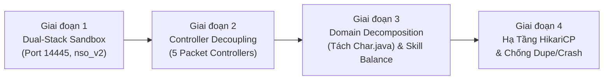

# KẾ HOẠCH TÁI CẤU TRÚC TOÀN DIỆN (MASTER PLAN REWORK & MODERNIZATION)
## DỰ ÁN: NSO GAME SERVER V2 (EVOLUTIONARY CLONE & REFACTOR)

---

## 1. TỔNG QUAN & TẦM NHÌN DỰ ÁN

### 1.1. Bối cảnh
Dự án kế thừa mã nguồn máy chủ cộng đồng Ninja School Online (NSO). Mặc dù hệ thống gốc đã vận hành ổn định trên môi trường máy chủ VM, nhưng codebase hiện tại đang đối mặt với những vấn đề nghiêm trọng về nợ kỹ thuật (Technical Debt):
- **God Class siêu khổng lồ:** `Char.java` chiếm tới ~25.000 dòng code (~34% toàn bộ mã nguồn Java), ôm đồm từ mạng, cơ sở dữ liệu, túi đồ, nhiệm vụ, kỹ năng đến luồng xử lý.
- **Tầng mạng gắn chặt vào nghiệp vụ (Inverted Layering):** Đối tượng socket nhị phân (`Message mss`) bị truyền sâu vào từng hàm của nhân vật, không có ranh giới phân tách.
- **Cơ sở dữ liệu phình to và chứa rác:** Hơn 70 bảng cơ sở dữ liệu, trong đó hơn 50% là tàn dư từ các hệ thống web nạp thẻ/CMS cũ (`charging_*`, `comments`, `napatm`, `momo_accounts`...), dữ liệu nhân vật bị nhồi nhét vào các chuỗi JSON tự do không có schema kiểm soát.
- **Rủi ro cạn kiệt luồng (Thread Starvation) & Dupe đồ:** Tồn tại các đoạn mã `threadPool.submit(new Thread(... Thread.sleep ...))` và các khối lock chưa chuẩn hóa dễ dẫn đến lỗi race-condition khi giao dịch hoặc cất đồ.

### 1.2. Chiến Lược Cốt Lõi: Bản Sao Độc Lập Tiến Hóa (Evolutionary Twin Sandbox)
Khác với phương pháp "Greenfield Rewrite" (đập đi xây mới hoàn toàn từ đầu bị thất bại do vướng phải hộp đen 20-30 packet ngầm định của J2ME Client), dự án áp dụng chiến lược **Clone-and-Modernize (Strangler Fig Pattern)**:

> [!IMPORTANT]
> **2 CỘT MỐC HỆ THỐNG BẤT BIẾN:**
> 1. **Server Gốc V1 (Port `14444`, DB `nso_test`):** Là mốc đối chứng an toàn tuyệt đối (Pristine Reference Anchor). Tuyệt đối **không sửa code, không đè dữ liệu, không can thiệp**.
> 2. **Server Cải Tiến V2 (Port `14445`, DB `nso_v2`):** Được clone nguyên bản từ V1 sang một môi trường độc lập hoàn toàn. Toàn bộ các cải tiến kiến trúc Clean Architecture, cân bằng gameplay (`update_skills.sql`), công thức sát thương mới, và tối ưu kết nối đều được thực thi và kiểm thử tại đây.

### 1.3. Định vị Portfolio & Tiêu chuẩn Thiết kế của Tác giả (Author's Core Guidelines)
Dự án được định hướng như một **Showpiece Portfolio** chứng minh năng lực kỹ thuật thực chiến ở cấp độ Senior Backend / System Architect:
1. **Tiêu chuẩn "Dùng gì gọi nấy — Hỏi gì trả đúng cái nấy":**
   * Triệt tiêu tác dụng phụ ngầm (No Hidden Side-Effects): Hàm tính toán không tự tiện sửa DB, không tự ý bắn socket broadcast.
   * Dữ liệu tường minh: Cần trường nào lấy đúng trường đó (No Over-fetching), không load cả cụm JSON to đùng lên RAM chỉ để đọc một con số.
   * Dùng Java 17 `record` làm DTO rõ ràng giữa các tầng.
2. **Nguyên tắc "Gom nhóm theo vai trò — Chống phân mảnh cực đoan":**
   * **Không sa vào cái bẫy Over-engineering:** Không chia vụn vặt mỗi hành động một class, không tạo ra hàng trăm file li ti gây áp lực dọn rác (GC Pressure) và khó trace code.
   * **Tập hợp phần tử tương đồng (High Cohesion):** Gom các tính năng có chung ngữ cảnh và thao tác trên cùng một tập dữ liệu thành **5 Tập Hợp Vai Trò (5 Cohesive Sets)**.
3. **Bảo tồn "Di sản" (Game DNA) của Ninja School Online:**
   * Không khắt khe ở các ID nhỏ lẻ hay công thức vi mô (tác giả tự do refactor/cân bằng).
   * Phải giữ trọn vẹn 5 Cột trụ Bản sắc (Tam trường lục phái, Hào quang Kenshiko +16, Avatar Part, Phân thân & Vĩ thú, Map tuổi thơ) để người chơi/người xem demo nhận ra ngay đây là Ninja School.
4. **Kế thừa Thực dụng (Pragmatic Inheritance):**
   * Kế thừa 100% Quái vật (bảng `monster`, tọa độ spawn) kết hợp kỹ thuật **Zone Hibernation** (ngủ đông zone trống, tiết kiệm 90% CPU).
   * Kế thừa 100% Nhiệm vụ 50 cấp cốt truyện kết hợp **Event-Driven Observer Pattern** nhẹ nhàng.

---

## 2. NGUYÊN TẮC CỐT LÕI: CHIẾN LƯỢC 80/20 (PARETO)

Để công cuộc cải tiến không biến thành gánh nặng vô tận, dự án áp dụng nguyên lý: **Kế thừa 20% cốt lõi giải quyết 80% độ phức tạp, và vứt bỏ 80% vỏ bọc spaghetti**.

```mermaid
graph TD
    subgraph KẾ THỪA 100% (KHÔNG TỐN CÔNG VIẾT LẠI)
        A1[Bộ máy Combat & Stat mới: NewDamageEngine, StatContainer]
        A2[Dữ liệu Game tĩnh: item_template, skill_template, map]
        A3[Quái vật & Tọa độ Spawn: monster table + Kỹ thuật Zone Hibernation]
        A4[Nhiệm vụ 50 cấp cốt truyện: task_template + Observer Pattern]
        A5[File nhị phân: Data/Map, Data/Img, Data/Lang]
        A6[Thuật toán TileMap: Va chạm địa hình pixel]
        A7[Bảng hằng số Opcode CMD.java & Crypto Handshake -27]
        A8[Bảng cấp độ Level & Mốc kinh nghiệm EXPS]
    end

    subgraph CHỈ LẤY CÔNG THỨC TOÁN - VIẾT LẠI VỎ
        B1[Công thức Cường hóa đập đồ: Đá +1 đến +16, tỷ lệ %]
        B2[Quy tắc Trang bị: Điều kiện mặc class/level/nam/nữ]
        B3[Công thức chia EXP Tổ đội & Điều kiện Gia tộc]
        B4[Cân bằng Kỹ năng 25 của 6 phái theo update_skills.sql]
    end

    subgraph VỨT BỎ HOÀN TOÀN - DỌN RÁC
        C1[Hơn 40 bảng DB rác: charging, momo, ctv_money, comments]
        C2[God Class Char.java 25.000 dòng]
        C3[Toàn bộ Thread.sleep trong Worker Thread Pool]
        C4[Switch-case khổng lồ trong Controller.java]
        C5[Các file Event copy-paste: Noel, LunarNewYear, He...]
        C6[Thư viện rác cũ: log4j 1.x, poi Excel, json-simple]
    end
```

---

## 3. MÔ HÌNH KIẾN TRÚC MỤC TIÊU V2 (4 TẦNG PHÂN LẬP)

```
┌────────────────────────────────────────────────────────┐
│               GAME CLIENT (JAR / APK)                  │
│       (Hộp đen giao tiếp qua TCP Socket Byte)          │
└───────────────────────────▲────────────────────────────┘
                            │ (Raw Byte Stream - Giữ nguyên 100%)
┌───────────────────────────▼────────────────────────────┐
│ 1. PROTOCOL ADAPTER LAYER                              │
│    - Packet Codec (Inbound Reader & Outbound Writer)   │
│    - 5 Controller Routers theo nhóm vai trò:           │
│      + AuthPacketController   + SpatialPacketController│
│      + CombatPacketController + InventoryPacketController│
│      + SocialPacketController                          │
│    - Chuyển đổi Byte <---> DTO / Command sạch          │
└───────────────────────────▲────────────────────────────┘
                            │ (Clean Request/Response DTOs)
┌───────────────────────────▼────────────────────────────┐
│ 2. PURE DOMAIN LAYER (5 TẬP HỢP VAI TRÒ CỐT LÕI)       │
│    - PlayerCharacter (Context / Facade tinh gọn)       │
│    - 1. SpatialComponent       (Map, Zone, Tọa độ X/Y) │
│    - 2. CharacterStateComponent (Level, EXP, HP, MP)   │
│    - 3. InventoryComponent    (Bag, Box, Equip, Mount) │
│    - 4. CombatComponent       (Skills, DamageEngine)   │
│    - 5. SocialComponent       (Party, Clan, Friends)   │
│    * Hoàn toàn không phụ thuộc vào Netty hay SQL       │
└───────────────────────────▲────────────────────────────┘
                            │ (Domain Entities)
┌───────────────────────────▼────────────────────────────┐
│ 3. DATA ACCESS LAYER (REPOSITORY PATTERN)              │
│    - PlayerRepository, UserRepository, ClanRepository  │
│    - Entity Mappers (Chuyển Domain <---> DB Entity)    │
│    - Dirty-checking & Batch Flushing (Hạn chế ghi DB)  │
└───────────────────────────▲────────────────────────────┘
                            │ (Clean SQL / HikariCP Pool)
┌───────────────────────────▼────────────────────────────┐
│ 4. DATABASE V2 SCHEMA (TINH GỌN TRÊN NSO_V2)           │
│    - Kế thừa schema hoạt động từ nso_test sang nso_v2  │
│    - Dọn dẹp an toàn các bảng rác nạp thẻ/CMS          │
│    - Tách biệt rõ: Static Templates vs Dynamic State   │
└────────────────────────────────────────────────────────┘
```

---

## 4. LỘ TRÌNH 4 GIAI ĐOẠN TIẾN HÓA TRÊN BẢN CLONE V2



### Giai đoạn 1: Thiết lập Dual-Stack Sandbox V2 Chạy Song Song
- Nhân bản an toàn cấu hình và DB `nso_test` sang `nso_v2`.
- Cấu hình server chạy độc lập tại Port `14445` (Embedded HTTP Bridge port `8081`).
- **Tiêu chí nghiệm thu (DoD):** Mở client kết nối port 14445, đăng nhập tài khoản test `admin / admin123`, vào thẳng Làng Tone (Map 22), di chuyển đánh quái mượt mà 100%. Server V1 gốc trên port 14444 vẫn chạy bình thường không bị ảnh hưởng.

### Giai đoạn 2: Bóc Tách Tầng Mạng (Controller Decoupling)
- Thu gọn `Controller.java` khổng lồ thành Facade Router gọn nhẹ.
- Tách thành 5 Controller chuyên biệt:
  1. `AuthPacketController`: Login, chọn/tạo nhân vật, khóa bảo vệ.
  2. `SpatialPacketController`: Di chuyển, đổi map, đổi zone, request template.
  3. `CombatPacketController`: Đánh quái/người, kỹ năng, PK, lôi đài, hồi sinh.
  4. `InventoryPacketController`: Túi, rương, mua bán, nâng cấp, vĩ thú.
  5. `SocialPacketController`: Chat, gia tộc, party, bạn bè, trade.
- **Tiêu chí nghiệm thu (DoD):** Biên dịch Maven sạch sẽ, toàn bộ thao tác di chuyển, nhặt đồ, tung chiêu trên server V2 chạy trơn tru 100%.

### Giai đoạn 3: Tái Cấu Trúc Domain (`Char.java`) & Cân Bằng Kỹ Năng
- Áp dụng Component Pattern để giải phẫu `Char.java` (~25.000 dòng):
  * Chuyển tọa độ sang `SpatialComponent`.
  * Chuyển chỉ số HP/MP/EXP sang `CharacterStateComponent`.
  * Chuyển hệ thống trang bị sang `InventoryComponent`.
  * Chuyển cơ chế sát thương sang `CombatComponent` kết hợp bộ công thức mới (`docs/rework/09, 10`).
- Áp dụng bộ cân bằng kỹ năng 25 của 6 phái ([`update_skills.sql`](file:///e:/TT/SETUP_LOCAL/SRC_GAME/update_skills.sql)) trên database `nso_v2`.
- **Tiêu chí nghiệm thu (DoD):** Nhân vật sử dụng chiêu thức mới mượt mà, công thức dame đối xứng tính toán chính xác không bị bug bất tử.

### Giai đoạn 4: Tối Ưu Hạ Tầng, HikariCP & Phòng Chống Dupe/Crash
- Nâng cấp connection pool từ DBCP thô sang **HikariCP** với cơ chế rò rỉ timeout an toàn.
- Vá các lỗ hổng Race-condition kinh điển tại các điểm nóng:
  * Giao dịch P2P giữa 2 người chơi.
  * Cất / rút đồ từ Rương và Hòm thư.
  * Nâng cấp / phân tách trang bị.
- Kích hoạt **Zone Hibernation** (ngủ đông quái ở các map không có người chơi) giúp giảm 80-90% tải CPU máy chủ.

---

## 5. BỘ TÀI LIỆU KIẾN TRÚC ĐI KÈM

1. **`00_MASTER_PLAN_REWORK_VA_KIEN_TRUC.md`** *(Tài liệu này)*: Kế hoạch tổng thể và lộ trình cải tiến V2.
2. **`01_BAN_DO_HE_SINH_THAI_GAME_NAY_CO_GI.md`**: Bản đồ chi tiết 8 trụ cột hệ sinh thái NSO.
3. **`02_THIET_KE_DATABASE_V2_TINH_GON.md`**: Tối ưu và dọn dẹp cơ sở dữ liệu `nso_v2`.
4. **`03_QUY_CHUAN_GIAO_THUC_CLIENT_ADAPTER.md`**: Quy chuẩn giao thức mạng nhị phân và kiến trúc Controller Adapter.
5. **`04_DAC_TA_DI_SAN_VA_KE_THUA.md`**: 5 Cột trụ Bản sắc DNA NSO, Zone Hibernation & Nhiệm vụ Observer.
6. **`05_DAC_TA_CHI_TIET_5_TAP_HOP_VAI_TRO.md`**: Đặc tả chi tiết 5 Component phân rã từ `Char.java`.
7. **`06_CAC_CAU_HOI_VA_QUYET_DINH_KIEN_TRUC.md`**: Bản khảo sát và các quyết định kiến trúc cốt lõi (ADR).
8. **`07_CHIEN_LUOC_MILESTONE_VA_UOC_LUONG_PHIEN_BAN.md`**: Chi tiết tiêu chuẩn nghiệm thu (DoD) của 4 Milestone cục bộ.
9. **`08_THIET_KE_HE_THONG_TRANG_BI_5_TIER.md`**: Thiết kế hệ thống trang bị 5 phẩm chất rời rạc.
10. **`09_THIET_KE_ENGINE_CHI_SO_VA_CAN_BANG_COMBAT.md`**: Engine chỉ số và công thức tính sát thương 3 tầng.
11. **`10_GIAI_THUAT_XAC_SUAT_SINGLE_ROLL_MULTI_VARIABLE.md`**: Giải thuật xác suất Single-Roll triệt tiêu bug bất tử.
