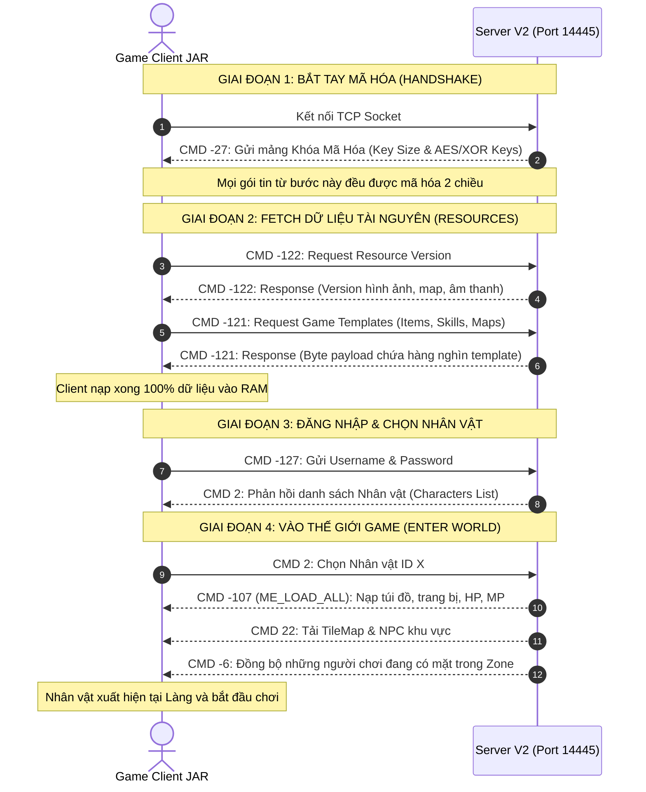

# QUY CHUẨN GIAO THỨC & THIẾT KẾ CLIENT ADAPTER
## ĐÓNG BĂNG GIAO THỨC SOCKET NHỊ PHÂN (ZERO CLIENT IMPACT)
**Dự án:** NSO Game Server Modernization  
**Mục tiêu:** Giữ nguyên 100% định dạng byte stream với game client JAR/APK hiện có, đồng thời tách rời tầng mạng ra khỏi logic nghiệp vụ của server.

---

## 1. NGUYÊN TẮC "HỘP ĐEN" (BLACK-BOX PROTOCOL)

Game client NSO (file JAR/APK J2ME) là một **Hộp đen (Black Box)**:
* Chúng ta **không thay đổi** mã nguồn của client.
* Client gửi lên byte stream như thế nào thì Server phải đọc đúng thứ tự từng byte đó.
* Server phản hồi về byte stream như thế nào thì Client chỉ hiểu khi nhận đúng thứ tự đó.

Để đạt được mục tiêu dọn sạch codebase mà không làm hỏng client, ta sử dụng mô hình **Protocol Adapter (Anti-Corruption Layer)**:

```
[ GAME CLIENT (Hộp Đen) ]
       │ ▲
       │ │ Giao thức Socket Nhị phân (Raw Bytes)
       ▼ │
┌────────────────────────────────────────────────────────┐
│             TẦNG PROTOCOL ADAPTER                      │
│                                                        │
│  [ Inbound Packet Decoder ]                            │
│  - Đọc bytes từ DataInputStream                        │
│  - Giải nén thành Request POJO / Command sạch          │
│                                                        │
│  [ Outbound Packet Encoder ]                           │
│  - Nhận Response POJO / Domain Event                   │
│  - Đóng gói bytes vào DataOutputStream theo mẫu        │
└────────────────────────────────────────────────────────┘
       │ ▲
       │ │ DTO thuần túy (Không dính dáng Netty / Socket)
       ▼ │
[ TẦNG NGHIỆP VỤ LÕI (PURE DOMAIN LOGIC) ]
```

---

## 2. VÒNG ĐỜI KẾT NỐI & CLIENT FETCHING (INITIALIZATION LIFECYCLE)

Khi game client mở lên và kết nối vào server, nó thực hiện một chuỗi "fetching" tuần tự bắt buộc. Nếu bất kỳ gói tin nào bị sai lệch thứ tự byte hoặc timeout, **client sẽ bị đứng ở màn hình nạp (0% hoặc 99%) hoặc crash văng ứng dụng**.



---

## 3. ĐẶC TẢ CHI TIẾT CÁC GÓI TIN THEN CHỐT (PHASE 1)

### 3.1. Gói tin Trao đổi Khóa: `CMD.NOT_LOGIN (-27)`
* **Hướng:** Server ➔ Client (Tự động gửi ngay khi socket vừa kết nối thành công).
* **Cấu trúc nhị phân:**
  ```java
  Message ms = new Message(CMD.NOT_LOGIN);
  DataOutputStream ds = ms.writer();
  ds.writeByte(key.length); // Kích thước mảng khóa (thường là 7)
  for (int i = 0; i < key.length; i++) {
      ds.writeByte(key[i]); // Từng byte khóa ngẫu nhiên
  }
  ```

### 3.2. Gói tin Tải Version: `CMD.GET_VER (-122)`
* **Hướng:** Client ➔ Server, Server phản hồi lại Client.
* **Cấu trúc phản hồi:**
  ```java
  Message ms = new Message(CMD.GET_VER);
  DataOutputStream ds = ms.writer();
  ds.writeInt(VERSION_IMAGE);    // Version hình ảnh
  ds.writeInt(VERSION_MAP);      // Version địa hình
  ds.writeInt(VERSION_SKILL);    // Version kỹ năng
  ds.writeInt(VERSION_ITEM);     // Version danh mục vật phẩm
  ```

### 3.3. Gói tin Tải Game Templates: `CMD.REQUEST_MAPTEMPLATES (-121)`
* **Hướng:** Client ➔ Server yêu cầu tải danh mục metadata.
* **Quy tắc đặc biệt:** Gói tin này chứa toàn bộ định nghĩa ItemTemplate, MapTemplate, SkillTemplate.
  * **Kế thừa 100%:** Bê nguyên hàm serialization cũ trong [`GameData.java`](file:///e:/TT/SETUP_LOCAL/SRC_GAME/src/main/java/com/nsoz/server/GameData.java) sang để đảm bảo không sai lệch một byte dữ liệu nào.

### 3.4. Gói tin Đăng nhập: `CMD.LOGIN (-127)`
* **Hướng:** Client ➔ Server.
* **Inbound Payload (Client gửi lên):**
  * `readUTF()`: Username.
  * `readUTF()`: Password.
  * `readUTF()`: Client Version / Hardware Info.
* **Xử lý:**
  * Giải nén thành `LoginCommand(username, password)`.
  * Domain Service xác thực với database `users` qua BCrypt.
* **Outbound Payload (Server phản hồi danh sách nhân vật - `CMD 2`):**
  * `writeByte(characterCount)`: Số lượng nhân vật của tài khoản (tối đa 3).
  * Vòng lặp cho từng nhân vật:
    * `writeInt(id)`: ID nhân vật.
    * `writeUTF(name)`: Tên nhân vật.
    * `writeByte(gender)`: Giới tính.
    * `writeShort(head)`: ID tóc/đầu.
    * `writeByte(clazz)`: Môn phái (0-6).
    * `writeShort(level)`: Cấp độ.

---

## 4. MẪU THIẾT KẾ PACKET CONTROLLERS V2: GOM THEO NHÓM VAI TRÒ (HIGH COHESION)

Theo đúng tiêu chuẩn **"Gom nhóm theo vai trò — Chống phân mảnh cực đoan"**, tầng mạng sẽ **không bị xé nhỏ thành 135 file lẻ**, mà được quy hoạch thành **5 Packet Controllers** đại diện cho 5 cụm vai trò:

```
[Netty RequestHandler] 
         │ (Đọc opcode CMD)
         ▼
[PacketRouter] ──> Điều phối tới đúng 1 trong 5 Controller:
         ├─ 1. AuthPacketController      (Handshake, Login, Chọn NV)
         ├─ 2. MovementPacketController  (Di chuyển, Nhảy, Chuyển map/khu)
         ├─ 3. InventoryPacketController (Mặc/tháo đồ, Dùng item, Rương, Cường hóa)
         ├─ 4. CombatPacketController    (Đánh quái, Đánh người, Dùng skill, Đổi cờ)
         └─ 5. SocialPacketController    (Chat, Bạn bè, Đội, Gia tộc, Giao dịch)
```

### 4.1. Ví dụ triển khai: `InventoryPacketController` (Gom toàn bộ nghiệp vụ đồ đạc)
```java
package com.nsoz.v2.transport.packet.inventory;

import com.nsoz.v2.domain.inventory.InventoryService;
import com.nsoz.v2.domain.session.GameSession;
import java.io.DataInputStream;
import java.io.IOException;

public class InventoryPacketController {

    private final InventoryService inventoryService;

    public InventoryPacketController(InventoryService inventoryService) {
        this.inventoryService = inventoryService;
    }

    /**
     * Điều phối các gói tin liên quan đến đồ đạc gom chung 1 chỗ
     */
    public void dispatch(byte cmd, GameSession session, DataInputStream dis) throws IOException {
        switch (cmd) {
            case -118: // CMD.USE_ITEM
                handleUseItem(session, dis);
                break;
            case -117: // CMD.ITEM_BUY
                handleEquipItem(session, dis);
                break;
            case -116: // CMD.UPGRADE
                handleUpgradeItem(session, dis);
                break;
            default:
                break;
        }
    }

    private void handleUseItem(GameSession session, DataInputStream dis) throws IOException {
        byte index = dis.readByte();
        inventoryService.useItem(session.getPlayer(), index);
    }

    private void handleEquipItem(GameSession session, DataInputStream dis) throws IOException {
        byte index = dis.readByte();
        inventoryService.equipItem(session.getPlayer(), index);
    }

    private void handleUpgradeItem(GameSession session, DataInputStream dis) throws IOException {
        byte itemIndex = dis.readByte();
        inventoryService.upgradeItem(session.getPlayer(), itemIndex);
    }
}
```

### 4.2. Lợi ích vượt trội của thiết kế này
1. **Độ kết dính cao (High Cohesion):** Mọi logic liên quan đến đồ đạc đều nằm chung trong `InventoryPacketController` và `InventoryService`. Không bị phân mảnh thành hàng chục file nhỏ lẻ.
2. **Triệt tiêu 135 nhánh switch-case tập trung:** Thay vì 1 file khổng lồ ôm 135 case, mỗi Controller chỉ quản lý 10-15 opcode cùng nhóm nghiệp vụ, code cực kỳ sáng sủa.
3. **Tiết kiệm bộ nhớ & Giảm áp lực GC:** Không cần tạo hàng loạt Object Request trung gian cho các hành động đơn giản, dữ liệu được truyền thẳng vào Service tương ứng.

