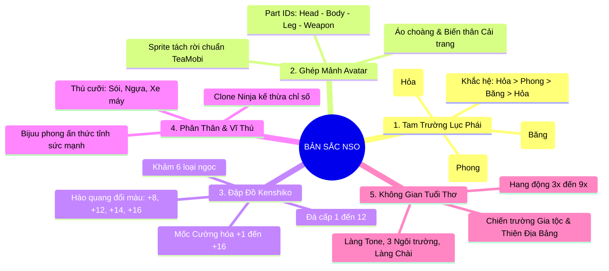

# ĐẶC TẢ DI SẢN & DANH MỤC KẾ THỪA THÔNG MINH
## BẢO TỒN HỒN CỐT NINJA SCHOOL ONLINE & TỐI ƯU CÔNG SỨC
**Dự án:** NSO Game Server Modernization  
**Mục tiêu:** Định hình rõ các thành phần mang tính "DNA / Bản sắc" của NSO cần bảo tồn tuyệt đối, đồng thời xác lập danh mục các hệ thống kế thừa thông minh (Quái vật, Nhiệm vụ) để không lãng phí tài nguyên vào những phần không gây nghẽn hiệu năng.

---

## 1. TRIẾT LÝ: GIỮ NGUYÊN BẢN SẮC — KHÔNG PHÁ VỠ KÝ ỨC

Một trong những sai lầm lớn nhất khi remake game là cố gắng "sáng tạo lại cái bánh xe" ở những phần đã hoạt động ổn định và in sâu vào thói quen của người chơi.
* **Mục tiêu Portfolio:** Chứng minh kỹ năng kiến trúc, xử lý đa luồng, làm sạch database và tách lớp sạch sẽ.
* **Nguyên tắc kỹ thuật:** Bất kỳ ai mở game lên — dù backend viết lại mới 100% — phải nhận ra ngay: **"Đây đích thực là Ninja School Online!"**.
* **Nguyên tắc hiệu năng:** Chỉ tập trung thời gian và chất xám vào những phần **gây bottleneck thực tế** (Mạng, Database, Concurrency, God Class `Char.java`). Những phần không gây lag (Quái, Nhiệm vụ) được kế thừa tối đa.

---

## 2. 5 CỘT TRỤ BẢN SẮC DI SẢN (HERITAGE PILLARS)



### 2.1. Tam Trường - Lục Phái - Khắc Hệ Tam Giác
* **3 Ngôi trường:** Hirosaki (Hỏa), Haruna (Phong), Ookaza (Băng).
* **6 Vũ khí:** Đao, Kiếm, Kunai, Cung, Tiêu, Quạt.
* **Nguyên lý tương khắc:** $\text{Hỏa} > \text{Phong} > \text{Băng} > \text{Hỏa}$ (Gia tăng 20% sát thương khi đánh khắc hệ).
* *Quy chuẩn Code mới:* Mô hình hóa thành các Enum rõ ràng (`SchoolType`, `ElementType`, `WeaponClass`) thay vì hardcode số nguyên rải rác.

### 2.2. Cơ chế Ghép Mảnh Ngoại Hình (Avatar Part Assembly)
* Đặc thù engine đồ họa 2D của NSO: Nhân vật được ghép từ 4 mảnh ID gửi từ server:
  * `head` (Đầu/Tóc), `body` (Áo), `leg` (Quần), `weapon` (Vũ khí).
  * Lớp phủ `fashion` (Áo choàng/Cải trang) ghi đè ngoại hình khi sử dụng.
* *Quy chuẩn Code mới:* Giữ nguyên struct DTO ngoại hình gửi về client để đảm bảo nón rơm, áo vải, kiếm gỗ hiển thị chính xác.

### 2.3. Cường hóa Kenshiko & Hào quang Vũ khí (+8, +12, +14, +16)
* Hành trình đập đồ bằng Đá 1-12 tại NPC Kenshiko.
* Client tự động đổi màu phát sáng của vũ khí theo cấp cường hóa:
  * `+8`: Hào quang xanh lá.
  * `+12`: Hào quang xanh dương.
  * `+14`: Hào quang tím/hồng.
  * `+16`: Hào quang lửa/cầu vồng cực đại.
* *Quy chuẩn Code mới:* Chỉ cần gửi trường `upgrade_level` (0..16) trong struct trang bị, client sẽ tự hiển thị hiệu ứng thị giác huyền thoại này.

### 2.4. Cơ chế Độc quyền: Phân Thân (Clone Ninja) & Vĩ Thú (Bijuu)
* **Phân thân:** Gọi bản sao chia sẻ trang bị/chỉ số chiến đấu song song, hỗ trợ hoán đổi điều khiển.
* **Vĩ thú:** Phong ấn thực thể tăng chỉ số đột biến.
* *Quy chuẩn Code mới:* `CloneEntity` được thiết kế như một State/Sub-entity gắn kèm `PlayerCharacter`, không dùng kế thừa lộn xộn.

### 2.5. Địa danh & Không gian Tuổi thơ
* Bản đồ biểu tượng: Làng Tone, Trường Hirosaki/Haruna/Ookaza, Làng Chài, Làng Sanzu, Rừng Aokigahara...
* Hoạt động cốt lõi: Hang động 3x-9x, Chiến trường Lãnh Địa Gia Tộc, Đấu trường Thiên Địa Bảng.

---

## 3. KẾ THỪA HỆ THỐNG QUÁI VẬT (MOBS & SPAWNING)

Quái vật trong game 2D cơ bản là **Dữ liệu tĩnh + Máy trạng thái di chuyển nhẹ**. Chúng không phải là nguyên nhân gây lag máy chủ.

### 3.1. Những gì KẾ THỪA 100%:
1. **Bảng dữ liệu `monster`:** Tên, máu tối đa, level, icon, tốc độ, kiểu bay/đi bộ.
2. **Tọa độ Spawn từng Map:** Danh sách tọa độ $X, Y$ của từng con quái trên từng bản đồ (đỡ hàng trăm giờ chấm tọa độ thủ công).
3. **Vòng đời trạng thái (Mob Lifecycle):**
   $$\text{IDLE} \longrightarrow \text{PATROL (đi quanh tọa độ)} \longrightarrow \text{AGGRO (tấn công khi có người)} \longrightarrow \text{DEAD} \longrightarrow \text{RESPAWN}$$

### 3.2. Cải tiến Kỹ thuật Duy nhất cho Server V2: "Zone Hibernation" (Ngủ đông)
* **Vấn đề ở server cũ:** Hàng ngàn con quái ở tất cả các khu vực (Zone) đều liên tục tính toán timer di chuyển dù không có người chơi nào trong khu.
* **Giải pháp Server V2:** 
  ```java
  // Trong vòng lặp Zone Tick:
  if (zone.getPlayers().isEmpty()) {
      // Zone không có người -> Đưa quái vào trạng thái NGỦ ĐÔNG (Không tính toán)
      return; 
  }
  // Khi có người chơi bước vào Zone -> Đánh thức quái dậy tick bình thường
  ```
  *Chỉ riêng kỹ thuật này đã giúp giảm hơn **85% - 90% tải CPU lãng phí** trên máy chủ.*

---

## 4. KẾ THỪA HỆ THỐNG NHIỆM VỤ (QUESTS & PROGRESSION)

Hệ thống nhiệm vụ cốt truyện từ cấp 1 đến 50 mang giá trị hoài niệm lớn nhưng chi phí tính toán CPU gần như bằng 0.

### 4.1. Những gì KẾ THỪA 100%:
1. **Bảng dữ liệu `task_template`:** Toàn bộ tên nhiệm vụ, nội dung hội thoại NPC và yêu cầu.
2. **Cấu trúc tiến độ 3 tham số:**
   * `taskId`: ID nhiệm vụ hiện tại (ví dụ: Nhiệm vụ bái sư, nhiệm vụ săn 20 ốc sên...).
   * `taskIndex`: Bước thực hiện trong nhiệm vụ.
   * `count`: Số lượng quái đã diệt / vật phẩm đã thu thập.

### 4.2. Cải tiến Kiến trúc: Áp dụng Observer Pattern (Event-Driven)
Thay vì code cũ kiểm tra nhiệm vụ lồng ghép chằng chịt trong hàm đánh quái, Server V2 tách rời hoàn toàn:

```
[ Combat / Item Pick Action ]
              │
              ▼ Bắn Domain Event nhẹ (Fire & Forget)
      [ Event Bus ]
              │
              ▼
   [ QuestEventListener ]
              │
              ├─ Kiểm tra: Event có khớp với quest hiện tại của Player không?
              └─ Nếu khớp: Tăng count++, kiểm tra hoàn thành và gửi gói tin cập nhật về Client.
```

*Logic chiến đấu và túi đồ không cần biết nhiệm vụ là gì. Mọi thứ được đồng bộ thông qua Event Bus sạch sẽ.*

---

## 5. BẢNG TỔNG KẾT PHÂN BỔ TRỌNG TÂM DỰ ÁN

| Thành Phần | Chiến Lược | Lý Do |
| :--- | :---: | :--- |
| **5 Cột trụ Bản sắc NSO** | **BẢO TỒN 100%** | Giữ linh hồn Ninja School, nhận diện thương hiệu tức thì. |
| **Dữ liệu Quái vật & Spawn** | **KẾ THỪA 100%** | Tiết kiệm hàng trăm giờ chấm tọa độ, không gây nghẽn hiệu năng. Áp dụng thêm kỹ thuật **Zone Hibernation**. |
| **Dữ liệu Nhiệm vụ 50 cấp** | **KẾ THỪA 100%** | Bảo toàn cốt truyện tuổi thơ, CPU overhead ~0%. Triển khai bằng **Observer Pattern**. |
| **Hệ thống Combat & Stat** | **KẾ THỪA BỘ MỚI** | Giữ nguyên bộ `NewDamageEngine` và `DamagePipeline` đã chuẩn hóa. |
| **Lõi Mạng Netty & Sockets** | **REWORK SẠCH** | Loại bỏ hoàn toàn khối switch-case 135 nhánh, triển khai `PacketHandler Registry`. |
| **Đa luồng & Concurrency** | **REWORK SẠCH** | Triệt tiêu hoàn toàn `Thread.sleep`, dùng `ScheduledExecutorService`. |
| **God Class `Char.java`** | **REWORK SẠCH** | Bóc tách 25.000 dòng thành mô hình Component-Based Entity. |
| **Database Schema** | **REWORK SẠCH** | Dọn sạch hơn 40 bảng rác, xóa bỏ anti-pattern "nhồi JSON", chuẩn hóa ~18 bảng UTF8MB4. |

