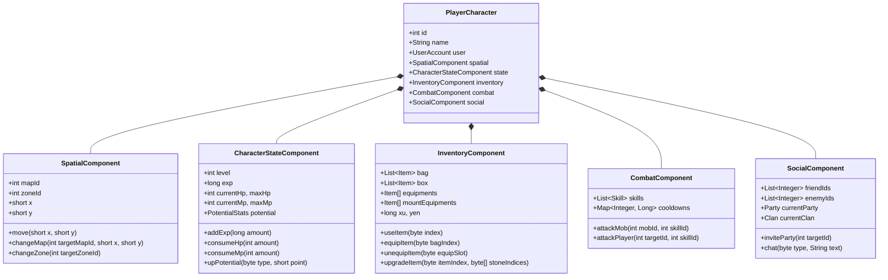

# ĐẶC TẢ CHI TIẾT 5 TẬP HỢP VAI TRÒ CỐT LÕI (5 COHESIVE SETS)
## HIỆN THỰC HÓA TIÊU CHUẨN: "DÙNG GÌ GỌI NẤY — GOM NHÓM THEO VAI TRÒ"
**Dự án:** NSO Game Server Modernization  
**Mục tiêu:** Định nghĩa chi tiết ranh giới dữ liệu, trách nhiệm duy nhất (SRP), các phương thức và khế ước tương tác của 5 Tập Hợp Vai Trò được bóc tách từ `Char.java`.

---

## 1. TỔNG QUAN KIẾN TRÚC THỰC THỂ (PLAYER AGGREGATE ROOT)

Thay vì để `PlayerCharacter` chứa 25.000 dòng code và 173 biến thành viên, `PlayerCharacter` chỉ đóng vai trò là **Aggregate Root / Facade Context** kết nối 5 Component chuyên trách:



---

## 2. CHI TIẾT TỪNG TẬP HỢP VAI TRÒ

### TẬP HỢP 1: `SpatialComponent` (Không gian, Vị trí & Tầm nhìn)

* **Vai trò duy nhất:** Quản lý tọa độ, sự hiện diện không gian, kiểm tra va chạm địa hình và đồng bộ người chơi xung quanh.
* **Tập dữ liệu quản lý:**
  * `mapId`: ID bản đồ hiện tại.
  * `zoneId`: ID khu vực hiện tại trong map.
  * `x, y`: Tọa độ pixel hiện tại.
  * `lastMoveAt`: Thời điểm gói tin di chuyển gần nhất (dùng chống hack speed/teleport).
* **Quy tắc "Dùng gì gọi nấy":**
  * Hàm `move(short x, short y)`: Chỉ cập nhật tọa độ trong RAM và phát gói tin tọa độ cho những người chơi khác trong cùng Zone. Không đụng chạm đến túi đồ hay máu.
  * Khi rời Zone: Hủy đăng ký (unregister) khỏi Zone cũ.
  * Khi vào Zone: Đăng ký (register) vào Zone mới và lấy danh sách người chơi/quái xung quanh.

---

### TẬP HỢP 2: `CharacterStateComponent` (Sinh mệnh, Cấp độ & Tiềm năng)

* **Vai trò duy nhất:** Quản lý vòng đời sinh tồn (HP, MP), tiến trình lên cấp (EXP) và 4 chỉ số tiềm năng gốc.
* **Tập dữ liệu quản lý:**
  * `level`: Cấp độ (1 -> 130).
  * `exp`: Điểm kinh nghiệm hiện tại.
  * `hp, maxHp`: Sinh lực hiện tại và tối đa.
  * `mp, maxMp`: Nội lực hiện tại và tối đa.
  * `potentialStr, potentialAgi, potentialVit, potentialSpi`: 4 chỉ số điểm tiềm năng.
  * `potentialPoints`: Điểm tiềm năng chưa cộng.
  * `skillPoints`: Điểm kỹ năng chưa cộng.
* **Quy tắc "Dùng gì gọi nấy":**
  * `addExp(long amount)`: Cộng dồn exp. Nếu vượt mốc bảng `EXPS` $\to$ Kích hoạt sự kiện `PlayerLevelUpEvent`.
  * `consumeHp(int amount)`: Trừ máu. Nếu $HP \le 0 \to$ Chuyển trạng thái `isDead = true` và bắn sự kiện `PlayerDiedEvent`.
  * Tuyệt đối không tự mở kết nối SQL ghi xuống đĩa khi đang tính trừ máu.

---

### TẬP HỢP 3: `InventoryComponent` (Toàn bộ Đồ đạc, Tài sản & Cường hóa)

* **Vai trò duy nhất:** Quản lý toàn bộ danh mục vật phẩm người chơi sở hữu và các thao tác biến đổi đồ đạc.
* **Tập dữ liệu quản lý:**
  * `bag`: Danh sách vật phẩm trong hành trang (mặc định 30 ô).
  * `box`: Danh sách vật phẩm trong rương đồ.
  * `equipments`: Mảng 10 ô trang bị đang mặc trên người.
  * `mountEquipments`: Mảng trang bị thú cưỡi.
  * `xu, yen`: Tiền tệ sở hữu.
* **Quy tắc "Dùng gì gọi nấy":**
  * `equipItem(byte bagIndex)`:
    1. Kiểm tra điều kiện mặc (class, level, giới tính).
    2. Hoán đổi vị trí giữa `bag[bagIndex]` và `equipments[targetSlot]`.
    3. Trả về kết quả: `EquipResult(success, equippedItem, unequippedItem)`.
    4. Yêu cầu `CharacterStateComponent` tính toán lại `maxHp, maxMp, dame` dựa trên bộ chỉ số mới.
  * `consumeItem(byte bagIndex)`: Trừ số lượng vật phẩm. Nếu số lượng = 0 thì xóa ô đó khỏi bag.

---

### TẬP HỢP 4: `CombatComponent` (Chiến đấu, Kỹ năng & Sát thương)

* **Vai trò duy nhất:** Quản lý cây kỹ năng, thời gian hồi chiêu (Cooldown) và kích hoạt bộ máy tính sát thương.
* **Tập dữ liệu quản lý:**
  * `skills`: Danh sách kỹ năng nhân vật đã học.
  * `cooldownTracker`: Bản đồ lưu trữ thời gian hồi chiêu của từng skill (`Map<Integer, Long>`).
  * `pkFlag`: Cờ PK hiện tại (Cờ trắng, đen, đỏ, xanh...).
* **Tương tác với `NewDamageEngine`:**
  * Khi tấn công mục tiêu: Gom chỉ số tấn công của người chơi kết hợp với chỉ số phòng thủ của đối phương.
  * Đưa vào `DamagePipeline` để tính ra số sát thương thực tế.
  * Trả về `CombatResult(hit, crit, damage, effects)`.

---

### TẬP HỢP 5: `SocialComponent` (Giao tiếp, Đội ngũ & Bang hội)

* **Vai trò duy nhất:** Quản lý danh sách quan hệ giữa người chơi và điều phối tương tác xã hội.
* **Tập dữ liệu quản lý:**
  * `friendIds`: Danh sách ID bạn bè.
  * `enemyIds`: Danh sách ID kẻ thù.
  * `party`: Tham chiếu tới tổ đội hiện tại (nếu có).
  * `clan`: Tham chiếu tới gia tộc hiện tại (nếu có).
* **Quy tắc:** Độc lập hoàn toàn với túi đồ và tọa độ. Việc chat hay kết bạn không được phép can thiệp vào luồng chiến đấu.

---

## 3. TƯƠNG TÁC GIỮA CÁC TẬP HỢP: MÔ HÌNH DOMAIN EVENT BUS

Để 5 tập hợp trên **không bị phụ thuộc chéo (Circular Dependency)**, chúng giao tiếp với nhau thông qua **Domain Event**:

```
[ InventoryComponent ] 
         │ (Người chơi cắn bình máu)
         ▼ Bắn sự kiện
[ PlayerHealedEvent(playerId, healAmount) ]
         │
         ▼
[ CharacterStateComponent ] ──> Nhận sự kiện: Cộng thêm HP vào thanh máu.
```

Nhờ mô hình này, `InventoryComponent` không cần phải gọi trực tiếp `CharacterStateComponent.setHp()`, giúp hai module độc lập tuyệt đối.

