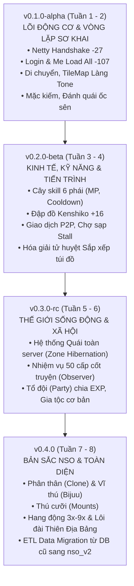

# CHIẾN LƯỢC CỤC BỘ MILESTONE & ƯỚC LƯỢNG PHIÊN BẢN (VERSIONING ROADMAP)
## LỘ TRÌNH TÁI CẤU TRÚC THEO CHUẨN SEMANTIC VERSIONING CHO DỰ ÁN LEGACY REWORK
**Dự án:** NSO Game Server Modernization  
**Mục tiêu:** Thiết lập chiến lược phát hành từng phân đoạn (Localized Milestones) có thể chạy độc lập 100%, định lượng phạm vi và tiêu chí nghiệm thu (Definition of Done) cho từng mốc phiên bản từ `v0.1.0` đến `v1.0.0`.

---

## 1. TẠI SAO CHIẾN LƯỢC NÀY ĐẶC BIỆT HỢP LÝ VỚI DỰ ÁN REWORK?

* **Với một dự án làm mới từ đầu (Newbuild / Greenfield):** Việc ước lượng phiên bản rất dễ vô lý vì bạn chưa biết game design sẽ đi về đâu, tài nguyên đồ họa chưa có, luật chơi còn thay đổi liên tục.
* **Với dự án Tái cấu trúc Di sản (Legacy Rework / Modernization):** Chiến lược này **hoàn toàn hợp lý và khả thi 100%** vì:
  1. **Đích đến đã biết trước 100%:** Định dạng packet, dữ liệu quái vật, danh mục vật phẩm, bản đồ đều đã có sẵn trong legacy code.
  2. **Tài nguyên Client đã đóng băng:** File JAR client là cố định, khế ước giao tiếp không thay đổi.
  3. **Không có rủi ro "bị phụ thuộc lơ lửng":** Mỗi Milestone là một phiên bản game thu nhỏ (Mini-NSO) tự đứng vững, có thể biên dịch, chạy thử, quay demo và đưa lên Portfolio ngay lập tức.

---

## 2. QUY CHUẨN ĐÁNH PHIÊN BẢN (SEMANTIC VERSIONING)

Áp dụng chuẩn `v0.MAJOR_MILESTONE.PATCH`:
* `v0.1.0`: Milestone 1 — Lõi Động cơ & Vòng lặp Cơ bản (Alpha).
* `v0.2.0`: Milestone 2 — Kinh tế, Kỹ năng & Cường hóa (Beta).
* `v0.3.0`: Milestone 3 — Xã hội, Hệ sinh thái Quái & Nhiệm vụ (Release Candidate).
* `v0.4.0`: Milestone 4 — Tính năng Đặc thù NSO & LiveOps.
* `v1.0.0`: Production Ready — Hoàn tất chuyển đổi dữ liệu và thay thế hoàn toàn server cũ.

---

## 3. BẢNG CHI TIẾT 4 MILESTONE CỤC BỘ

---

### MILESTONE 1: `v0.1.0-alpha` — LÕI ĐỘNG CƠ & VÒNG LẶP SƠ KHAI (VERTICAL SLICE)
* **Thời gian ước lượng:** Tuần 1 - 2.
* **Mục tiêu cục bộ:** Chứng minh toàn bộ kiến trúc (Netty $\to$ Domain Component $\to$ MariaDB V2) đã thông suốt.
* **Phạm vi tính năng:**
  1. Bắt tay trao đổi khóa mã hóa nhị phân (`CMD -27`).
  2. Nạp metadata game tĩnh từ MariaDB V2 (`CMD -122, -121`).
  3. Đăng nhập tài khoản bằng BCrypt, hiển thị danh sách nhân vật (`CMD -127, 2`).
  4. Chọn nhân vật vào map Làng Tone (`CMD -107 Me Load All`), di chuyển va chạm TileMap mượt mà.
  5. Hai client cùng online nhìn thấy nhau di chuyển và chat kênh Làng được với nhau.
  6. Mở túi đồ nạp từ bảng `character_items`, bấm mặc 1 thanh kiếm $\to$ Đổi sprite, nhảy số sát thương.
  7. Đánh 1 con quái Ốc sên bằng chiêu đánh thường $\to$ `NewDamageEngine` tính dame, nảy số, quái chết rơi đồ nhặt được vào túi.
  8. **Công cụ hỗ trợ Dev:** Tích hợp 2 lệnh chat GM đơn giản: `/item [id]` và `/level [lv]` để tiện test tính năng.
* **Tiêu chuẩn Hoàn thành (Definition of Done - DoD):**
  * Biên dịch sạch bằng Maven không có warning/error.
  * Bật 2 file client JAR kết nối vào port `14445` chơi mượt mà chuỗi 7 hành động trên.
  * Đóng gói Git Tag: `v0.1.0-alpha`, quay được video demo 2 phút nạp vào Portfolio.

---

### MILESTONE 2: `v0.2.0-beta` — KINH TẾ, KỸ NĂNG & TIẾN TRÌNH NHÂN VẬT
* **Thời gian ước lượng:** Tuần 3 - 4.
* **Mục tiêu cục bộ:** Mở rộng vòng lặp RPG: Học kỹ năng, phát triển trang bị và lưu thông tài sản.
* **Phạm vi tính năng:**
  1. Cây kỹ năng 6 phái: Gọi chiêu thức tốn MP, đếm cooldown chuẩn, hiệu ứng buff/debuff.
  2. Hệ thống Cường hóa đập đồ Kenshiko: Đập đá cấp 1-12 từ +1 đến +16, hiển thị hào quang phát sáng tương ứng (+8, +12, +14, +16).
  3. Giao dịch P2P giữa 2 người chơi: Trao đổi Xu và Vật phẩm trong Database Transaction an toàn, chống dup đồ.
  4. Mở sạp hàng (Stall) bán đồ tự động tại Làng Tone.
  5. Kích hoạt cơ chế sắp xếp túi đồ 100% trên RAM (hóa giải tử huyệt Deadlock).
* **Tiêu chuẩn Hoàn thành (DoD):**
  * 2 người chơi có thể giao dịch đồ an toàn cho nhau.
  * Đập vũ khí lên +16 phát sáng lửa cầu vồng rực rỡ trên màn hình client.
  * Đóng gói Git Tag: `v0.2.0-beta`.

---

### MILESTONE 3: `v0.3.0-rc` — THẾ GIỚI SỐNG ĐỘNG, NHIỆM VỤ & XÃ HỘI
* **Thời gian ước lượng:** Tuần 5 - 6.
* **Mục tiêu cục bộ:** Kế thừa toàn bộ hệ sinh thái thế giới và cộng đồng người chơi.
* **Phạm vi tính năng:**
  1. Kế thừa toàn bộ dữ liệu quái vật và tọa độ spawn trên tất cả các map.
  2. Kích hoạt kỹ thuật **Zone Hibernation** (ngủ đông các khu vực không có người chơi, tiết kiệm 90% CPU).
  3. Kế thừa chuỗi Nhiệm vụ cốt truyện 50 cấp độ kết hợp **Observer Pattern**.
  4. Hệ thống Tổ đội (Party): Mời đội, chia sẻ exp trong cùng khu.
  5. Hệ thống Gia tộc (Clan) cơ bản: Tạo bang, quỹ bang, cống hiến xu.
* **Tiêu chuẩn Hoàn thành (DoD):**
  * Server vận hành được toàn bộ hệ thống map và quái dã ngoại mà CPU máy chủ vẫn dưới 5%.
  * Người chơi nhận và trả được chuỗi nhiệm vụ sư môn từ level 1 đến 50.
  * Đóng gói Git Tag: `v0.3.0-rc`.

---

### MILESTONE 4: `v0.4.0` — BẢN SẮC NSO & TOÀN DIỆN DI SẢN
* **Thời gian ước lượng:** Tuần 7 - 8.
* **Mục tiêu cục bộ:** Đưa các tính năng độc quyền của NSO vào hoạt động và sẵn sàng thay thế server cũ.
* **Phạm vi tính năng:**
  1. Cơ chế Phân thân (Clone Ninja) và thức tỉnh Vĩ thú (Bijuu).
  2. Hệ thống Thú cưỡi (Sói, Ngựa, Xe máy).
  3. Phó bản Hang động 3x đến 9x và Đấu trường Thiên Địa Bảng.
  4. Hệ thống Sự kiện mùa (Tết, Noel) đọc từ cấu hình JSON Data-driven.
  5. Chạy kịch bản **ETL Migration** chuyển đổi toàn bộ tài khoản từ database cũ sang `nso_v2`.
* **Tiêu chuẩn Hoàn thành (DoD):**
  * Đạt trạng thái **Production Ready (`v1.0.0`)**.
  * Chuyển đổi cổng vận hành từ `14445` sang cổng chính thức `14444`. Server cũ hoàn thành sứ mệnh lịch sử và nghỉ hưu.

