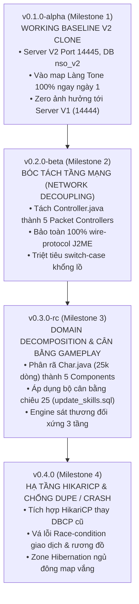

# CHIẾN LƯỢC CỤC BỘ MILESTONE & ƯỚC LƯỢNG PHIÊN BẢN (VERSIONING ROADMAP)
## LỘ TRÌNH TIẾN HÓA KIẾN TRÚC V2 (STRANGLER FIG REFACTOR TRÊN NỀN BẢN CLONE)
**Dự án:** NSO Game Server Modernization  
**Mục tiêu:** Thiết lập lộ trình phát hành từng phân đoạn (Localized Milestones) có thể chạy và chơi được độc lập 100% trên Server V2 (Port `14445`, DB `nso_v2`), tuyệt đối bảo vệ an toàn cho Server Gốc V1 (Port `14444`).

---

## 1. TẠI SAO CHIẾN LƯỢC TIẾN HÓA TRÊN BẢN CLONE LÀ TỐI ƯU NHẤT?

* **Cách tiếp cận cũ (Greenfield Rewrite từ số 0):** Bị chặn đứng bởi "Hộp đen Client J2ME" do client nuốt lỗi ngầm và phụ thuộc hơn 20–30 gói tin ngầm định (`itemInfo`, `sendZone`, `effAuto`, `thoiTrang`...). Viết mới từ đầu dẫn đến việc mất 80% thời gian chỉ để đoán mò từng byte socket.
* **Cách tiếp cận mới (Evolutionary Refactor trên bản Clone V2):** 
  1. **Chơi được 100% ngay ngày đầu tiên:** Bản clone V2 kế thừa nguyên vẹn khả năng vào map, di chuyển, đánh quái mượt mà của V1.
  2. **Vòng lặp phản hồi cực nhanh:** Sửa controller nào, test ngay controller đó trên port 14445 bằng client thật.
  3. **Zero Risk đối với Server Gốc:** Server V1 trên port 14444 không bao giờ bị ảnh hưởng hay gián đoạn.
  4. **Kiến trúc đích đến vẫn đạt chuẩn Senior Clean Architecture:** Mã nguồn được bóc tách theo đúng 5 Cohesive Sets, HikariCP, chống dupe và cân bằng combat mới.

---

## 2. QUY CHUẨN ĐÁNH PHIÊN BẢN (SEMANTIC VERSIONING)

Áp dụng chuẩn `v0.MAJOR_MILESTONE.PATCH` trên nhánh phát triển V2:
* `v0.1.0-alpha`: Milestone 1 — Thiết lập Working Baseline V2 Clone (Port 14445, DB `nso_v2`).
* `v0.2.0-beta`: Milestone 2 — Bóc tách Tầng mạng (Controller Decoupling $\to$ 5 Packet Controllers).
* `v0.3.0-rc`: Milestone 3 — Tái cấu trúc Domain (`Char.java` $\to$ 5 Components) & Cân bằng Kỹ năng 25.
* `v0.4.0`: Milestone 4 — Hạ tầng HikariCP, Phòng chống Dupe đồ & Tối ưu Zone Hibernation.
* `v1.0.0`: Production Ready — Bản V2 hoàn thiện toàn diện, vượt trội về hiệu năng và sạch sẽ kiến trúc.

---

## 3. BẢNG CHI TIẾT 4 MILESTONE TIẾN HÓA TRÊN BẢN CLONE V2

---

### MILESTONE 1: `v0.1.0-alpha` — THIẾT LẬP WORKING BASELINE V2 CLONE (PORT 14445)
* **Mục tiêu:** Tạo dựng môi trường Sandbox V2 độc lập, chạy thông suốt 100% các tính năng của game mà không chạm vào Server Gốc V1.
* **Phạm vi triển khai:**
  1. Nhân bản cấu hình và cơ sở dữ liệu `nso_test` sang `nso_v2`.
  2. Cấu hình cổng độc lập: Game Socket `14445`, Embedded HTTP Bridge `8081`, RMI `10001`.
  3. Tạo tài khoản thử nghiệm V2: `admin / admin123`, nhân vật `admin_v2` tại Làng Tone.
  4. Sử dụng client trỏ cổng `14445` kết nối và kiểm chứng luồng vào game.
* **Tiêu chuẩn Hoàn thành (Definition of Done - DoD):**
  * Server V2 khởi động nạp đủ 179/179 map, không xung đột port với Server V1.
  * Đăng nhập client vào thẳng Làng Tone (Map 22), di chuyển mượt mà, thấy quái và NPC, đánh thử chiêu thức thành công 100%.
  * Server V1 trên port 14444 hoàn toàn nguyên vẹn, không gián đoạn.

---

### MILESTONE 2: `v0.2.0-beta` — BÓC TÁCH TẦNG MẠNG (CONTROLLER DECOUPLING)
* **Mục tiêu:** Phá vỡ God Controller, phân rã luồng xử lý packet theo 5 Tập Hợp Vai Trò mà giữ nguyên 100% wire-protocol.
* **Phạm vi triển khai:**
  1. `AuthPacketController`: Xử lý bắt tay login, chọn/tạo nhân vật, mã bảo vệ.
  2. `SpatialPacketController`: Xử lý di chuyển, chuyển map, đổi khu, nạp template.
  3. `CombatPacketController`: Xử lý đánh quái, đánh người, PK, hồi sinh, tăng điểm tiềm năng/kỹ năng.
  4. `InventoryPacketController`: Xử lý túi đồ, rương, mua bán NPC, vứt/nhặt đồ, nâng cấp trang bị, vĩ thú.
  5. `SocialPacketController`: Xử lý chat các kênh, gia tộc (clan), tổ đội (party), giao dịch, bạn bè.
  6. `Controller.java` thu gọn thành Facade Router gọn nhẹ (~180 dòng).
* **Tiêu chuẩn Hoàn thành (DoD):**
  * Maven compile sạch với `BUILD SUCCESS`.
  * Deploy lên Server V2 port 14445: Di chuyển, chat, tung chiêu, nhặt đồ và đổi map mượt mà, không gặp bất kỳ lỗi byte stream nào.

---

### MILESTONE 3: `v0.3.0-rc` — DOMAIN DECOMPOSITION (`CHAR.JAVA`) & CÂN BẰNG GAMEPLAY
* **Mục tiêu:** "Giải phẫu" God Class `Char.java` (~25.000 dòng) theo Component Pattern và tích hợp bộ cân bằng chỉ số/kỹ năng mới.
* **Phạm vi triển khai:**
  1. Phân rã `Char.java` thành 5 Component cốt lõi:
     * `SpatialComponent`: Quản lý tọa độ `(x, y)`, `mapId`, `zoneId`.
     * `CharacterStateComponent`: Cấp độ, kinh nghiệm, HP, MP, trạng thái sống/chết.
     * `CombatComponent`: Chỉ số công/thủ/kháng, tính dame đối xứng.
     * `InventoryComponent`: Túi, rương, trang bị.
     * `SocialComponent`: Quan hệ xã hội, tổ đội, bang hội.
  2. Áp dụng kịch bản cân bằng Kỹ năng 25 của 6 phái ([`update_skills.sql`](file:///e:/TT/SETUP_LOCAL/SRC_GAME/update_skills.sql)) trên `nso_v2`.
  3. Tích hợp công thức tính sát thương đối xứng 3 tầng và Single-roll xác suất triệt tiêu bug bất tử (`docs/rework/09, 10`).
* **Tiêu chuẩn Hoàn thành (DoD):**
  * `Char.java` giảm phụ thuộc trực tiếp, hoạt động thông qua các component.
  * Kỹ năng 25 của 6 phái thi triển chuẩn xác, hiển thị đúng mô tả và debuff (giảm công, giảm kháng) trên quái/người.

---

### MILESTONE 4: `v0.4.0` — HẠ TẦNG HIKARICP, CHỐNG DUPE & ZONE HIBERNATION
* **Mục tiêu:** Đưa server đạt chuẩn chịu tải cao, triệt tiêu các lỗi kinh điển của game private và tối ưu tài nguyên máy chủ.
* **Phạm vi triển khai:**
  1. Thay thế DBCP bằng **HikariCP** (kết nối nhanh, leak detection tự động).
  2. Vá lỗi Race-condition dupe đồ tại giao dịch P2P, rương đồ và hòm thư bằng Transaction Lock 2 chiều.
  3. Kích hoạt **Zone Hibernation** (ngủ đông các khu vực không có người chơi), giảm 80-90% CPU máy chủ.
  4. Dọn dẹp các bảng rác nạp thẻ/CMS không sử dụng trên database `nso_v2`.
* **Tiêu chuẩn Hoàn thành (DoD):**
  * Thử nghiệm đồng thời nhiều session giao dịch và thao tác rương đồ không xảy ra duplicate item hay deadlock.
  * Tải CPU trên VM của Server V2 ở mức tối ưu.
  * Đạt tiêu chuẩn **`v1.0.0` Production Ready**.
