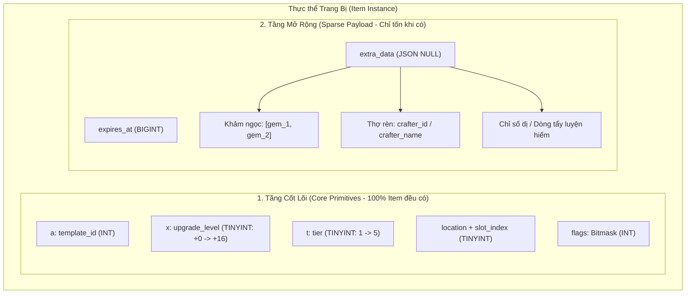
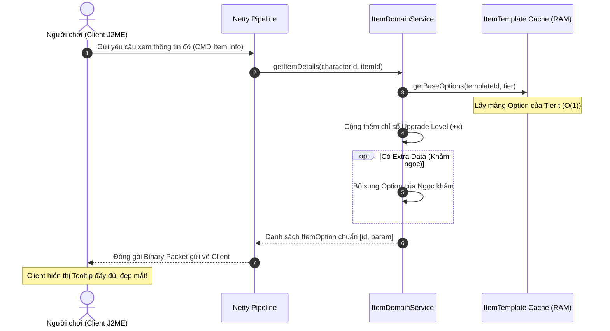

# THIẾT KẾ HỆ THỐNG TRANG BỊ 5 TIER VÀ NỘI SUY CHỈ SỐ RỜI RẠC {a; x; t; ...}
## DISCRETE QUANTIZATION & EXTENSIBLE ITEM TUPLE SPECIFICATION

**Dự án:** NSO Game Server Modernization (V2)  
**Phiên bản tài liệu:** v1.0.0  
**Tác giả ý tưởng:** Product Owner / Lead Architect  
**Trạng thái:** `[ĐÃ DUYỆT - ACCEPTED]`

---

## 1. BỐI CẢNH & ĐỘNG LỰC THIẾT KẾ (RATIONALE)

### 1.1. "Tử huyệt" của phiên bản gốc (Legacy Anti-Pattern)
Trong phiên bản NSO gốc của Teamobi và các source lậu kế thừa:
* Khi quái rơi trang bị hoặc người chơi rèn đồ, hệ thống bốc ngẫu nhiên liên tục một con số trong khoảng $[min, max]$ cho từng dòng thuộc tính (ví dụ: Tấn công $100 \to 120$, HP $200 \to 250$).
* **Hậu quả kỹ thuật:** 
  1. Mỗi món trang bị trong hành trang người chơi đều có một bộ chỉ số độc nhất vô nhị không ai giống ai.
  2. Database buộc phải lưu chuỗi JSON hoặc Text dài ngoằng cho từng món đồ: `options_json = '[{"id":0,"param":112},{"id":1,"param":54},{"id":8,"param":10}]'`.
  3. Với hàng triệu món trang bị rác của hàng vạn người chơi, Database bị phình to (DB Bloat), phân mảnh bảng dữ liệu, và tiêu tốn chu kỳ CPU khổng lồ để serialize/deserialize chuỗi mỗi khi người chơi đăng nhập/đăng xuất.

### 1.2. Đột phá kiến trúc: Rời rạc hóa chỉ số (Discrete Quantization)
Thay vì ngẫu nhiên vô hạn số điểm, ta **rời rạc hóa (quantize)** không gian trạng thái chỉ số thành **5 phẩm chất (Tier A1 $\to$ A5)**:
* **Tier 1 (A1 - Phổ thông):** Mốc chỉ số thấp nhất ($min$).
* **Tier 2 (A2 - Tinh luyện):** Mốc $min + 25\% \times \Delta$.
* **Tier 3 (A3 - Thượng phẩm):** Mốc trung vị chuẩn ($min + 50\% \times \Delta$).
* **Tier 4 (A4 - Siêu cấp):** Mốc $min + 75\% \times \Delta$.
* **Tier 5 (A5 - Hoàn mỹ):** Mốc chỉ số cao nhất kịch trần ($max$).

> **Ý nghĩa:**
> * Về mặt Database: Triệt tiêu 100% việc lưu chuỗi JSON cho đồ cơ bản. Chỉ cần lưu đúng 1 byte số nguyên `tier` (1 đến 5).
> * Về mặt Gameplay: Giữ trọn vẹn cảm giác "săn đồ max opt" (săn đồ A5 Hoàn Mỹ) và bảo tồn kinh tế giao dịch phân cấp, đồng thời giúp người chơi dễ dàng nhận biết giá trị món đồ hơn bản gốc.

---

## 2. BỘ TRẠNG THÁI MỞ RỘNG `{a; x; t; ...}` (CORE + SPARSE PAYLOAD)

Thiết kế không gò bó cứng nhắc vào 3 tham số, mà tuân thủ nguyên lý: **Core Primitives (Cốt lõi Cố định) + Sparse Extensible Payload (Dữ liệu Thưa Mở Rộng)**.



### 2.1. Tầng Cốt lõi (Core Primitives)
Các trường mang tính định danh và thuộc tính nền tảng, 100% item đều có, được lưu bằng các kiểu dữ liệu số nguyên nguyên thủy (`INT`, `TINYINT`):
* `a` (*template_id*): Mã định danh mẫu vật phẩm trong bảng `item_templates`.
* `x` (*upgrade_level*): Cấp cường hóa từ $+0 \to +16$.
* `t` (*tier*): Phẩm chất đồ từ $1 \to 5$ (A1 đến A5).
* `flags` (*Bitmask*): Tích hợp toàn bộ cờ logic vào đúng 1 biến số nguyên 4-byte:
  * `0x01`: Đã khóa giao dịch (`is_bound`).
  * `0x02`: Đã giám định phẩm chất (`is_identified`).
  * `0x04`: Vật phẩm sự kiện (`is_event`).
  * `0x08`: Đã phong ấn bảo hiểm (`is_sealed`).

### 2.2. Tầng Mở rộng (Sparse Extensible Payload)
Những thuộc tính chỉ phát sinh ở trang bị cao cấp/đặc biệt:
* `expires_at`: Thời gian hết hạn tính bằng mili-giây (`-1` = Vĩnh viễn).
* `extra_data`: Cột `JSON` có giá trị mặc định là `NULL`. Trong MariaDB InnoDB, một cột mang giá trị `NULL` hoàn toàn **không tốn dung lượng đĩa**. Chỉ khi người chơi khảm ngọc hoặc rèn tên thì mới ghi dữ liệu vào đây.

---

## 3. THUẬT TOÁN NỘI SUY TUYẾN TÍNH 5 MỐC (LINEAR INTERPOLATION)

### 3.1. Công thức Toán học
Với một dòng chỉ số có khoảng biến thiên $[min, max]$ trong cấu hình gốc:
* Khoảng biến thiên: $\Delta = max - min$.
* Số khoảng chia đều: $N - 1 = 5 - 1 = 4$ bước nhảy.
* Độ dài bước nhảy: $step = \frac{max - min}{4}$.

Giá trị tại Tier $t$ ($t \in [1, 5]$) được làm tròn số nguyên gần nhất:

$$\text{Value}(t) = \text{round}\left( min + (max - min) \times \frac{t - 1}{4} \right)$$

### 3.2. Xử lý các trường hợp biên (Edge Cases)
1. **Chỉ số cố định ($min == max$):**
   * Ví dụ: *Hút HP 5%* hoặc *Tốc độ di chuyển +10*.
   * $\Delta = 0 \implies \text{Value}(t) = min$ cho mọi $t \in [1, 5]$.
2. **Khoảng biến thiên hẹp ($\Delta < 4$):**
   * Ví dụ: Chí mạng từ $2\% \to 5\%$ ($\Delta = 3, step = 0.75$).
   * $t=1 \implies 2$
   * $t=2 \implies \text{round}(2.75) = 3$
   * $t=3 \implies \text{round}(3.50) = 4$
   * $t=4 \implies \text{round}(4.25) = 4$
   * $t=5 \implies 5$
   * *Kết quả:* $[2, 3, 4, 4, 5]$ — dãy đơn điệu tăng, tự nhiên, không bao giờ vượt trần $max$.
3. **Chỉ số âm (Penalties / Debuff):**
   * Công thức đại số giữ nguyên tính đúng đắn trên trục số thực.

### 3.3. Mã nguồn triển khai chuẩn (Java)

```java
package com.nsoz.v2.domain.item.calculator;

public final class ItemStatCalculator {

    private ItemStatCalculator() {}

    /**
     * Nội suy giá trị thuộc tính cho Tier t (1 -> 5)
     */
    public static int calculate(int min, int max, byte tier) {
        if (tier <= 1) return min;
        if (tier >= 5) return max;
        if (min == max) return min;

        double step = (double) (max - min) / 4.0;
        return (int) Math.round(min + (tier - 1) * step);
    }
}
```

---

## 4. CHIẾN LƯỢC BỘ NHỚ FLYWEIGHT (IN-MEMORY CACHING & BOOTSTRAP)

### 4.1. Quy trình Khởi động Server (Server Bootstrap)
* Khi khởi động Server: Toàn bộ bảng `item_templates` và `item_option_templates` từ DB chỉ lưu chỉ số gốc $[min, max]$.
* Server đọc dữ liệu lên RAM và **tự động sinh sẵn 5 bộ Options cho 5 Tier**:

```java
public class ItemTemplate {
    private final int id;
    private final String name;
    private final byte type;
    
    // Mảng cố định 5 phần tử đại diện cho Tier 1 -> Tier 5
    // Đã được tính toán sẵn ngay lúc Server khởi động!
    private final ItemTierConfig[] tiers = new ItemTierConfig[5];

    public List<ItemOption> getBaseOptions(byte tier) {
        int index = Math.max(0, Math.min(4, tier - 1));
        return this.tiers[index].getOptions();
    }
}
```

### 4.2. Chi phí Biên (Marginal Cost)
* **Thời gian tính toán:** Toàn bộ ~800 trang bị được tính toán nội suy trong vòng chưa đầy **$20\text{ ms}$** lúc bật server.
* **Thời gian truy xuất lúc chạy (Runtime Latency):** **$O(1)$** (Truy cập mảng trực tiếp bằng index `tier - 1`).
* **Cấp phát bộ nhớ Heap:** **$0\text{ bytes}$** cấp phát thêm khi có người chơi nhặt đồ hay mở túi đồ (Zero Allocation).

---

## 5. PHÂN PHỐI XÁC SUẤT RƠI (WEIGHTED DROP RATES)

Để giữ giá trị kinh tế cho các món đồ cực phẩm, xác suất rơi ra các Tier **không chia đều 20%** mà tuân theo phân phối trọng số hình chuông (Bell-Curve Weighted Distribution):

| Phẩm chất (Tier) | Tên gọi hiển thị | Chỉ số | Tỷ lệ Rơi Quái Thường | Tỷ lệ Rơi Boss / Tinh Anh | Tỷ lệ Rèn Làng Kojin |
| :---: | :---: | :---: | :---: | :---: | :---: |
| **Tier 1** | Phổ thông | $min$ | **40%** | 10% | 5% |
| **Tier 2** | Tinh luyện | Mốc 2 | **35%** | 25% | 20% |
| **Tier 3** | Thượng phẩm | Trung vị | **18%** | **40%** | **45%** |
| **Tier 4** | Siêu cấp | Mốc 4 | **6%** | **20%** | **25%** |
| **Tier 5** | Hoàn mỹ | $max$ | **1%** | **5%** | **5%** |

> [!IMPORTANT]
> Đồ **Tier 5 (Hoàn mỹ)** là "Jackpot" của game: Chỉ số đạt trần tối đa. Người chơi nhặt được hoặc rèn được đồ Tier 5 sẽ có giá trị giao dịch rất cao trên thị trường chợ đen.

---

## 6. LƯỢC ĐỒ DATABASE V2 (`character_items`)

```sql
CREATE TABLE `character_items` (
    `id` BIGINT UNSIGNED NOT NULL AUTO_INCREMENT,
    `character_id` INT UNSIGNED NOT NULL,
    `template_id` INT UNSIGNED NOT NULL,          -- [a]
    `upgrade_level` TINYINT UNSIGNED NOT NULL DEFAULT 0, -- [x] (0 -> 16)
    `tier` TINYINT UNSIGNED NOT NULL DEFAULT 3,     -- [t] (1 -> 5, mặc định A3)
    `location` ENUM('BAG', 'BOX', 'EQUIP', 'MOUNT', 'FASHION') NOT NULL,
    `slot_index` SMALLINT NOT NULL,
    `quantity` INT NOT NULL DEFAULT 1,
    `sys` TINYINT NOT NULL DEFAULT 0,             -- Hệ nguyên tố (1: Hỏa, 2: Băng, 3: Phong)
    `flags` INT UNSIGNED NOT NULL DEFAULT 0,      -- Bitmask: Khóa, Giám định, Sự kiện...
    `expires_at` BIGINT NOT NULL DEFAULT -1,      -- -1: Vĩnh viễn, hoặc timestamp ms
    `extra_data` JSON DEFAULT NULL,               -- SPARSE PAYLOAD: gems, crafter_name...
    
    PRIMARY KEY (`id`),
    CONSTRAINT `fk_item_char` FOREIGN KEY (`character_id`) REFERENCES `characters` (`id`) ON DELETE CASCADE,
    INDEX `idx_char_loc_slot` (`character_id`, `location`, `slot_index`)
) ENGINE=InnoDB DEFAULT CHARSET=utf8mb4 COLLATE=utf8mb4_unicode_ci;
```

---

## 7. ADAPTER TƯƠNG THÍCH CLIENT J2ME (PACKET ADAPTER)

Client J2ME không cần biết cơ chế lưu trữ nội bộ `{a; x; t; ...}` hay 5 Tier của Server V2. Nó chỉ mong đợi gói tin nhị phân chuẩn mang danh sách options để vẽ lên giao diện:



---

## 8. TỔNG KẾT SO SÁNH GIỮA HAI THẾ HỆ

| Tiêu chí | Server V1 (Legacy) | Server V2 (Hệ thống 5 Tier `{a; x; t; ...}`) |
| :--- | :--- | :--- |
| **Cơ chế chỉ số** | Random điểm liên tục ($100, 101, \dots, 120$) | Rời rạc hóa thành 5 phẩm chất chuẩn ($A1 \to A5$) |
| **Lưu trữ Database** | Chuỗi JSON/Text khổng lồ cho từng item | **Số nguyên nguyên thủy** (`tier TINYINT`, 1 byte) |
| **Dung lượng 1 dòng item** | $\sim 150 - 200\text{ bytes}$ | $\mathbf{\sim 25 - 30\text{ bytes}}$ (Giảm 6 lần) |
| **Tốc độ đọc khi đăng nhập** | Chậm (Tốn CPU parse hàng trăm chuỗi JSON) | **Siêu tốc** (Đọc số nguyên thuần, trỏ thẳng RAM Cache) |
| **Bảo trì / Cân bằng game** | Ác mộng (Sửa 1 dòng phải update hàng vạn bản ghi) | **1 nốt nhạc** (Sửa hệ số trong file config, reboot server) |
| **Tâm lý người chơi** | Khó đánh giá giá trị món đồ | **Trực quan tuyệt đối** (Nhặt được A5 là biết ngay hàng cực phẩm) |
| **Khả năng mở rộng** | Bị khóa chặt trong cấu trúc cũ | **Vô hạn** (Nhờ tầng Sparse Payload `extra_data` + `flags`) |

