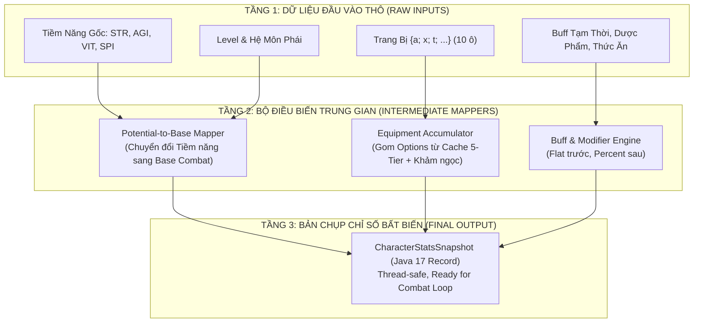

# THIẾT KẾ ENGINE TÍNH TOÁN CHỈ SỐ VÀ CÂN BẰNG COMBAT
## 3-LAYER STAT PIPELINE, STAT SQUISH & LEVEL SCALING MITIGATION

**Dự án:** NSO Game Server Modernization (V2)  
**Phiên bản tài liệu:** v1.0.0  
**Tác giả ý tưởng:** Product Owner / Lead Architect  
**Trạng thái:** `[ĐÃ DUYỆT - ACCEPTED]`

---

## 1. TỔNG QUAN & TRIẾT LÝ THIẾT KẾ

Tài liệu này chuẩn hóa toàn bộ kiến trúc tính toán thuộc tính nhân vật và cơ chế cân bằng giao tranh (Combat Engine) cho Server V2.

### 1.1. Triết lý Thiết kế Cốt lõi
1. **"Hàm thuần túy, Triệt tiêu Tác dụng phụ" (Pure Functions & No Side-Effects):**
   * Module tính toán chỉ số chỉ nhận nguyên liệu đầu vào và trả ra kết quả. Tuyệt đối không tự ý ghi Database, không can thiệp luồng mạng, và không tự biến đổi trạng thái bên ngoài.
2. **"Bất biến & An toàn luồng Tuyệt đối" (Immutable Snapshots):**
   * Mọi chỉ số chiến đấu được đóng gói trong một **Java 17 `record`** bất biến. Luồng Combat Loop trong Zone đọc snapshot này với tốc độ tối đa mà không cần bất kỳ cơ chế khóa luồng (`synchronized` / `Lock`) nào.
3. **"Dùng Cơ Chế Thông Minh Thay Vì Bơm Số Ảo" (Mechanics Over Inflation):**
   * Triệt tiêu căn bệnh lạm phát chỉ số (hàng tỷ máu, hàng triệu sát thương).
   * Khống chế tập số trần (Stat Squish) kết hợp với **Lớp lọc thiên lệch trình độ ($\Delta L$)** và **Hàm tăng trưởng kiểm soát đạo hàm ($f'(x) > 0$)**.

---

## 2. ĐƯỜNG ỐNG TÍNH TOÁN 3 TẦNG (THE 3-LAYER STAT PIPELINE)



### 2.1. Tầng 1: Dữ Liệu Đầu Vào Thô (Raw Inputs)
* **Bộ tứ Tiềm năng (Core Potentials):** Sức mạnh (STR), Thân pháp (AGI), Thể lực (VIT), Chakra (SPI).
* **Đặc tính Môn phái:** Hệ ngũ hành (Hỏa - Băng - Phong), Tốc độ chạy gốc ($100\text{ px/s}$).
* **Trang bị:** Danh sách 10 món đồ trên người theo mô hình `{a; x; t; ...}`.
* **Hiệu ứng:** Danh sách Buff/Debuff đang có hiệu lực.

### 2.2. Tầng 2: Bộ Điều Biến Trung Gian (Intermediate Mappers)
* **Chuyển đổi Tiềm năng $\to$ Chỉ số cơ sở:**
  * Đao / Kiếm (Cận chiến): $1\text{ STR} \to +2.5\text{ Sát thương}$; $1\text{ VIT} \to +10\text{ HP}$.
  * Tiêu / Kunai / Cung (Tầm xa): $1\text{ SPI} \to +2.0\text{ Sát thương}$; $1\text{ AGI} \to +1.5\text{ Né} + 1.0\text{ CX}$.
  * Quạt (Phép / Hỗ trợ): $1\text{ SPI} \to +2.8\text{ Sát thương}$; $1\text{ SPI} \to +10\text{ MP}$.
* **Quy tắc Gom Chỉ Số Chuẩn Quốc Tế:**
  $$\text{Final\_Stat} = \left( \text{Base} + \sum \text{Flat\_Bonus} \right) \times \left( 1 + \sum \text{Percent\_Multiplier} \right)$$
  *(Cộng dồn điểm cố định Flat trước, sau đó mới nhân tỷ lệ phần trăm Percent để chống lạm phát).*

### 2.3. Tầng 3: Bản Chụp Chỉ Số Bất Biến (`CharacterStatsSnapshot`)

```java
public record CharacterStatsSnapshot(
    // 1. Sinh tồn (EHP & Defense)
    int maxHp,
    int maxMp,
    int physicalDefense,
    int damageDown,         // Giảm trừ sát thương (Flat - trừ thẳng điểm)
    double damageTakenMultiplier, // Hệ số nhận sát thương sau Phép Nhân Miễn Thương (%)
    int critResistance,     // [MỚI] Kháng chí mạng (Trừ thẳng vào điểm bạo kích đối phương)
    int critDamageReductionPercent, // [MỚI] Giảm sát thương chí mạng phải gánh chịu (%)
    int resFire,
    int resIce,
    int resWind,

    // 2. Tấn công (Offense)
    int minDamage,
    int maxDamage,
    int criticalRate,       // Tỷ lệ chí mạng (%)
    int criticalDamageMult, // Sát thương chí mạng (% chuẩn 200%)
    int damageAmplifyPercent, // Vận công / Tăng thương (%)

    // 3. Cơ động & Độ chuẩn (Agility & Precision)
    int accuracy,           // Chính xác
    int evasion,            // Né đòn
    int moveSpeed,          // Tốc độ di chuyển (px/s)
    int attackSpeedBonus,   // % Giảm trễ ra đòn

    // 4. Bổ trợ & Hồi phục (Utility)
    int hpLeechPercent,     // Hút máu (%)
    int mpLeechPercent,     // Hút MP (%)
    int hpOnHit,            // Hồi HP khi đánh (On-hit Flat)
    int mpOnHit,            // Hồi MP khi đánh (On-hit Flat)
    int reactDamagePercent  // Phản đòn cận chiến (%)
) {}
```

* **Cơ chế Tái tính toán Lười (Lazy Recomputation):** Server **không** tính lại chỉ số mỗi tick. Snapshot chỉ được tạo mới khi có 3 sự kiện kích hoạt:
  1. Thay đổi trang bị (Tháo / Mặc / Đổi đồ).
  2. Tăng cấp độ hoặc cộng điểm tiềm năng / kỹ năng.
  3. Có Buff mới tác động hoặc Buff cũ hết hạn.

---

## 3. TỪ ĐIỂN 34 CHỈ SỐ CHIẾN ĐẤU CHUẨN HÓA V2

Thay vì 150 ID trùng lặp hỗn loạn của bản cũ, V2 tinh giản toàn bộ hệ thống về đúng **34 Chỉ số cốt lõi (ID 0 -> 33)** có cấu trúc đối xứng hoàn hảo giữa Công và Thủ:

### 3.1. Danh Sách 34 Chỉ Số Chuẩn Hóa
* **0: Tấn công** (Cộng điểm sát thương cơ bản, tự động ánh xạ hiển thị Hỏa công / Băng sát / Phong lôi theo hệ)
* **1: Sát thương chuẩn** (Sát thương xuyên thấu, bỏ qua hoàn toàn giáp, kháng tính và giảm trừ sát thương)
* **2: Vận công %** (Khuếch đại tổng lực sát thương đầu ra theo phần trăm - Tăng thương %)
* **3: Chính xác** (Tăng điểm đánh trúng, khắc chế né tránh)
* **4: Né đòn** (Tăng điểm né hoàn toàn đòn tấn công)
* **5: Chí mạng** (Tăng tỷ lệ nổ đòn đánh bạo kích)
* **6: Sát thương chí mạng %** (Tăng thêm sát thương khi nổ chí mạng vượt mốc 200%)
* **7: Giảm trừ sát thương** (Trừ thẳng điểm sát thương nhận vào từ mọi nguồn - Flat)
* **8: HP tối đa** (Cộng trực tiếp điểm máu tối đa)
* **9: HP tối đa %** (Khuếch đại tổng lượng máu theo phần trăm)
* **10: MP tối đa** (Cộng trực tiếp điểm chakra tối đa)
* **11: MP tối đa %** (Khuếch đại tổng lượng chakra theo phần trăm)
* **12: Kháng Hỏa** (Giảm sát thương phải nhận từ hệ Hỏa)
* **13: Kháng Băng** (Giảm sát thương phải nhận từ hệ Băng)
* **14: Kháng Phong** (Giảm sát thương phải nhận từ hệ Phong)
* **15: Kháng tất cả** (Cộng điểm cứng cho cả 3 kháng Hỏa, Băng, Phong)
* **16: Kháng tất cả %** (Khuếch đại % giảm sát thương từ mọi hệ nguyên tố)
* **17: Phản đòn cận chiến** (Phản lại một phần sát thương cho kẻ tấn công tầm gần)
* **18: Xuyên kháng** (Trừ thẳng một lượng điểm kháng và giáp của mục tiêu)
* **19: Xuyên kháng %** (Bỏ qua phần trăm kháng và giáp của mục tiêu)
* **20: Hồi HP on-hit** (Hồi một lượng máu cố định mỗi khi đánh trúng mục tiêu)
* **21: Hút HP khi đánh %** (Hồi máu theo phần trăm sát thương thực tế gây ra)
* **22: Hồi MP on-hit** (Hồi một lượng chakra cố định mỗi khi đánh trúng mục tiêu)
* **23: Hút MP khi đánh %** (Hồi chakra theo phần trăm sát thương thực tế gây ra)
* **24: Phục hồi HP mỗi 5 giây** (Tự động hồi phục máu định kỳ)
* **25: Phục hồi MP mỗi 5 giây** (Tự động hồi phục chakra định kỳ)
* **26: Tốc độ di chuyển** (Tăng vận tốc chạy của nhân vật trên bản đồ)
* **27: Giảm thời gian Bỏng %** (Rút ngắn thời gian bị dính hiệu ứng thiêu đốt)
* **28: Giảm thời gian Đóng Băng %** (Rút ngắn thời gian bị bất động và làm chậm)
* **29: Giảm thời gian Choáng %** (Rút ngắn thời gian bị vô hiệu hóa chiêu thức)
* **30: Tăng kinh nghiệm đánh quái %** (Tăng lượng EXP nhận được khi tiêu diệt quái)
* **31: Kháng chí mạng [MỚI]** (Điểm cứng đối trọng với ID 5, trừ thẳng vào điểm Chí Mạng của kẻ tấn công: $NetCrit = Fatal - CritRes$)
* **32: Giảm sát thương chí mạng % [MỚI]** (Giảm % sát thương bạo kích phải gánh chịu, đối trọng trực tiếp với ID 6)
* **33: Miễn thương % [MỚI]** (Giảm % tổng sát thương cuối cùng nhận vào từ mọi nguồn)

---

### 3.2. CƠ CHẾ MIỄN THƯƠNG NHÂN TÍCH (MULTIPLICATIVE DAMAGE REDUCTION)

> [!IMPORTANT]
> **Quy tắc Vàng của Engine:** Miễn thương (%) từ các nguồn khác nhau (Trang bị, Kỹ năng bị động, Dược phẩm buff) **TUYỆT ĐỐI KHÔNG CỘNG DỒN TUYẾN TÍNH ($\sum r_i$)**, mà bắt buộc phải tính theo **PHÉP NHÂN TÍCH LŨY TIỆM CẬN (Multiplicative Stacking)**.

#### 1. Công thức Toán học:
Gọi $r_1, r_2, \dots, r_n$ là tỷ lệ miễn thương từ $n$ nguồn khác nhau:

$$\text{Damage Multiplier} = \prod_{i=1}^{n} (1 - r_i) = (1 - r_1) \times (1 - r_2) \times \dots \times (1 - r_n)$$

$$\text{Tổng Miễn Thương Thực Tế} = 1 - \text{Damage Multiplier} = 1 - \prod_{i=1}^{n} (1 - r_i)$$

#### 2. Ví dụ Minh họa Thực tế:
Giả sử người chơi sở hữu:
* Nguồn A (Giáp Thần Thoại): Giảm $10\%$ sát thương ($r_A = 0.10 \implies 1 - 0.10 = 0.90$).
* Nguồn B (Bí Thuật Hộ Thể): Giảm $12\%$ sát thương ($r_B = 0.12 \implies 1 - 0.12 = 0.88$).

Miễn thương sau cùng được tính bằng:
$$\text{Damage Multiplier} = 0.90 \times 0.88 = 0.792$$
$$\text{Miễn Thương Thực Tế} = 1 - 0.792 = \mathbf{20.8\%}$$
*(Hoàn toàn khác với phép cộng dồn tuyến tính $10\% + 12\% = 22\%$).*

#### 3. Tại sao cơ chế này là sống còn cho Game Balance?
* **Triệt tiêu Bug Bất Tử 100%:** Nếu dùng phép cộng, người chơi chỉ cần mặc 5 món đồ giảm $20\%$ là đạt $100\%$ Miễn thương $\implies$ Bất tử vô địch, mọi đòn đánh đều gây 0 sát thương.
* **Quy luật Hiệu suất Giảm Dần (Diminishing Returns):** Với phép nhân, dù người chơi có mặc 10 món đồ giảm $20\%$, hệ số nhận sát thương vẫn là $0.80^{10} \approx 0.107$ (tức giảm $89.3\%$, vẫn nhận $10.7\%$ sát thương). Không bao giờ có người chơi nào có thể đạt $100\%$ miễn thương.
* **Bảo toàn Giá Trị Cho Sát Thương Chuẩn (True Damage):** Sát thương chuẩn (`ID 1`) đi xuyên qua toàn bộ hệ số `Damage Multiplier` này, bảo đảm luôn có khắc chế cứng với các tanker "siêu trâu".

#### 4. Đoạn Mã Triển Khai Trong Engine:
```java
package com.nsoz.v2.domain.combat.engine;

public final class DamageReductionCalculator {

    /**
     * Tính toán hệ số nhân sát thương từ danh sách các nguồn miễn thương
     * @param reductionRates Mảng các tỷ lệ giảm thương (ví dụ: [0.10, 0.12])
     * @return Hệ số sát thương thực tế phải nhận (ví dụ: 0.792)
     */
    public static double calculateDamageMultiplier(double... reductionRates) {
        double multiplier = 1.0;
        for (double rate : reductionRates) {
            multiplier *= Math.max(0.0, 1.0 - rate);
        }
        return multiplier; // Sát thương nhận = Sát thương gốc * multiplier
    }
}
```

---

### 3.3. CƠ CHẾ XUYÊN KHÁNG % NHÂN TÍCH (MULTIPLICATIVE PENETRATION)

> [!IMPORTANT]
> Tương tự như Miễn Thương, **Xuyên Kháng % (`ID 19`) bắt buộc phải tính theo Phép Nhân Tích Lũy**, tuyệt đối không cộng dồn tuyến tính để tránh thảm họa xóa sạch $100\%$ Kháng của mục tiêu.

#### 1. Công thức Toán học:
Gọi $p_1, p_2, \dots, p_n$ là tỷ lệ xuyên kháng từ $n$ nguồn khác nhau:

$$\text{Hệ Số Kháng Còn Lại} = \prod_{i=1}^{n} (1 - p_i) = (1 - p_1) \times (1 - p_2) \times \dots \times (1 - p_n)$$

$$\text{Tổng Xuyên Kháng Thực Tế} = 1 - \prod_{i=1}^{n} (1 - p_i)$$

*Ví dụ:* Nguồn A xuyên $30\%$, Nguồn B xuyên $25\%$:
$$\text{Kháng còn lại} = (1 - 0.30) \times (1 - 0.25) = 0.70 \times 0.75 = 0.525 \implies \mathbf{52.5\%}$$
$$\text{Xuyên Kháng thực tế} = 1 - 0.525 = \mathbf{47.5\%} \quad (\text{thay vì } 30\% + 25\% = 55\%)$$

#### 2. Thứ tự Trừ Kháng Phối Hợp:
Engine thực hiện theo nguyên tắc **"Xuyên % trước (trị Tanker), Trừ Điểm Flat sau (trị Máu Giấy)"**:

$$\text{Kháng Cuối} = \max\left(0,\; \left[ \text{Kháng Gốc} \times \prod_{i=1}^{n} (1 - p_i) \right] - \text{Xuyên Kháng Điểm} \right)$$

---

### 3.4. ĐẶC TẢ BỘ BA HIỆU ỨNG PHÁI & CƠ CHẾ CỘNG DỒN TAM TRƯỜNG (TRI-ELEMENT STACKING)

Kế thừa bản sắc của Tam Đại Trường Học (Hirosaki - Haruna - Ookaza), nhưng tái cân bằng theo tư duy thiết kế hiện đại:

#### 1. Cơ Chế 3 Hiệu Ứng Riêng Biệt:
* **HỎA — BỎNG (`ID 5, type 1` - Trường Hirosaki: Kiếm, Tiêu):**
  * *Tần suất:* Trung bình.
  * *Cơ chế:* **Trừ 100% Miễn Thương** của mục tiêu:
    $$\text{Miễn\_Thương\_Sau\_Bỏng} = \text{Miễn\_Thương\_Gốc} - 1.0$$
    Khi miễn thương bị âm, sát thương nhận vào bị khuếch đại: Mục tiêu có 0% miễn thương sẽ nhận **gấp đôi ($+100\%$) sát thương** (bảo tồn trọn vẹn di sản NSO gốc `dameHit += dameBasic`).
  * *Ý nghĩa:* **Vũ khí tối thượng xé nát Tanker / Đồ thủ dày**.
* **BĂNG — ĐÓNG BĂNG / TÊ CÓNG (`ID 6, type 2` - Trường Haruna: Kunai, Quạt):**
  * *Tần suất:* **Cao (Thường xuyên)**.
  * *Cơ chế:* Hạn chế thao tác trung bình khá (Giảm $40\%$ tốc chạy, tăng $50\%$ thời gian trễ ra đòn) VÀ **Chặt đôi $50\%$ Bộ tứ Thân pháp**:
    $$\text{Accuracy} \times 0.5 \quad\Big|\quad \text{Evasion} \times 0.5 \quad\Big|\quad \text{Fatal} \times 0.5 \quad\Big|\quad \text{CritRes} \times 0.5$$
  * *Ý nghĩa:* **Khắc tinh số 1 của Sát thủ / Dân cậy Né đòn & Chí mạng cao**.
* **PHONG — CHOÁNG (`ID 7, type 3` - Trường Ookaza: Đao, Cung):**
  * *Tần suất:* **Thấp (Ít thường xuyên, quý giá)**.
  * *Cơ chế:* **Khóa cứng $100\%$ hành động** (Không thể di chuyển, đánh, dùng chiêu hay cắn bình máu) trong $1.0 - 1.5\text{s}$.
  * *Điểm tinh tế:* **Bảo toàn 100% Chỉ số Phòng ngự**: Người bị choáng vẫn có thể Né đòn nhờ phản xạ bản năng (vẫn tính toán qua Bảng Single-Roll bình thường), Giáp và Kháng giữ nguyên giá trị.
  * *Ý nghĩa:* **Khắc tinh số 1 của Pháp sư / Niệm chiêu dồn combo**.

#### 2. Cơ Chế Cộng Dồn Đồng Thời (Simultaneous 3-Layer Stacking):
1 mục tiêu **HOÀN TOÀN CÓ THỂ bị dính cùng lúc cả 3 tầng hiệu ứng** (Bỏng + Đóng Băng + Choáng):
* **Không Xung Đột Kỹ Thuật:** 3 hiệu ứng tác động lên 3 hệ thống phân lập:
  * *Choáng* can thiệp vào Máy trạng thái thao tác (`Input / State Machine`).
  * *Đóng Băng* can thiệp vào Bộ chỉ số thân pháp (`Precision Stat Multiplier`).
  * *Bỏng* can thiệp vào Tầng tính toán sát thương (`Damage Mitigation Layer`).
* **Combo Tử Thần (Teamwork Wombo Combo):**
  * Khi bị Choáng (không đi lại được) + Đóng Băng (bị bẻ gãy 50% Né và Kháng Bạo Kích) + Bỏng (bị trừ 100% Miễn Thương) $\implies$ Mục tiêu phải chịu đòn đánh gần như chắc chắn trúng, dễ nổ bạo kích và nhận gấp đôi sát thương!
* **Quy Tắc An Toàn (Guardrails):**
  1. *Cùng hệ không cộng dồn (Refresh Timer):* Nhiều đòn đánh cùng hệ Hỏa chỉ làm mới thời gian Bỏng ($3\text{s}$), không trừ lũy tiến thành $-300\%$.
  2. *Bộ đếm thời gian độc lập:* Mỗi hiệu ứng đếm ngược riêng. Choáng hết sau $1.2\text{s}$ thì đối thủ lấy lại quyền điều khiển ngay lập tức, dù lúc đó vẫn đang bị Bỏng và Băng.

---

## 4. ĐẶC TẢ BẢNG THÔNG TIN NHÂN VẬT & GIAO THỨC CLIENT

Dữ liệu gửi về Client khi xem thông tin nhân vật (`CMD.VIEW_INFO` mã 93 và `CMD.ME_LOAD_ALL` mã -127) được gom thành 4 nhóm mạch lạc:

```java
public record CharacterInfoView(
    // 1. Nhận diện & Tiến trình
    int id, String name, byte gender, byte classId, int level, long exp,
    int potentialPoints, int skillPoints, int pkPoints,
    String clanName, byte clanRole, int famePoints, byte dailyTaskCount,

    // 2. Bộ tứ Tiềm năng
    int strength, int agility, int vitality, int spirit,

    // 3. Chỉ số Chiến đấu (Từ CharacterStatsSnapshot)
    int currentHp, int maxHp, int currentMp, int maxMp,
    int damage, int damageDown, int accuracy, int evasion, int fatal,
    int reactDamage, int resFire, int resIce, int resWind, int speed,

    // 4. Tài sản & Kinh tế
    long xu, long yen, int luong
) {}
```
> [!NOTE]
> Bảng DTO này khớp 100% với cấu trúc tuần tự nhị phân của Client J2ME, bảo đảm client nguyên bản không bị lỗi giao diện hay lệch byte gói tin.

---

## 5. CHIẾN LƯỢC GHÌM CƯƠNG CHỈ SỐ (STAT SQUISH & TỐI ƯU PHẦN CỨNG)

### 5.1. Lợi Ích Của Việc Giảm Trần Số
1. **CPU Cache Line Locality (64-byte Alignment):**
   * Chuyển từ `long` (8 bytes) sang `int` (4 bytes) giúp tăng gấp đôi mật độ dữ liệu trong một CPU Cache Line (từ 8 lên 16 phần tử).
   * Giảm tỷ lệ trượt bộ nhớ đệm (Cache Miss) khi duyệt danh sách quái/người chơi.
2. **Triệt tiêu Lỗi Tràn Số Trung Gian (Intermediate Math Overflow):**
   * Nếu Sát thương là $1.5\text{ tỷ}$, biểu thức nhân chí mạng `(damage * 150) / 100` sẽ chạm mốc $225\text{ tỷ} \to$ Lập tức vượt trần signed 32-bit int ($2.14\text{ tỷ}$), gây ra bug máu âm hoặc quái tự hồi đầy máu.
   * Giữ trần số trong khoảng vừa vặn giúp các phép toán nhân chia tỷ lệ an toàn tuyệt đối.
3. **Bảo vệ Tính Tương Thích Hộp Đen Client J2ME:**
   * Client gốc sử dụng `readInt()` (trần 2.14 tỷ). Các server lậu bơm máu boss hàng chục tỷ làm vỡ client, vạch máu nhảy loạn xạ và tràn khung chữ màn hình nhỏ ($240 \times 320$).

### 5.2. Mốc Trần Số Tối Ưu Cho NSO V2

| Chỉ số | Mốc Đề Xuất Cho V2 | Kiểu Dữ Liệu | Hiệu quả |
| :--- | :---: | :---: | :--- |
| **HP Quái Thường** | $40 \to 20,000$ | `int` (4 bytes) | Gọn nhẹ, mượt mà |
| **HP Boss Thế Giới** | $1\text{M} \to 20\text{M}$ | `int` (4 bytes) | Thanh máu Client hiển thị hoàn hảo |
| **Sát thương Nhân vật** | $100 \to 15,000$ | `int` (4 bytes) | Phép tính % chí mạng không tràn số |
| **EXP Tích lũy Cấp 1 $\to$ 130** | $1\text{M} \to 500\text{M}$ | `long` hoặc `int` | Cân bằng nhịp độ cày cuốc chuẩn mực |

### 5.3. Hàm Tính Máu Quái Với Đạo Hàm $f'(x) > 0$ và Kiểm Soát Tốc Độ Tăng

Để máu quái vật tăng liên tục theo cấp độ nhưng không bùng nổ sang hàng triệu, áp dụng hàm lũy thừa kiểm soát số mũ:

$$f(L) = \text{BaseHP} \times L^{1.35} \quad (\text{với } \text{BaseHP} = 40)$$

* **Đạo hàm bậc 1:** $f'(L) = 1.35 \times 40 \times L^{0.35} > 0$ (Đồ thị luôn dốc lên, quái cấp cao luôn nhiều máu hơn).
* **Kiểm soát độ cong:** Số mũ $1.35$ kiềm chế độ dốc, giúp máu quái cấp 100 dừng lại ở mức $\approx 20,000\text{ HP}$ (thay vì $2,000,000\text{ HP}$ như các bản lậu).

---

## 6. LỚP LỌC THIÊN LỆCH TRÌNH ĐỘ (LEVEL SCALING MITIGATION)

Thay vì dùng chỉ số trâu bò để cản người chơi, Game Engine sử dụng **Lớp Lọc Thiên Lệch Trình Độ ($\Delta L$)**.

### 6.1. Công thức Toán học
Gọi $\Delta L = \text{Level}_{\text{Mục tiêu}} - \text{Level}_{\text{Kẻ tấn công}}$:

$$K_{\text{level}} = \begin{cases} 
1.0 & \text{khi } \Delta L \le 3 \text{ (Chênh lệch không đáng kể)} \\
\max\left(0.05,\; 1.0 - (\Delta L - 3) \times 0.08\right) & \text{khi } \Delta L > 3 \text{ (Vượt cấp)} \\
\min\left(1.50,\; 1.0 + |\Delta L| \times 0.03\right) & \text{khi } \Delta L < 0 \text{ (Đánh quái cấp thấp)}
\end{cases}$$

### 6.2. Giá Trị Thực Chiến
* **Khóa Map Tự Nhiên (Soft-Gating):** Người chơi cấp 20 có thể tự do đi sang map quái cấp 60, nhưng bị giảm $95\%$ sát thương và quái đánh 1 hit là gục. Không cần dựng tường ảo hay cấm cổng dịch chuyển.
* **Chặn Đứng Bot Kéo Cấp (Power-Leveling):** Acc clone cấp thấp không thể đi theo acc VIP để hưởng ké EXP map cao.

---

## 7. PHÂN TÍCH NGÂN SÁCH HIỆU NĂNG & TỐI ƯU HÓA CỰC ĐOAN

### 7.1. Đánh Đổi Ngân Sách CPU (Performance Budgeting)
* **Chi phí bỏ ra:** 
  * 1 phép trừ $\Delta L$ (`SUB`: 1 cycle $\approx 0.33\text{ ns}$).
  * 1 phép nhân hệ số (`IMUL`: 3 cycles $\approx 1.0\text{ ns}$).
  * $\to$ **Tổng cộng:** $\approx 1.5 - 2.0\text{ nanoseconds}$ cho mỗi đòn đánh.
* **Quy mô 1,000 CCU:** Tiêu tốn $\approx 0.002\text{ ms}$ mỗi giây ($\mathbf{0.0002\%}$ năng lực của 1 Core CPU — hoàn toàn không đáng kể).
* **Cái được lại:** 
  * Triệt tiêu CPU Cache Miss ngoài RAM (mỗi lần miss tốn $60 \to 100\text{ ns}$).
  * Giữ nguyên vẹn tính ổn định của hệ thống mạng và Client J2ME.

### 7.2. Triệt Tiêu Hoàn Toàn Lệnh Rẽ Nhánh (Zero-Branch Lookup Table)
Để CPU không phải tốn chu kỳ cho Branch Prediction (`if-else`), toàn bộ hệ số $\Delta L$ từ $-100 \to +100$ được đúc sẵn thành mảng trong RAM lúc khởi động:

```java
package com.nsoz.v2.domain.combat.engine;

public final class DamageEngine {

    // Mảng 201 phần tử cache sẵn hệ số từ delta = -100 đến delta = +100
    // Kích thước chỉ 804 bytes, nằm trọn vĩnh viễn trong CPU L1 Data Cache
    private static final float[] LEVEL_FACTORS = new float[201];

    static {
        for (int delta = -100; delta <= 100; delta++) {
            LEVEL_FACTORS[delta + 100] = calculateRawFactor(delta);
        }
    }

    private static float calculateRawFactor(int delta) {
        if (delta <= 3) {
            return (float) Math.min(1.50, 1.0 + Math.max(0, -delta) * 0.03);
        }
        return (float) Math.max(0.05, 1.0 - (delta - 3) * 0.08);
    }

    /**
     * Tính toán sát thương thực tế với độ phức tạp O(1) không rẽ nhánh
     */
    public static int calculateDamage(int rawDamage, int targetDefense, int attackerLevel, int targetLevel) {
        int netDamage = Math.max(1, rawDamage - targetDefense);
        
        int delta = targetLevel - attackerLevel;
        int index = Math.min(200, Math.max(0, delta + 100));

        // 1 phép đọc mảng O(1) + 1 phép nhân (Zero Branch Misprediction)
        return Math.max(1, (int) (netDamage * LEVEL_FACTORS[index]));
    }
}
```

---

## 8. TỔNG KẾT SO SÁNH GIỮA HAI MÔ HÌNH CÂN BẰNG

| Tiêu chí | Mô hình Cũ (Chạy đua Bơm Số Ảo) | Mô hình V2 (Stat Squish + Level Mitigation) |
| :--- | :--- | :--- |
| **Quy mô số liệu** | Máu quái hàng triệu, sát thương hàng trăm ngàn | Máu quái $\le 20,000$, sát thương $\le 15,000$ |
| **Kiểm soát vượt cấp** | Phải tăng máu và giáp quái lên vô tận | Tự động hóa qua Lớp lọc thiên lệch $\Delta L$ |
| **Rủi ro tràn số** | Rất cao khi tính % chí mạng/buff kỹ năng | Bằng **0** (An toàn 100% trong miền số nguyên) |
| **Tương thích Client J2ME** | Dễ crash, vỡ thanh máu, tràn khung chữ | Hiển thị hoàn mỹ trên màn hình $240 \times 320$ |
| **Chi phí bảo trì cân bằng** | Ác mộng (Chỉnh tay hàng ngàn dòng DB) | **Nhàn nhã** (1 công thức toán học bao quát toàn bộ game) |
| **Tải CPU / Bộ nhớ** | Dễ dính L3 Cache Miss | **$O(1)$ Zero-Branch**, dữ liệu gọn trong L1 Cache |

