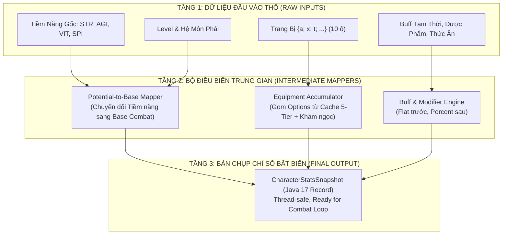

# THIẾT KẾ ENGINE TÍNH TOÁN CHỈ SỐ VÀ CÂN BẰNG COMBAT
## 3-LAYER STAT PIPELINE, STAT SQUISH & LEVEL SCALING MITIGATION

**Dự án:** NSO Game Server Modernization (V2)  
**Phiên bản tài liệu:** v1.0.0  
**Tác giả ý tưởng:** Product Owner / Lead Architect  
**Trạng thái:** `[ĐÃ DUYỆT - ACCEPTED]`

---

## 1. TỔNG QUAN & TRIẾT LÝ THIẾT KẾ

Tài liệu này chuẩn hóa toàn bộ kiến trúc tính toán thuộc tính nhân vật và cơ chế cân bằng giao tranh (Combat Engine) cho Server V2.

### 1.1. Triết lý Thiết kế Cốt lõi
1. **"Hàm thuần túy, Triệt tiêu Tác dụng phụ" (Pure Functions & No Side-Effects):**
   * Module tính toán chỉ số chỉ nhận nguyên liệu đầu vào và trả ra kết quả. Tuyệt đối không tự ý ghi Database, không can thiệp luồng mạng, và không tự biến đổi trạng thái bên ngoài.
2. **"Bất biến & An toàn luồng Tuyệt đối" (Immutable Snapshots):**
   * Mọi chỉ số chiến đấu được đóng gói trong một **Java 17 `record`** bất biến. Luồng Combat Loop trong Zone đọc snapshot này với tốc độ tối đa mà không cần bất kỳ cơ chế khóa luồng (`synchronized` / `Lock`) nào.
3. **"Dùng Cơ Chế Thông Minh Thay Vì Bơm Số Ảo" (Mechanics Over Inflation):**
   * Triệt tiêu căn bệnh lạm phát chỉ số (hàng tỷ máu, hàng triệu sát thương).
   * Khống chế tập số trần (Stat Squish) kết hợp với **Lớp lọc thiên lệch trình độ ($\Delta L$)** và **Hàm tăng trưởng kiểm soát đạo hàm ($f'(x) > 0$)**.

---

## 2. ĐƯỜNG ỐNG TÍNH TOÁN 3 TẦNG (THE 3-LAYER STAT PIPELINE)



### 2.1. Tầng 1: Dữ Liệu Đầu Vào Thô (Raw Inputs)
* **Bộ tứ Tiềm năng (Core Potentials):** Sức mạnh (STR), Thân pháp (AGI), Thể lực (VIT), Chakra (SPI).
* **Đặc tính Môn phái:** Hệ ngũ hành (Hỏa - Băng - Phong), Tốc độ chạy gốc ($100\text{ px/s}$).
* **Trang bị:** Danh sách 10 món đồ trên người theo mô hình `{a; x; t; ...}`.
* **Hiệu ứng:** Danh sách Buff/Debuff đang có hiệu lực.

### 2.2. Tầng 2: Bộ Điều Biến Trung Gian (Intermediate Mappers)
* **Chuyển đổi Tiềm năng $\to$ Chỉ số cơ sở:**
  * Đao / Kiếm (Cận chiến): $1\text{ STR} \to +2.5\text{ Sát thương}$; $1\text{ VIT} \to +10\text{ HP}$.
  * Tiêu / Kunai / Cung (Tầm xa): $1\text{ SPI} \to +2.0\text{ Sát thương}$; $1\text{ AGI} \to +1.5\text{ Né} + 1.0\text{ CX}$.
  * Quạt (Phép / Hỗ trợ): $1\text{ SPI} \to +2.8\text{ Sát thương}$; $1\text{ SPI} \to +10\text{ MP}$.
* **Quy tắc Gom Chỉ Số Chuẩn Quốc Tế:**
  $$\text{Final\_Stat} = \left( \text{Base} + \sum \text{Flat\_Bonus} \right) \times \left( 1 + \sum \text{Percent\_Multiplier} \right)$$
  *(Cộng dồn điểm cố định Flat trước, sau đó mới nhân tỷ lệ phần trăm Percent để chống lạm phát).*

### 2.3. Tầng 3: Bản Chụp Chỉ Số Bất Biến (`CharacterStatsSnapshot`)

```java
public record CharacterStatsSnapshot(
    // 1. Sinh tồn (EHP)
    int maxHp,
    int maxMp,
    int physicalDefense,
    int resFire,
    int resIce,
    int resWind,

    // 2. Tấn công
    int minDamage,
    int maxDamage,
    int criticalRate,       // Tỷ lệ chí mạng (%)
    int criticalDamageMult, // Sát thương chí mạng (% chuẩn 200%)

    // 3. Cơ động & Độ chuẩn
    int accuracy,           // Chính xác
    int evasion,            // Né đòn
    int moveSpeed,          // Tốc độ di chuyển (px/s)
    int attackSpeedBonus,   // % Giảm trễ ra đòn

    // 4. Bổ trợ
    int hpLeechPercent,     // Hút máu (%)
    int mpLeechPercent,     // Hút MP (%)
    int reactDamagePercent  // Phản đòn cận chiến (%)
) {}
```

* **Cơ chế Tái tính toán Lười (Lazy Recomputation):** Server **không** tính lại chỉ số mỗi tick. Snapshot chỉ được tạo mới khi có 3 sự kiện kích hoạt:
  1. Thay đổi trang bị (Tháo / Mặc / Đổi đồ).
  2. Tăng cấp độ hoặc cộng điểm tiềm năng / kỹ năng.
  3. Có Buff mới tác động hoặc Buff cũ hết hạn.

---

## 3. ĐẶC TẢ BẢNG THÔNG TIN NHÂN VẬT & GIAO THỨC CLIENT

Dữ liệu gửi về Client khi xem thông tin nhân vật (`CMD.VIEW_INFO` mã 93 và `CMD.ME_LOAD_ALL` mã -127) được gom thành 4 nhóm mạch lạc:

```java
public record CharacterInfoView(
    // 1. Nhận diện & Tiến trình
    int id, String name, byte gender, byte classId, int level, long exp,
    int potentialPoints, int skillPoints, int pkPoints,
    String clanName, byte clanRole, int famePoints, byte dailyTaskCount,

    // 2. Bộ tứ Tiềm năng
    int strength, int agility, int vitality, int spirit,

    // 3. Chỉ số Chiến đấu (Từ CharacterStatsSnapshot)
    int currentHp, int maxHp, int currentMp, int maxMp,
    int damage, int damageDown, int accuracy, int evasion, int fatal,
    int reactDamage, int resFire, int resIce, int resWind, int speed,

    // 4. Tài sản & Kinh tế
    long xu, long yen, int luong
) {}
```
> [!NOTE]
> Bảng DTO này khớp 100% với cấu trúc tuần tự nhị phân của Client J2ME, bảo đảm client nguyên bản không bị lỗi giao diện hay lệch byte gói tin.

---

## 4. CHIẾN LƯỢC GHÌM CƯƠNG CHỈ SỐ (STAT SQUISH & TỐI ƯU PHẦN CỨNG)

### 4.1. Lợi Ích Của Việc Giảm Trần Số
1. **CPU Cache Line Locality (64-byte Alignment):**
   * Chuyển từ `long` (8 bytes) sang `int` (4 bytes) giúp tăng gấp đôi mật độ dữ liệu trong một CPU Cache Line (từ 8 lên 16 phần tử).
   * Giảm tỷ lệ trượt bộ nhớ đệm (Cache Miss) khi duyệt danh sách quái/người chơi.
2. **Triệt tiêu Lỗi Tràn Số Trung Gian (Intermediate Math Overflow):**
   * Nếu Sát thương là $1.5\text{ tỷ}$, biểu thức nhân chí mạng `(damage * 150) / 100` sẽ chạm mốc $225\text{ tỷ} \to$ Lập tức vượt trần signed 32-bit int ($2.14\text{ tỷ}$), gây ra bug máu âm hoặc quái tự hồi đầy máu.
   * Giữ trần số trong khoảng vừa vặn giúp các phép toán nhân chia tỷ lệ an toàn tuyệt đối.
3. **Bảo vệ Tính Tương Thích Hộp Đen Client J2ME:**
   * Client gốc sử dụng `readInt()` (trần 2.14 tỷ). Các server lậu bơm máu boss hàng chục tỷ làm vỡ client, vạch máu nhảy loạn xạ và tràn khung chữ màn hình nhỏ ($240 \times 320$).

### 4.2. Mốc Trần Số Tối Ưu Cho NSO V2

| Chỉ số | Mốc Đề Xuất Cho V2 | Kiểu Dữ Liệu | Hiệu quả |
| :--- | :---: | :---: | :--- |
| **HP Quái Thường** | $40 \to 20,000$ | `int` (4 bytes) | Gọn nhẹ, mượt mà |
| **HP Boss Thế Giới** | $1\text{M} \to 20\text{M}$ | `int` (4 bytes) | Thanh máu Client hiển thị hoàn hảo |
| **Sát thương Nhân vật** | $100 \to 15,000$ | `int` (4 bytes) | Phép tính % chí mạng không tràn số |
| **EXP Tích lũy Cấp 1 $\to$ 130** | $1\text{M} \to 500\text{M}$ | `long` hoặc `int` | Cân bằng nhịp độ cày cuốc chuẩn mực |

### 4.3. Hàm Tính Máu Quái Với Đạo Hàm $f'(x) > 0$ và Kiểm Soát Tốc Độ Tăng

Để máu quái vật tăng liên tục theo cấp độ nhưng không bùng nổ sang hàng triệu, áp dụng hàm lũy thừa kiểm soát số mũ:

$$f(L) = \text{BaseHP} \times L^{1.35} \quad (\text{với } \text{BaseHP} = 40)$$

* **Đạo hàm bậc 1:** $f'(L) = 1.35 \times 40 \times L^{0.35} > 0$ (Đồ thị luôn dốc lên, quái cấp cao luôn nhiều máu hơn).
* **Kiểm soát độ cong:** Số mũ $1.35$ kiềm chế độ dốc, giúp máu quái cấp 100 dừng lại ở mức $\approx 20,000\text{ HP}$ (thay vì $2,000,000\text{ HP}$ như các bản lậu).

---

## 5. LỚP LỌC THIÊN LỆCH TRÌNH ĐỘ (LEVEL SCALING MITIGATION)

Thay vì dùng chỉ số trâu bò để cản người chơi, Game Engine sử dụng **Lớp Lọc Thiên Lệch Trình Độ ($\Delta L$)**.

### 5.1. Công thức Toán học
Gọi $\Delta L = \text{Level}_{\text{Mục tiêu}} - \text{Level}_{\text{Kẻ tấn công}}$:

$$K_{\text{level}} = \begin{cases} 
1.0 & \text{khi } \Delta L \le 3 \text{ (Chênh lệch không đáng kể)} \\
\max\left(0.05,\; 1.0 - (\Delta L - 3) \times 0.08\right) & \text{khi } \Delta L > 3 \text{ (Vượt cấp)} \\
\min\left(1.50,\; 1.0 + |\Delta L| \times 0.03\right) & \text{khi } \Delta L < 0 \text{ (Đánh quái cấp thấp)}
\end{cases}$$

### 5.2. Giá Trị Thực Chiến
* **Khóa Map Tự Nhiên (Soft-Gating):** Người chơi cấp 20 có thể tự do đi sang map quái cấp 60, nhưng bị giảm $95\%$ sát thương và quái đánh 1 hit là gục. Không cần dựng tường ảo hay cấm cổng dịch chuyển.
* **Chặn Đứng Bot Kéo Cấp (Power-Leveling):** Acc clone cấp thấp không thể đi theo acc VIP để hưởng ké EXP map cao.

---

## 6. PHÂN TÍCH NGÂN SÁCH HIỆU NĂNG & TỐI ƯU HÓA CỰC ĐOAN

### 6.1. Đánh Đổi Ngân Sách CPU (Performance Budgeting)
* **Chi phí bỏ ra:** 
  * 1 phép trừ $\Delta L$ (`SUB`: 1 cycle $\approx 0.33\text{ ns}$).
  * 1 phép nhân hệ số (`IMUL`: 3 cycles $\approx 1.0\text{ ns}$).
  * $\to$ **Tổng cộng:** $\approx 1.5 - 2.0\text{ nanoseconds}$ cho mỗi đòn đánh.
* **Quy mô 1,000 CCU:** Tiêu tốn $\approx 0.002\text{ ms}$ mỗi giây ($\mathbf{0.0002\%}$ năng lực của 1 Core CPU — hoàn toàn không đáng kể).
* **Cái được lại:** 
  * Triệt tiêu CPU Cache Miss ngoài RAM (mỗi lần miss tốn $60 \to 100\text{ ns}$).
  * Giữ nguyên vẹn tính ổn định của hệ thống mạng và Client J2ME.

### 6.2. Triệt Tiêu Hoàn Toàn Lệnh Rẽ Nhánh (Zero-Branch Lookup Table)
Để CPU không phải tốn chu kỳ cho Branch Prediction (`if-else`), toàn bộ hệ số $\Delta L$ từ $-100 \to +100$ được đúc sẵn thành mảng trong RAM lúc khởi động:

```java
package com.nsoz.v2.domain.combat.engine;

public final class DamageEngine {

    // Mảng 201 phần tử cache sẵn hệ số từ delta = -100 đến delta = +100
    // Kích thước chỉ 804 bytes, nằm trọn vĩnh viễn trong CPU L1 Data Cache
    private static final float[] LEVEL_FACTORS = new float[201];

    static {
        for (int delta = -100; delta <= 100; delta++) {
            LEVEL_FACTORS[delta + 100] = calculateRawFactor(delta);
        }
    }

    private static float calculateRawFactor(int delta) {
        if (delta <= 3) {
            return (float) Math.min(1.50, 1.0 + Math.max(0, -delta) * 0.03);
        }
        return (float) Math.max(0.05, 1.0 - (delta - 3) * 0.08);
    }

    /**
     * Tính toán sát thương thực tế với độ phức tạp O(1) không rẽ nhánh
     */
    public static int calculateDamage(int rawDamage, int targetDefense, int attackerLevel, int targetLevel) {
        int netDamage = Math.max(1, rawDamage - targetDefense);
        
        int delta = targetLevel - attackerLevel;
        int index = Math.min(200, Math.max(0, delta + 100));

        // 1 phép đọc mảng O(1) + 1 phép nhân (Zero Branch Misprediction)
        return Math.max(1, (int) (netDamage * LEVEL_FACTORS[index]));
    }
}
```

---

## 7. TỔNG KẾT SO SÁNH GIỮA HAI MÔ HÌNH CÂN BẰNG

| Tiêu chí | Mô hình Cũ (Chạy đua Bơm Số Ảo) | Mô hình V2 (Stat Squish + Level Mitigation) |
| :--- | :--- | :--- |
| **Quy mô số liệu** | Máu quái hàng triệu, sát thương hàng trăm ngàn | Máu quái $\le 20,000$, sát thương $\le 15,000$ |
| **Kiểm soát vượt cấp** | Phải tăng máu và giáp quái lên vô tận | Tự động hóa qua Lớp lọc thiên lệch $\Delta L$ |
| **Rủi ro tràn số** | Rất cao khi tính % chí mạng/buff kỹ năng | Bằng **0** (An toàn 100% trong miền số nguyên) |
| **Tương thích Client J2ME** | Dễ crash, vỡ thanh máu, tràn khung chữ | Hiển thị hoàn mỹ trên màn hình $240 \times 320$ |
| **Chi phí bảo trì cân bằng** | Ác mộng (Chỉnh tay hàng ngàn dòng DB) | **Nhàn nhã** (1 công thức toán học bao quát toàn bộ game) |
| **Tải CPU / Bộ nhớ** | Dễ dính L3 Cache Miss | **$O(1)$ Zero-Branch**, dữ liệu gọn trong L1 Cache |

