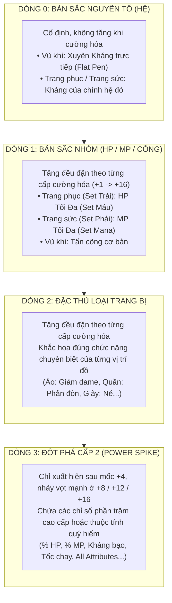

# ĐẶC TẢ HỆ THỐNG TRANG BỊ ĐẶC THÙ, KÍCH ẨN ĐƠN GIẢN & MA TRẬN TIỀM NĂNG 6 PHÁI
## SPEC 11: STREAMLINED EQUIPMENT ARCHITECTURE, THRESHOLD SET BONUSES & CLASS-SPECIFIC POTENTIAL SCALING

**Dự án:** NSO Game Server Modernization (V2)  
**Tác giả ý tưởng:** Product Owner / Lead Architect  
**Trạng thái:** `[BRAINSTORMING & DRAFT SPECIFICATION]`  
**Tài liệu liên kết:** [Spec 08 (5-Tier Equipment)](08_THIET_KE_HE_THONG_TRANG_BI_5_TIER.md), [Spec 09 (Combat Engine & 34 Stats)](09_THIET_KE_ENGINE_CHI_SO_VA_CAN_BANG_COMBAT.md), [Spec 10 (Single-Roll Probability)](10_GIAI_THUAT_XAC_SUAT_SINGLE_ROLL_MULTI_VARIABLE.md)

---

## 1. TỔNG QUAN & TRIẾT LÝ THIẾT KẾ (DESIGN PHILOSOPHY)

### 1.1. Bối cảnh & Những hạn chế của phiên bản gốc (Legacy Issues)
1. **Loạn chỉ số (Stat Bloat):** Trong phiên bản NSO cũ, một chiếc Nón hay chiếc Quần có thể chứa từ 5 đến 7 dòng chỉ số hỗn tạp (Dame, HP, MP, Né, Kháng lộn xộn). Người chơi khó nhận diện vai trò của từng món trang bị.
2. **Kích ẩn chuỗi mắt xích rắc rối:** Bản cũ vận hành kích ẩn theo quan hệ dây chuyền: Nón $\to$ Quần $\to$ Áo $\to$ Giày... Nếu người chơi mặc lệch 1 món đồ thì gãy toàn bộ chuỗi kích ẩn, tạo cảm giác ức chế và triệt tiêu tính sáng tạo khi phối đồ.
3. **Cào bằng tiềm năng giữa các phái:** Tỷ lệ quy đổi từ Tiềm năng sang chỉ số là như nhau giữa các phái ($1\text{ VIT} = 10\text{ HP}$, $1\text{ AGI} = 1.5\text{ Né}$), làm mờ nhạt bản sắc riêng của Đao (Tanker), Kunai (Né tránh), Cung (Chính xác), hay Quạt (Pháp sư).

### 1.2. Mục tiêu Cải cách của Spec 11
* **Tối giản & Định vị rõ ràng:** Giảm số lượng dòng thuộc tính trên mỗi món đồ xuống còn **3 - 4 dòng có cấu trúc tầng rõ rệt**, mỗi món đại diện cho một vai trò chuyên biệt.
* **Kích ẩn theo Số lượng Trang bị Cùng Hệ (Threshold Set Bonus):** Bỏ cơ chế kích mắt xích cũ, chuyển sang đếm số lượng trang bị cùng hệ mang trên người theo các mốc $2 / 3 / 4 / 5$ món.
* **Cơ chế Mỏ Neo Level Nhỏ Nhất:** Chỉ số kháng được kích hoạt sẽ tính toán dựa trên **Cấp độ (Level) của món đồ nhỏ nhất** trong set để chống lạm phát.
* **Ma trận Tiềm năng Đặc thù 6 Phái:** Ánh xạ 4 điểm tiềm năng (STR, AGI, VIT, SPI) theo tỷ lệ riêng biệt, khắc họa rõ nét bản sắc nghề.

---

## 2. KIẾN TRÚC PHÂN TẦNG 4 DÒNG TRANG BỊ

Mọi trang bị trong hệ thống V2 được chuẩn hóa theo cấu trúc **4 Tầng Chỉ Số (Tiered Option Slots)**:



---

## 3. MA TRẬN 10 TRANG BỊ $\times$ 4 DÒNG THUỘC TÍNH

| Phân Nhóm | Vị trí Trang Bị | Dòng 0 (Hệ - Cố định) | Dòng 1 (Nhóm - Tăng đều) | Dòng 2 (Đặc Thù 1 - Tăng đều) | Dòng 3 (Đột Phá +4 - Nhảy vọt) |
| :--- | :--- | :--- | :--- | :--- | :--- |
| **Vũ Khí** | **Vũ Khí** | **Xuyên Kháng (Flat)** | **Tấn Công Cơ Bản** | **Vật Công / Công Phép** | **Chính Xác** *(Trị né đòn)* |
| **Trang Phục**<br>*(Set Trái: Máu & Thủ)* | **Nón / Mũ** | Kháng Hệ | **HP Tối Đa** | Điểm MP | **% MP Tối Đa** |
| | **Áo** | Kháng Hệ | **HP Tối Đa** | Giảm trừ sát thương (`dameDown`)| **Kháng Bạo** *(Crit Resistance)* |
| | **Quần** | Kháng Hệ | **HP Tối Đa** | Phản đòn cận chiến | **% HP Tối Đa** |
| | **Găng Tay** | Kháng Hệ | **HP Tối Đa** | Điểm Chính Xác | **Tỷ Lệ Chí Mạng** |
| | **Giày** | Kháng Hệ | **HP Tối Đa** | Điểm Né Đòn | **Tốc Độ Di Chuyển** |
| **Trang Sức**<br>*(Set Phải: Mana & Tiện ích)*| **Dây Chuyền**| Kháng Hệ | **MP Tối Đa** | Tấn Công (Công phụ) | **Điểm Né Đòn** |
| | **Ngọc Bội** | Kháng Hệ | **MP Tối Đa** | Điểm HP (Máu phụ) | **Hồi Phục HP** *(Mỗi 5s)* |
| | **Nhẫn** | Kháng Hệ | **MP Tối Đa** | Tỷ Lệ Chí Mạng | **% Xuyên Kháng** |
| | **Bùa** | Kháng Hệ | **MP Tối Đa** | Kháng Tất Cả (All Res) | **+Điểm Tiềm Năng (All Stats)** |

---

## 4. CƠ CHẾ KÍCH ẨN THEO SỐ LƯỢNG TRANG BỊ CÙNG HỆ (THRESHOLD SET BONUS)

### 4.1. Nguyên tắc Kích hoạt
* Không áp dụng cho Vũ khí (Vũ khí độc lập, giữ vai trò sát thương chính).
* Chia làm 2 cụm kiểm tra độc lập:
  1. **Cụm Set Trái (Trang phục):** 5 món (Nón, Áo, Quần, Găng, Giày).
  2. **Cụm Set Phải (Trang sức):** 4 món (Dây chuyền, Ngọc bội, Nhẫn, Bùa).
* Đếm số lượng món đồ cùng mang một hệ $Sys \in \{\text{Hỏa, Băng, Phong}\}$ trong cụm:
  * Khi đạt mốc **2 / 3 / 4 / 5** món cùng hệ $\implies$ Mở khóa lượng **Kháng tương ứng của hệ đó**.

### 4.2. Bảng Mốc Kích Hoạt & Cường Độ Kháng

| Mốc Đồ Cùng Hệ | Cấp Độ Kích Hoạt | Cường Độ Kháng Tương Ứng | Ý Nghĩa Chiến Thuật |
| :---: | :---: | :---: | :--- |
| **2 Món** | Mốc 1 | **Ít** ($30\%$ Base Res) | Khởi đầu dễ tiếp cận, kích hoạt ngay khi mặc 2 món cùng hệ. |
| **3 Món** | Mốc 2 | **Vừa** ($60\%$ Base Res) | Ngưỡng trung cấp, kháng đủ dùng khi đi săn quái. |
| **4 Món** | Mốc 3 | **Lớn** ($100\%$ Base Res) | Mốc chuẩn cho người chơi chuyên sâu, tạo lợi thế kháng rõ rệt. |
| **5 Món** | Mốc 4 *(Max Set Trái)* | **Rất Lớn** ($150\%$ Base Res) | **Phần thưởng độc quyền khi mặc trọn bộ Trang phục cùng hệ!** |

### 4.3. Thuật toán Mỏ Neo: "Level Đồ Nhỏ Nhất Trong Set"
Để triệt tiêu tình trạng người chơi dùng 1 món đồ cấp thấp (Level 10) kẹp vào set cấp cao (Level 90) để hưởng lợi:

$$\text{ActiveLevel} = \min_{i \in \text{EquipMatchingSys}} (\text{LevelRequire}(i))$$

$$\text{BonusResistance} = \text{CalculateBaseRes}(\text{ActiveLevel}) \times \text{ThresholdMultiplier}$$

*Ví dụ:* Người chơi mặc 4 món Hỏa:
* Áo Level 90, Quần Level 90, Nón Level 90, Giày Level 50.
* $\text{ActiveLevel} = \min(90, 90, 90, 50) = \mathbf{50}$.
* Người chơi sẽ nhận mốc Kháng Hỏa cấp "Lớn" nhưng dựa trên chỉ số của **Level 50**. Muốn hưởng trọn Kháng Hỏa Level 90, người chơi buộc phải nâng cấp nốt Giày lên Level 90.

---

## 5. MA TRẬN ÁNH XẠ TIỀM NĂNG RIÊNG BIỆT 6 MÔN PHÁI (CLASS-SPECIFIC POTENTIAL SCALING)

Quy tắc thiết kế cân bằng V2:
* **Khác biệt có kiểm soát (Soft-Asymmetry):** Khắc họa bản sắc riêng của từng môn phái nhưng biên độ chênh lệch chỉ kiểm soát ở mức vừa phải (**$\mathbf{15\% \sim 25\%}$** quanh mốc cơ sở), không để xảy ra tình trạng "quá chênh lệch" làm gãy cân bằng PvP/PvE hay khiến phái nào bị "out-meta" triệt để.
* **Chuẩn hóa đối xứng 3 Hệ Nguyên Tố (Mỗi hệ gồm 1 Phái Ngoại & 1 Phái Nội):**
  * **Hệ Hỏa (Trường Hirosaki):** Kiếm (Ngoại) — Tiêu (Nội)
  * **Hệ Băng (Trường Ookaza):** Cung (Ngoại) — Kunai (Nội)
  * **Hệ Phong (Trường Haruna):** Đao (Ngoại) — Quạt (Nội)

Bảng ma trận quy đổi 1 điểm tiềm năng (STR, AGI, VIT, SPI) sang chỉ số chiến đấu thực tế:

| Môn Phái | Hệ / Vũ Khí | Sức Mạnh (STR) | Thân Pháp (AGI) | Thể Lực (VIT) | Chakra (SPI) | Định Vị Bản Sắc |
| Môn Phái | Hệ / Loại Công | Sức Mạnh (STR) | Thân Pháp (AGI) | Thể Lực (VIT) | Chakra (SPI) | Định Vị Bản Sắc |
| :--- | :---: | :---: | :---: | :---: | :---: | :--- |
| **1. Kiếm** | Hỏa / Kiếm | **+3.0 Công**, +0.5 Giáp | +1.2 Né, +1.0 CX | **+12 HP** | +6 MP | **Đấu Sĩ Bền Bỉ:** Công thủ toàn diện, lượng máu dày dặn. |
| **2. Tiêu** | Hỏa / Tiêu | +0.5 Công | **+1.6 CX**, +1.0 Né, +0.05% Crit | +8 HP | **+2.8 Công phép**, +8 MP | **Xạ Thủ Chí Mạng:** Sốc sát thương từ xa cực lớn, máu mỏng. |
| **3. Kunai** | Băng / Kunai | +1.0 Công | **+2.2 Né Đòn** *(Đỉnh nhất)* | +9 HP | **+2.6 Công phép**, +8 MP | **Sát Thủ Bóng Đêm:** Khả năng né tránh cao nhất game. |
| **4. Quạt** | Băng / Quạt | +0.2 Công | +1.0 Né, +0.8 CX | +7 HP *(Máu giấy)* | **+3.2 Công phép**, **+16 MP** | **Pháp Sư / Trị Liệu:** Kho Mana khổng lồ để nuôi khiên & buff. |
| **5. Đao** | Phong / Đao | **+3.5 Công**, +1.0 DameDown | +0.8 Né, +0.8 CX | **+16 HP** *(Dày nhất)* | +5 MP | **Cuồng Chiến / Tanker:** Thanh máu khổng lồ, càn quét giao tranh. |
| **6. Cung** | Phong / Cung | +0.5 Công | **+2.2 Chính Xác** *(Đỉnh nhất)* | +7 HP | **+2.8 Công**, +8 MP | **Thiện Xạ Bắn Tỉa:** Bách phát bách trúng, khắc tinh của né đòn. |
| **1. Kiếm** | Hỏa / Ngoại | **+2.50 Công VL**<br>+0.3 Giáp | +1.25 Né Đòn<br>+1.20 Chính Xác | **+11.0 HP** | +8 MP | **Đấu Sĩ Bền Bỉ:** Công thủ toàn diện, lượng máu dày, cận chiến ổn định. |
| **2. Tiêu** | Hỏa / Nội | +0.50 Công VL | +1.30 Né Đòn<br>**+1.35 Chính Xác** | +9.5 HP | **+2.50 Công Phép**<br>+9 MP | **Xạ Thủ Chí Mạng:** Sát thương phép tầm xa, linh hoạt và chuẩn xác. |
| **3. Kunai** | Băng / Nội | +0.50 Công VL | **+1.60 Né Đòn** *(Đỉnh né)*<br>+1.15 Chính Xác | +10.0 HP | **+2.45 Công Phép**<br>+9 MP | **Sát Thủ Bóng Đêm:** Thân thủ thoăn thoắt, né đòn cao nhất game. |
| **4. Cung** | Băng / Ngoại | **+2.50 Công VL**<br>+0.2 Xuyên Giáp | +1.20 Né Đòn<br>**+1.50 Chính Xác** *(Đỉnh CX)* | +9.5 HP | +8 MP | **Thiện Xạ Bắn Tỉa:** Sát thương vật lý từ xa, khắc tinh của né đòn. |
| **5. Đao** | Phong / Ngoại | **+2.70 Công VL**<br>+0.3 Giảm ST (`dameDown`)| +1.10 Né Đòn<br>+1.10 Chính Xác | **+11.5 HP** *(Máu dày nhất)* | +7 MP | **Cuồng Chiến / Tanker:** Công vật lý và máu khủng, càn quét giao tranh. |
| **6. Quạt** | Phong / Nội | +0.40 Công VL | +1.40 Né Đòn<br>+1.00 Chính Xác | +9.2 HP | **+2.60 Công Phép**<br>**+10 MP** *(Max Mana)* | **Pháp Sư / Trị Liệu:** Công phép cao nhất, kho mana dồi dào nuôi buff/khiên. |

> [!NOTE] Phân tích biên độ cân bằng mới (Khác biệt rõ rệt nhưng không chênh lệch quá lớn):
> 1. **Thể Lực (VIT $\to$ HP):** Dao động trong khoảng **$9.2 \sim 11.5$ HP** (chênh lệch tối đa $\approx 25\%$). Đao vẫn là tanker dày máu nhất ($11.5$), Quạt mỏng nhất ($9.2$ nhưng bù lại có khiên trị liệu/mana), xóa bỏ hoàn toàn mức chênh lệch tiêu cực $7$ vs $16$ (lệch $128\%$) của bảng cũ.
> 2. **Thân Pháp (AGI $\to$ Né & CX):** Kunai giữ đỉnh Né ($1.6$), Cung giữ đỉnh CX ($1.5$). Khoảng cách giữa đỉnh cao nhất và phái thấp nhất (Đao $1.1$) chỉ là $\approx 45\%$, đảm bảo Đao vẫn có đủ né/chính xác cơ bản trong giao chiến, không còn bị tình trạng đánh toàn trượt.
> 3. **Chakra (SPI $\to$ MP):** Dao động từ **$7 \sim 10$ MP**. Quạt sở hữu kho mana lớn nhất ($10$ MP) để nuôi bộ kỹ năng buff/khiên, trong khi phái ít mana nhất (Đao $7$ MP) vẫn có đủ lượng nội lực cần thiết để xoay vòng combo.
> 4. **Sát thương chính (STR / SPI):** Phái Ngoại (Đao $2.7$, Kiếm $2.5$, Cung $2.5$) và Phái Nội (Quạt $2.6$, Tiêu $2.5$, Kunai $2.45$) bám sát quanh ngưỡng chuẩn $2.5$ điểm công / 1 điểm tiềm năng (chênh lệch chỉ dưới $10\%$), giữ cho tương quan DPS giữa các class luôn cân bằng và phụ thuộc vào trình độ PK/phối đồ.

---

## 6. ĐƯỜNG CONG TĂNG TRƯỞNG KHI CƯỜNG HÓA (+1 ĐẾN +16) & POWER SPIKES

Thay vì tăng đều $+15$ điểm vô lý như bản cũ, chỉ số của **Dòng 1** và **Dòng 2** sẽ tăng trưởng theo tỷ lệ % so với chỉ số gốc tại $+0$:

$$\text{Param}(x) = \text{BaseParam} \times \Big( 1 + \text{ScaleRate}(x) \Big)$$

```
• +1 -> +3:  Tăng +4% mỗi cấp  (+12% tổng)     [Pha khởi động]
• +4:        Nhảy vọt +8%      (+20% tổng)     --> Mở khóa Dòng 3 (Đột phá)
• +5 -> +7:  Tăng +6% mỗi cấp  (+38% tổng)     [Pha tích lũy]
• +8:        Nhảy vọt +17%     (+55% tổng)     --> Cột mốc 2, Dòng 3 tăng mạnh
• +9 -> +11: Tăng +11% mỗi cấp (+88% tổng)     [Pha vượt ngưỡng]
• +12:       Nhảy vọt +32%     (+120% tổng)    --> Power Spike 1, Hào quang sáng
• +13:       Tăng +20%         (+140% tổng)
• +14:       Nhảy vọt +30%     (+170% tổng)    --> Power Spike 2, Hào quang cuộn
• +15:       Tăng +35%         (+205% tổng)
• +16:       Nhảy vọt +45%     (+250% tổng)    --> ĐỈNH PHONG KENSHIKO (Mạnh gấp 3.5 lần +0)
```

### Quy tắc Biến thiên Dòng 3 (Đột phá):
* Dòng 3 **chỉ xuất hiện từ mốc $+4$**.
* Giá trị của Dòng 3 nhảy vọt ở 4 cột mốc: $+4 \to +8 \to +12 \to +16$.

---

## 7. ĐIỂM KIỂM SOÁT CÂN BẰNG (BALANCE WATCHPOINTS)

1. **Giày — Tốc độ di chuyển (Dòng 3):**
   * Giới hạn an toàn: $+1$ (tại $+4$), $+2$ (tại $+8 \to +12$), kịch trần $+3$ (tại $+16$).
   * Tuyệt đối không để tốc độ vượt quá $+4$ trên một món đồ để tránh desync vị trí tọa độ client/server.
2. **Nhẫn — % Xuyên Kháng (Dòng 3):**
   * Tuân thủ Spec 09: Tính theo phép nhân tích lũy (Multiplicative Stacking).
   * Giới hạn: $3\%$ (tại $+4$) $\to 6\%$ (tại $+8$) $\to 10\%$ (tại $+12$) $\to 15\%$ (tại $+16$).
3. **Bùa — +Điểm Tiềm Năng Cho Tất Cả (Dòng 3):**
   * Giới hạn: $+3$ mỗi loại (tại $+4$) $\to +6$ (tại $+8$) $\to +10$ (tại $+12$) $\to +15$ (tại $+16$).
4. **Áo — Kháng Bạo (Dòng 3):**
   * Giá trị: Khấu trừ trực tiếp vào điểm Chí Mạng của kẻ tấn công: $\text{NetCrit} = \text{Fatal} - \text{CritRes}$.

---

## 8. LỘ TRÌNH THẢO LUẬN TIẾP THEO (NEXT STEPS TO BRAINSTORM)

1. **Thống nhất bảng công thức số học chi tiết:** Giá trị gốc ($min, max$) của Dòng 0, 1, 2, 3 cho từng dải cấp độ trang bị ($10, 20, 30, \dots, 90, 100$).
2. **Quy tắc hiển thị Client:** Đảm bảo khi gửi packet `itemInfo` xuống Client J2ME, các dòng mới được hiển thị rõ ràng, đúng màu sắc và không bị crash bộ font chữ.
3. **Tương thích ngược (Backward Compatibility):** Xử lý chuyển đổi an toàn đối với các trang bị cũ đã lưu trong Database trước khi áp dụng cơ chế mới.

